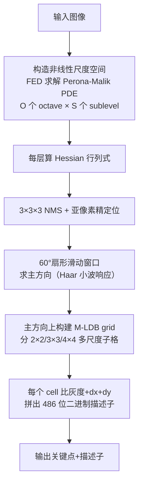

# 算法流程：AKAZE 加速 KAZE 特征

## 整体流程图

## 步骤详解

### Step 1：输入与初始高斯平滑
输入灰度图，先做一次 σ=1.0 的高斯平滑，消掉像素噪声。

### Step 2：FED 构建非线性尺度空间
默认 4 个 octave，每个 octave 4 个 sublevel，共 16 层。每层对应一个进化时间 t_i = \frac{1}{2} σ_i²（σ_i 是该层尺度）。
对相邻两层，用 FED 算法跑若干次 diffusion cycle，构造出 L^{t_i}。每一步里要：
1. 用 Scharr 核算当前层的梯度 Lx, Ly
2. 算传导系数 c = exp(-|∇L_σ|² / λ²)（λ 是对比度参数，默认 0.001）
3. 用 FED 步长做一次显式更新

### Step 3：Hessian 检测
在每一层算 Lxx, Lyy, Lxy（Scharr/Sobel），构造 det(H_norm) = σ²(Lxx·Lyy - Lxy²)。
在每个点 (x,y,σ) 的 3×3×3 邻域里做非极大值抑制，再做二次拟合（D. Brown 方法）得到亚像素、亚尺度位置。

### Step 4：主方向估计
和 SURF 类似：在关键点周围一个 6σ 半径的圆内，每 5°（共 72 个方向）用扇形 Haar 小波响应累加，找响应最大的方向作为主方向。

### Step 5：M-LDB 描述子
把关键点附近 24σ×24σ 的区域按主方向旋转对齐，分成多尺度 grid（2×2, 3×3, 4×4 合共 4+9+16=29 个 cell），对每个 cell 计算：
- V：平均灰度
- Dx：平均水平梯度
- Dy：平均垂直梯度

然后对相邻 cell 逐对比较 V/Dx/Dy，得到 3 × (sum over pairs) 个 bit。默认 486 位。

### Step 6：输出
关键点 + 486 位描述子。

## 参数对照（论文 vs OpenCV 默认 vs 工程建议）

| 参数 | 论文建议 | OpenCV 默认 | 工程建议 | 调参影响 |
|---|---|---|---|---|
| descriptor_type | M-LDB | AKAZE_DESCRIPTOR_MLDB | MLDB（默认），若要浮点可选 MLDB_UPRIGHT/KAZE_UPRIGHT | 二进制匹配快 |
| descriptor_size | 0 | 0（=全 486 位） | 0 / 256 / 512 | 越大越鲁棒、越大越慢 |
| threshold | 0.001 | 0.001 | 0.0005–0.002 | Hessian 响应阈值，越小点越多 |
| nOctaves | 4 | 4 | 4 | octave 数，控制尺度范围 |
| nOctaveLayers | 4 | 4 | 4 | 每 octave 层数 |
| diffusivity | PM_G2 | DIFF_PM_G2 | 默认 | 传导函数，G2 保边效果最好 |

## 复杂度分析

- FED 构建尺度空间：O(N_iter · W · H)，每像素只做加减乘，常数小
- 检测：与 SIFT 同量级
- 描述子：每个关键点 O(grid²) 次比较，和 BRISK 同量级
- 实测：640×480 图 20–60ms（CPU 单线程），比 SIFT 快 3–5×，比 KAZE 快 20×
