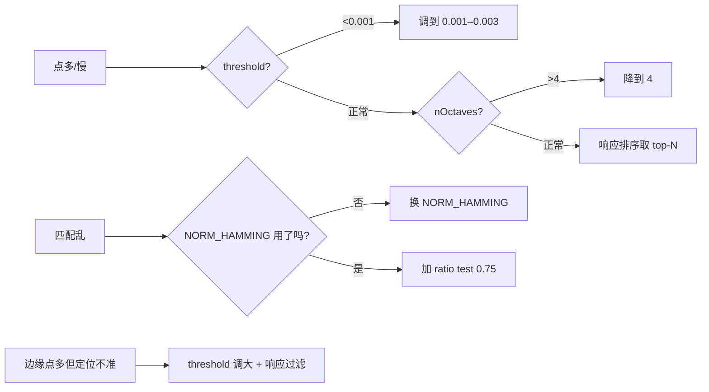

# 实战踩坑：AKAZE 加速 KAZE 特征

## 最常见的 8 个坑

### 1. threshold 设得太小导致点爆炸
threshold 默认 0.001，模糊图上可能出几千个点。**修法**：调到 0.002–0.005，或响应排序 top-N。

### 2. 把 AKAZE 当"免费版 SIFT"期望过高
AKAZE 重复率优于 ORB/BRISK，但**对极端旋转+尺度+视角变化**仍略弱于 SIFT。不要期望一个二进制描述子全面打赢 128 维浮点。

### 3. descriptor_size=0 与自定义 size 混用
0 代表全 486 位；设置 256/512 会截取前若干 bit，性能略有下降但内存省。注意 486 不是 8 的倍数，某些自定义汉明距离计算要注意尾部。

### 4. diffusivity 选错
DIFF_WEICKERT / DIFF_CHARBONNIER 对特定场景好，但默认 PM_G2 是最稳的。除非你清楚区别，不要改。

### 5. 错用 NORM_L2 匹配
AKAZE 默认输出二进制描述子，必须用 `NORM_HAMMING`（不是 NORM_L2）。只有选了 `DESCRIPTOR_KAZE`（浮点）才用 NORM_L2。

### 6. 主方向估计不稳导致"匹配抖动"
主方向用的是 SURF 风格 Haar 响应，对**低纹理区域**会不稳定。**修法**：只对 response 大的点保留，或用 UPRIGHT 版本（无旋转不变）匹配特定场景。

### 7. 速度不达预期
AKAZE 默认参数比 ORB 慢 2–3×。要加速：nOctaves=3, nOctaveLayers=3, threshold=0.003；或改用 UPRIGHT 描述子（AKAZE_DESCRIPTOR_MLDB_UPRIGHT）。

### 8. 与 FLANN 搭配不当
二进制描述子用 `FlannBasedMatcher` 时必须配 LSH index params，否则默认 KDTREE 会把二进制当浮点、效果极差。

## 失败案例诊断流程

