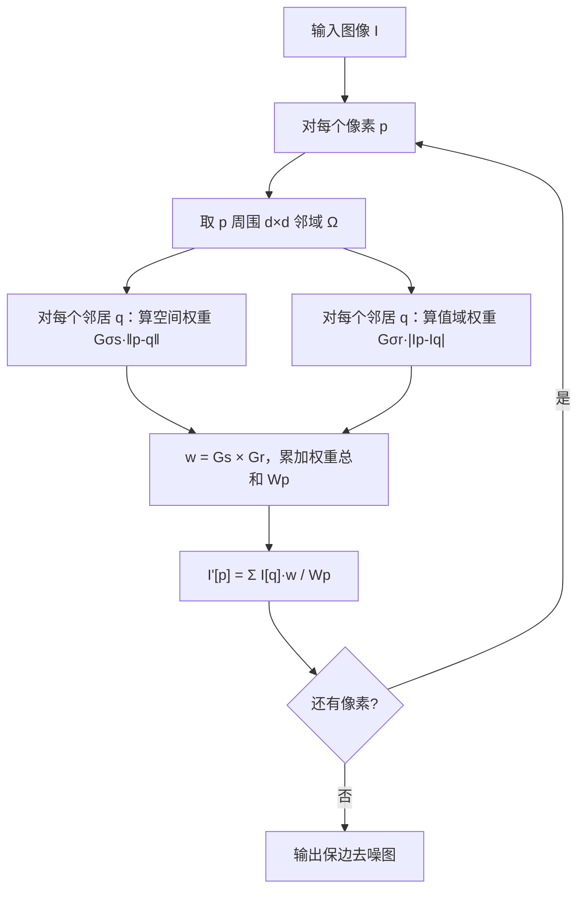

# 🏗 算法流程

## 原始版双边滤波流程（逐像素）

## O(1) 加速思路（Porikli 2008 核心 idea）

原始双边核 $G_{\sigma_s}(\cdot)\cdot G_{\sigma_r}(\cdot)$ 是非线性的、不能分离，但可以**按亮度值分箱**，对每个箱做一次盒滤波/高斯滤波，最后插值回来——这就是"双边网格 Bilateral Grid"的核心思想，把 O(r²) 降到 O(1) 常数时间。

工程上 OpenCV 里的 `cv2.bilateralFilter` 用的就是快速近似，比手写循环快 50 倍。

## 一个典型例子：人像磨皮流水线

这就是"自然磨皮"——只抹平色斑低频，保留皮肤纹理高频。**直接把整张图高斯糊掉会变成假面**。

<!-- AUTO-EXTENSION -->

## 🏗 数学公式直观化

双边滤波的权重 = **空间高斯 × 颜色高斯**：

$$
w(i,j,k,l) = \exp\!\left(-\frac{(i-k)^2 + (j-l)^2}{2\sigma_s^2}\right) \cdot \exp\!\left(-\frac{|I(i,j)-I(k,l)|^2}{2\sigma_r^2}\right)
$$

- 第一个高斯（σ_s）：**离得多近**——决定"磨皮力度"（半径）；
- 第二个高斯（σ_r）：**颜色多像**——决定"保边阈值"。

两个数乘起来，离得远权重小，颜色差得多权重也小；**只有又近又像**的像素才真的参与平均。

## 📊 σ_s 和 σ_r 的直觉

| 参数 | 太小 | 正好 | 太大 |
| --- | --- | --- | --- |
| **σ_s（空间）** | 没效果 | d=2σ_s 即可 | 太慢，但不会更糊 |
| **σ_r（颜色）** | 什么都不平滑（只平均同色） | 30~60（磨皮） | 退化成普通高斯（什么都平均）|

**经验公式**：`d = -1`（自动）、`sigmaColor = sigmaSpace = 50~100` 是通用美颜起点。

## 🧩 为什么双边滤波慢？怎么加速？

高斯模糊可以用"分离卷积"先横再竖，复杂度 O(N)；双边滤波**因为乘了颜色高斯，无法分离**，必须 O(N r²) 复杂度。
加速方法：
- **OpenCV 里自动用 O(1) 近似实现**（论文作者 Paris & Durand 提出），对 σ 大的情况提速 10 倍以上；
- 实在太慢可以用**引导滤波（Guided Filter）**或**Domain Transform**，效果类似、速度快一个量级。
