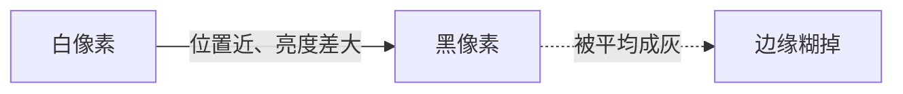
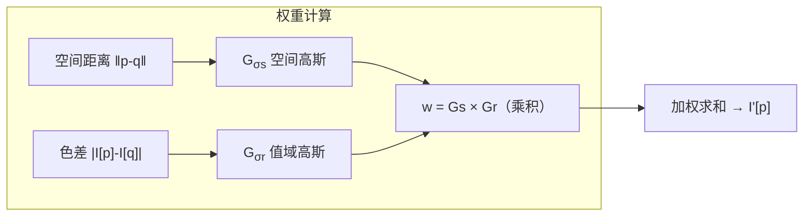

# 💡 核心概念

🧪 公式看不懂？去 <a href="/math-lab/">原理实验室</a> 拖动滑块直观体验卷积/梯度/高斯/霍夫/角点/RANSAC/光流等核心概念；看完原理再去本页底部 <a href="./source">源码/真机实验室</a> 亲手调参数。

## 为什么高斯会糊边？

普通高斯核：「**离得近就拉一把**」——边缘左边的白像素和右边的黑像素因为位置近，互相取平均，边缘就被抹成灰色了。

## 双边 = 空间高斯 × 值域高斯

关键直觉：
- **边缘两侧**的像素空间上近，但色差大 → $G_{\sigma_r} \approx 0$ → 权重≈0 → 不参与平均 ✅
- **平坦区域**色差小 → $G_{\sigma_r} \approx 1$ → 退化成普通高斯 ✅

## 三个 σ 怎么区分

| 参数 | 控制什么 | 小值 | 大值 |
| --- | --- | --- | --- |
| `d`（核直径） | 看多大邻域 | 只磨细噪点 | 大面积色块化 |
| `sigmaColor` | 颜色相似度阈值 | 色差很小才被拉平（磨皮轻） | 差很多也拉平（磨皮重） |
| `sigmaSpace` | 空间扩散范围 | 局部影响 | 大范围融合 |

经验法则：**`sigmaColor` 和 `sigmaSpace` 一般设成一样大**（比如 75/75），视觉最舒服。

## 双边 vs 高斯 vs 中值 vs 引导

| 算子 | 保边 | 去椒盐 | 速度 | 灰度偏移 |
| --- | --- | --- | --- | --- |
| 高斯 | ❌ | ❌ | ⚡⚡⚡ | 无 |
| 中值 | 半保边 | ✅ | ⚡⚡ | 无 |
| **双边** | ✅ | ❌ | ⚡ | 轻微 |
| 引导滤波 | ✅ | ❌ | ⚡⚡⚡ | 无（O(N)） |

---

## 🧪 原理可视化

看不懂上面的公式？下面这个互动组件把「卷积」画出来了——拖动滑块，看每一步怎么算。

<ClientOnly>
  <MathVisualizer initial-tab="conv" compact />
</ClientOnly>

> 想看它在真实照片上的实际效果？回到 [本算法首页](./index) 或去 [🎮 真机实验室](/playgrounds/)。

<!-- AUTO-EXTENSION -->

## 🧓 大白话解释：双边滤波 = "看颜色交朋友"

普通高斯模糊是"离得近的像素一起平均"——边缘被糊掉。双边滤波多了一个条件："不仅要离得近，**颜色还要接近**才一起平均"。

打比方：你在派对上找人平均意见——
- **高斯模糊**：只找身边 5 米内的所有人，不管他们是不是一伙的；
- **双边滤波**：只找身边 5 米内**且和你穿同色衣服**的人。

结果就是：**衣服内部大家一起平均（磨皮），衣服和衣服之间的边缘（颜色突变处）没人跨过去，边缘依然锐利**。

## 🔍 效果对比图

<svg xmlns="http://www.w3.org/2000/svg" width="720" height="170" style="background:#fafbfc;border-radius:12px;border:1px solid #eaecef">
  <g transform="translate(20,10)">
    <text x="100" y="18" text-anchor="middle" font-size="13" font-weight="bold" fill="#333">原图（带噪点）</text>
    <rect x="20" y="30" width="160" height="120" fill="#fff"/>
    <rect x="20" y="30" width="80" height="120" fill="#d4a373"/>
    <rect x="100" y="30" width="80" height="120" fill="#3a5a40"/>
    <g>
      <circle cx="50" cy="60" r="1.5" fill="#000"/><circle cx="70" cy="80" r="1.5" fill="#fff"/>
      <circle cx="120" cy="50" r="1.5" fill="#000"/><circle cx="150" cy="100" r="1.5" fill="#fff"/>
      <circle cx="60" cy="120" r="1.5" fill="#000"/><circle cx="140" cy="70" r="1.5" fill="#fff"/>
    </g>
    <line x1="100" y1="30" x2="100" y2="150" stroke="#000" stroke-width="2"/>
  </g>
  <g transform="translate(260,10)">
    <text x="100" y="18" text-anchor="middle" font-size="13" font-weight="bold" fill="#333">高斯模糊（边缘糊了）</text>
    <rect x="20" y="30" width="160" height="120" fill="#fff"/>
    <defs><linearGradient id="grad1" x1="0" x2="1"><stop offset="0" stop-color="#d4a373"/><stop offset="0.5" stop-color="#a07b5a"/><stop offset="1" stop-color="#3a5a40"/></linearGradient></defs>
    <rect x="20" y="30" width="160" height="120" fill="url(#grad1)"/>
    <text x="100" y="160" text-anchor="middle" font-size="10" fill="#888">边缘被跨过去平均了</text>
  </g>
  <g transform="translate(500,10)">
    <text x="100" y="18" text-anchor="middle" font-size="13" font-weight="bold" fill="#333">双边滤波（边缘保住了）</text>
    <rect x="20" y="30" width="160" height="120" fill="#fff"/>
    <rect x="20" y="30" width="80" height="120" fill="#d4a373"/>
    <rect x="100" y="30" width="80" height="120" fill="#3a5a40"/>
    <line x1="100" y1="30" x2="100" y2="150" stroke="#000" stroke-width="2"/>
    <text x="100" y="160" text-anchor="middle" font-size="10" fill="#888">噪点没了，边还在</text>
  </g>
</svg>

