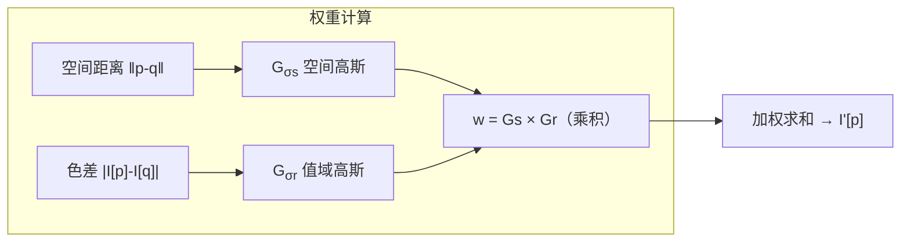

# 💡 核心概念

## 为什么高斯会糊边？

普通高斯核：「**离得近就拉一把**」——边缘左边的白像素和右边的黑像素因为位置近，互相取平均，边缘就被抹成灰色了。

## 双边 = 空间高斯 × 值域高斯

关键直觉：
- **边缘两侧**的像素空间上近，但色差大 → $G_{\sigma_r} \approx 0$ → 权重≈0 → 不参与平均 ✅
- **平坦区域**色差小 → $G_{\sigma_r} \approx 1$ → 退化成普通高斯 ✅

## 三个 σ 怎么区分

| 参数 | 控制什么 | 小值 | 大值 |
| --- | --- | --- | --- |
| `d`（核直径） | 看多大邻域 | 只磨细噪点 | 大面积色块化 |
| `sigmaColor` | 颜色相似度阈值 | 色差很小才被拉平（磨皮轻） | 差很多也拉平（磨皮重） |
| `sigmaSpace` | 空间扩散范围 | 局部影响 | 大范围融合 |

经验法则：**`sigmaColor` 和 `sigmaSpace` 一般设成一样大**（比如 75/75），视觉最舒服。

## 双边 vs 高斯 vs 中值 vs 引导

| 算子 | 保边 | 去椒盐 | 速度 | 灰度偏移 |
| --- | --- | --- | --- | --- |
| 高斯 | ❌ | ❌ | ⚡⚡⚡ | 无 |
| 中值 | 半保边 | ✅ | ⚡⚡ | 无 |
| **双边** | ✅ | ❌ | ⚡ | 轻微 |
| 引导滤波 | ✅ | ❌ | ⚡⚡⚡ | 无（O(N)） |
