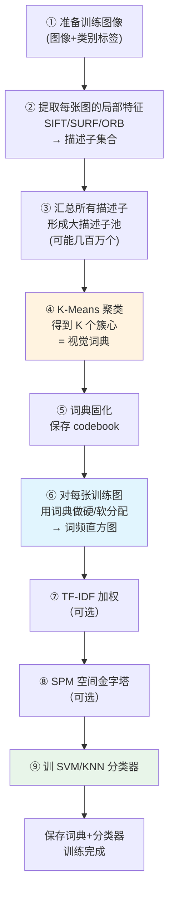
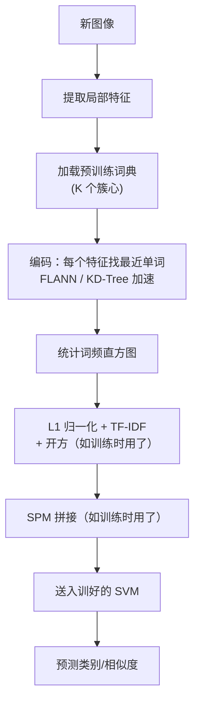

# BoVW 算法流程

BoVW 分**训练阶段**（建词典 + 训分类器）和**测试阶段**（编码 + 分类）两部分。

## A. 训练阶段（离线）



---

### A.1 特征提取

对每张训练图：
1. 转灰度
2. 检测关键点 + 计算描述子
3. 可选：限制特征点上限（比如每张图最多 500~1000 个点，避免大特征集占用过多内存）

```python
def extract_des(img, detector, max_pts=1000):
    kp, des = detector.detectAndCompute(img, None)
    if des is None:
        return np.zeros((0, 128), np.float32)
    if len(des) > max_pts:
        idx = np.random.choice(len(des), max_pts, replace=False)
        des = des[idx]
    return des.astype(np.float32)
```

### A.2 汇总描述子池

把所有训练图的描述子 vstack 成一个大矩阵：
```python
all_des = np.vstack([extract_des(img, detector) for img in train_imgs])
# all_des.shape = (N_total, 128)，可能是 (1e6, 128)
```

### A.3 K-Means 聚类建词典

```python
from sklearn.cluster import MiniBatchKMeans
K = 1000
kmeans = MiniBatchKMeans(n_clusters=K, batch_size=2000, n_init=3, verbose=1)
kmeans.fit(all_des)
codebook = kmeans.cluster_centers_.astype(np.float32)  # (K, 128)
```

**时间复杂度**：标准 K-Means 是 O(N·K·D·iter)；Mini-Batch 是 O(batch·K·D·iter·epoches)，百万级描述子几分钟能跑完。

### A.4 计算 IDF（可选）
$$
\text{IDF}(k) = \log\frac{N}{1 + \text{DF}(k)}
$$
其中 DF(k) = 出现单词 k 的训练图像数。

```python
df = np.zeros(K)
for img in train_imgs:
    hist = encode_hist(img, codebook, detector)  # 先临时编码
    df += (hist > 0).astype(float)
idf = np.log(len(train_imgs) / (1 + df))
```

### A.5 编码训练图像

每张图通过词典转化为 K 维直方图（详见 B.2），然后：
- L1 归一化
- 可选：乘 IDF
- 可选：开方（Hellinger 核）
- 可选：SPM 多层拼接

### A.6 训练分类器

线性 SVM 是经典选择（速度快、精度高）：

```python
from sklearn.svm import LinearSVC
clf = LinearSVC(C=0.1).fit(X_train, y_train)
```

多分类场景用 sklearn 的 `OneVsRestClassifier` 包装。

---

## B. 测试阶段（在线/检测时）



---

### B.1 特征提取（和训练时完全相同）

### B.2 编码：最近词查找（关键步）

对每个特征描述子 d_i（D 维），在词典 K 个簇心中找欧氏距离最近的：

$$
w_i = \arg\min_k \|d_i - c_k\|_2
$$

暴力法是 O(N·K·D)，K 大时慢。用 **FLANN KD-Tree** 加速：

```python
def encode_hist(img, codebook, detector):
    _, des = detector.detectAndCompute(img, None)
    if des is None:
        return np.zeros(len(codebook), np.float32)
    des = des.astype(np.float32)
    # FLANN 最近邻
    flann = cv2.FlannBasedMatcher(
        dict(algorithm=1, trees=5),   # KD-Tree
        dict(checks=50)
    )
    matches = flann.knnMatch(des, codebook, k=1)
    hist = np.zeros(len(codebook), np.float32)
    for m in matches:
        hist[m[0].trainIdx] += 1
    hist /= (hist.sum() + 1e-9)      # L1 归一化
    return hist
```

### B.3 SPM 编码（如用）

如果训练时用了 SPM，测试时也要分块：
```python
def encode_spm(img, codebook, detector, levels=[1, 2, 4]):
    h, w = img.shape[:2]
    hists = []
    weight = {1: 1/4, 2: 1/4, 4: 1/2}
    for L in levels:
        gh, gw = h // L, w // L
        for i in range(L):
            for j in range(L):
                patch = img[i*gh:(i+1)*gh, j*gw:(j+1)*gw]
                sub_hist = encode_hist(patch, codebook, detector)
                hists.append(sub_hist * weight[L])
    return np.hstack(hists)
```

### B.4 TF-IDF + Hellinger（如训练时用）

```python
hist = encode_hist(img, codebook, detector)
hist = hist * idf               # TF-IDF
hist /= (hist.sum() + 1e-9)     # 重新归一化
hist = np.sqrt(hist)            # Hellinger 核
```

### B.5 分类

```python
pred = clf.predict(hist.reshape(1, -1))
prob = clf.decision_function(hist.reshape(1, -1))
```

---

## C. 图像检索流程（和分类略有不同）

BoVW 也常用于"以图搜图"：

1. 离线：对所有图像库的图像都提前编码成 TF-IDF 直方图，建立**倒排索引**
2. 在线：
   - 查询图编码成 TF-IDF 向量
   - 用**余弦相似度**在库里找 top-N 最相似的图像
   - 返回结果

倒排索引加速：只在"查询图里出现过的单词"对应的图像中比较，而不是扫全库。

---

## 典型超参数一览

| 阶段 | 参数 | 典型值 |
|---|---|---|
| 特征 | 类型 | SIFT（精度）/ ORB（速度） |
| 特征 | 每图点数 | 300~2000 |
| 词典 | K | 500~4000 |
| 词典 | K-Means 初始化 | K-Means++ |
| 词典 | Mini-batch 大小 | 1000~5000 |
| 编码 | 分配方式 | 硬分配（默认）/ Top-N 软分配 |
| 编码 | 近邻算法 | FLANN KD-Tree（K>1000）/ BF（K<1000） |
| 池化 | 归一化 | L1 |
| 池化 | TF-IDF | 强烈建议 |
| 池化 | Hellinger 开方 | 强烈建议 |
| 池化 | SPM 层数 | L0+L1+L2（3 层，21 块） |
| 分类 | 类型 | 线性 SVM |
| 分类 | C | 0.01~1 |

---

## 时间复杂度估算（1000 张图、K=1000）

| 步骤 | 时间（CPU） |
|---|---|
| 特征提取（SIFT） | 每张 0.1~0.3 s |
| K-Means 训练（百万级描述子） | 几十秒~几分钟 |
| 编码 1000 张图 | 每张 0.05~0.2 s |
| SVM 训练 | 秒级 |
| 单张测试 | 0.1~0.3 s |
