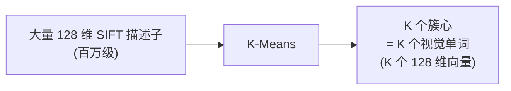
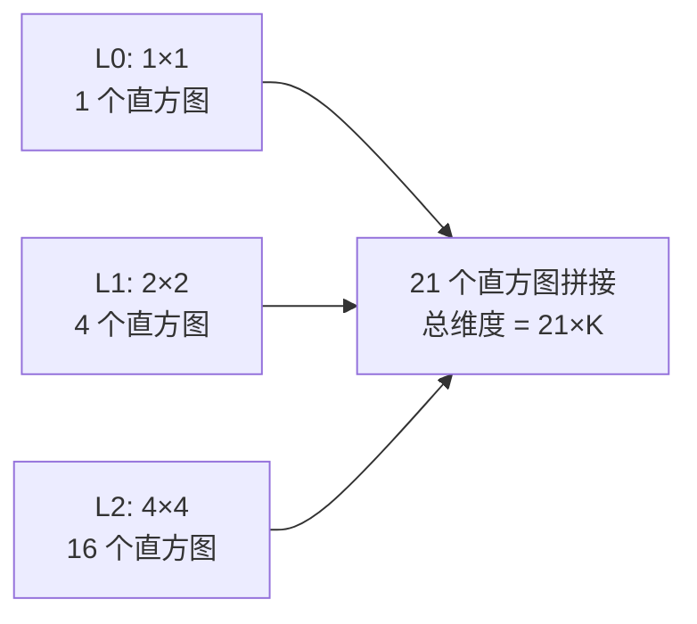
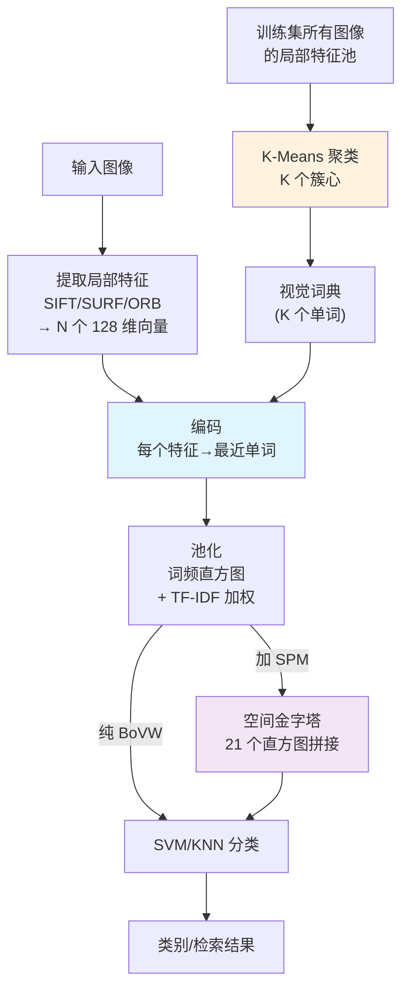

## 🧪 原理互动演示

<AlgoVisualizer type="bovw" />

# BoVW 核心概念

理解 BoVW，要搞懂六样东西：**局部特征**、**K-Means 聚类**、**视觉词典**、**硬/软分配**、**词频直方图与 TF-IDF**、**空间金字塔匹配**。

<div class="tip custom-block"><p>🧪 公式看不懂？去 <a href="/math-lab/">原理实验室</a> 拖动滑块直观体验卷积/梯度/高斯/霍夫/角点/RANSAC/光流等核心概念；看完原理再去本页底部 <a href="./source">源码/真机实验室</a> 亲手调参数。</p></div>


## ① 局部特征（Local Features）

### 一句话
BoVW 的"字母"——从图像里检测出的具有重复性、抗旋转/尺度的局部区域描述子。

### 常用选择
| 特征 | 维度 | 速度 | 版权 | 适用 |
|---|---|---|---|---|
| SIFT | 128 | 慢 | 专利已过期 | 精度优先（推荐） |
| SURF | 64/128 | 中 | 专利 | 比 SIFT 快 |
| ORB | 32 字节(256 bit) | **快** | 免费 | 速度优先 |

### 为什么用局部特征
- 抗旋转、抗尺度变化（SIFT 本身保证）
- 对局部遮挡鲁棒（挡住一部分不影响其他点）
- 数量可变，能覆盖图像各个区域

### 每图提多少
- 一般 300~2000 个点/图
- 点太少：覆盖不足；点太多：词典训练和编码慢

## ② K-Means 聚类（建词典的核心）

### 一句话
把所有训练图像的局部特征描述子，按欧氏距离聚成 K 个簇，每个簇心就是一个"视觉单词"。

### K-Means 流程
1. **初始化**：随机选 K 个点作为初始簇心（或用 K-Means++）
2. **分配**：每个样本归到最近的簇心
3. **更新**：每个簇用均值更新簇心
4. **重复** 2~3 直到收敛（簇心移动小于阈值）



### Mini-Batch K-Means（工程常用）
数据量大（百万级）时，标准 K-Means 内存放不下所有样本。Mini-Batch K-Means 每次用一小批（batch=1000~10000）样本更新簇心，速度快 10 倍以上，精度几乎不变。

```python
from sklearn.cluster import MiniBatchKMeans
kmeans = MiniBatchKMeans(n_clusters=1000, batch_size=2000, n_init=3)
kmeans.fit(all_descriptors)
codebook = kmeans.cluster_centers_  # (K, 128)
```

## ③ 视觉词典（Codebook / Vocabulary）

### 一句话
K 个簇心向量组成的"字典"——任何新特征都可以在这本字典里找到"最像的单词"。

### 类比理解
- **文本**：牛津词典有 30 万个单词
- **视觉**：视觉词典有 K 个视觉单词（K=500~10000）
- 一张图经过"编码"后，变成一串视觉单词 ID，再统计词频

### K 的选择（核心超参）
| K | 效果 | 适用 |
|---|---|---|
| 100~500 | 单词太粗，很多不同模式被合并，欠拟合 | 小数据集/快速原型 |
| **1000~4000** | **平衡** | **通用甜点** |
| 10000+ | 单词太细，过拟合，编码/匹配都慢 | 大数据集+SPM |

经验法则：K ≈ sqrt(N) 或 K ≈ N/100（N 为总描述子数），但更可靠的办法是用验证集调。

## ④ 硬分配 vs 软分配

### 硬分配（Hard Assignment，标准 BoVW）
每个特征**只分配给最近的 1 个单词**：

$$
w(x) = \arg\min_k \|x - c_k\|_2
$$

简单、快，但信息损失——当一个特征到两个单词差不多远时，硬塞给其中一个会"武断"。

### 软分配（Soft Assignment）
一个特征按距离**加权分配给多个单词**：

$$
w_k(x) = \frac{\exp(-\beta \|x - c_k\|^2)}{\sum_j \exp(-\beta \|x - c_j\|^2)}
$$

或者简单地分配给 top-N 近邻（Top-N soft assignment）。精度更高，直方图更平滑，但编码慢。

### VLAD / Fisher Vector
进阶软分配：不仅记录"出现"，还记录"相对于簇心的残差"。

## ⑤ 词频直方图 + TF-IDF 加权

### 词频（Term Frequency, TF）
$$
\text{TF}(k, I) = \frac{\text{图像 I 中单词 k 出现次数}}{\text{图像 I 中总单词数}}
$$

简单归一化后的直方图。但 TF 有问题：**所有词权重一样**，但"斜条纹纹理"这种通用背景词到处都有，判别力差；"猫耳朵"这种稀有词判别力强。

### TF-IDF（词频-逆文档频率）
来自信息检索的经典加权：

$$
\text{TF-IDF}(k, I) = \text{TF}(k, I) \times \log\frac{N}{1 + \text{DF}(k)}
$$

其中：
- N = 图像总数
- DF(k) = 出现单词 k 的图像数（文档频率）

**直觉**：**在当前图像里频繁出现、但在整个库里很少见的单词权重高**——和文本检索里"关键词"的概念一致。

### Hellinger 核（开方归一化）
实战中对 L1 归一化后的直方图再做**逐元素开方**（相当于映射到 Hellinger 核空间），线性 SVM 就能近似得到非线性核的效果：

$$
\tilde{h}_k = \sqrt{h_k}
$$

这是一个简单但**在多个基准上稳定提升**的技巧。

## ⑥ 空间金字塔匹配（SPM, Spatial Pyramid Matching）

### BoVW 的硬伤：丢空间信息
```
天空+草地 的图        颠倒后 草地+天空
→ BoVW 直方图完全相同！
```

### SPM 的解法：多层网格分别统计
- **Level 0**：整图 → 1 个直方图
- **Level 1**：2×2 网格 → 4 个直方图
- **Level 2**：4×4 网格 → 16 个直方图
- 拼起来共 1+4+16 = 21 个直方图，再做加权拼接



### 加权方式
- 越细的层（空间分辨率高）权重越大：Level 0 权重 1/4，Level 1 权重 1/4，Level 2 权重 1/2（论文默认）
- 直觉：粗层提供全局信息，细层提供位置信息，但细层的"硬匹配"太严格，所以用加权融合

### 效果
在 Scene-15、Caltech-101 等基准上，SPM 比纯 BoVW 高 10~15 个百分点。**SPM + BoVW + SVM 是 2006~2012 年图像分类的标准 pipeline**。

## 概念关系图



## 相关算子/概念

| 算子 | 作用 |
|---|---|
| SIFT/SURF/ORB | 底层局部特征提取 |
| K-Means 聚类 | 构建视觉词典 |
| 直方图统计 | 词频池化 |
| SVM 训练 | 最终分类器 |
| 近邻匹配（FLANN/BF） | 编码时找最近单词 |
