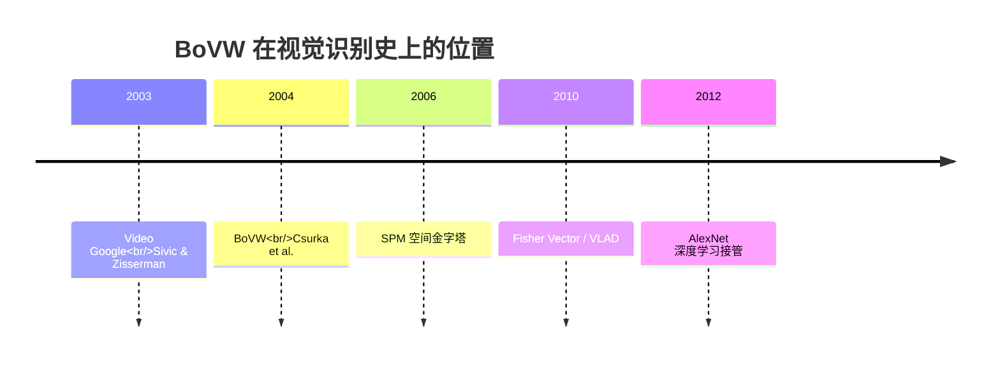

# BoVW 词袋模型

## 🧪 原理互动演示

<AlgoVisualizer type="bovw" />


## 🚀 动手体验

> 🧪 **先懂原理**：翻到下一节「核心概念」，页面里直接嵌入了可拖动滑块的原理动画（SIFT高斯金字塔、FLANN KD树、GrabCut迭代、KCF响应峰、ICP配准等），拖一拖就懂。

> 🎮 **再跑真机**：跳到第5页「源码实现」，底部有真机实验室（OpenCV.js 浏览器本地运行），选图调参即可看到真实效果与三语代码。

---

<AlgorithmCard
  name="BoVW"
  enName="Bag of Visual Words"
  chapter="第12章 · 景物识别"  chapterLink="/chapters/ch12-recognition"
  branch="detection"
  year="2004"
  author="Gabriella Csurka / Christopher Dance / Lixin Fan / Jutta Willamowski / Cédric Bray"
  paper="https://link.springer.com/chapter/10.1007/978-3-540-30224-7_2"
  level="high"
  tagline="把图像当成「一袋视觉单词」——深度学习前图像分类/检索的绝对主流"
  analogy="读文章看关键词就能判断主题——体育新闻有「进球、犯规」，医学文章有「医生、药」。BoVW 用同样逻辑看图像：把局部特征当字母，聚成视觉单词，数词频做分类"
  scene="小样本图像分类、商标识别、织物分类、以图搜图、工业缺陷分型——几十张样本就能训，不需要 GPU"
  :pros="['每类几十张图就能训，小样本强','抗旋转/尺度（依赖 SIFT）','可解释（能反查贡献单词）','OpenCV 原生 BOW 模块','搭配 TF-IDF/SPM 效果上一台阶']"
  :cons="['丢空间信息（SPM 只能部分补）','词典大小 K 敏感','建词+编码流程慢','复杂场景精度不如深度学习','无法端到端优化']"
/>

## 一句话理解

BoVW 把"图像分类"变成"文本分类"：

1. **抽局部特征**（SIFT/SURF/ORB）→ 像从文章里抽出一堆"字母/字"
2. **K-Means 聚类** 成 K 个视觉单词 → 编一本"视觉词典"
3. **把每个特征映射到最近单词**，统计整张图的**词频直方图** → 这张图变成一个 K 维向量
4. 用 **SVM / KNN** 对直方图分类 → 图像类别


## 生活类比：看关键词就懂主题

你不用把文章逐字读完也知道主题——
- 看到「进球」「犯规」「裁判」多 → 体育新闻
- 看到「医生」「病人」「药」多 → 医学文章

BoVW 在图像上做同样的事：
- 看到「斜纹图案」「直线交点」多 → 可能是建筑
- 看到「圆弧」「毛绒纹理」多 → 可能是猫
- 不关心这些"单词"在哪（在左上还是右下），**只关心出现多少次**

## 为什么这是里程碑

BoVW 第一次把**可变长的局部特征集合**变成了**定长的向量**，直接对接统计学习（SVM），开启了"特征+编码+池化+分类"这一沿用至今的视觉范式——连 CNN 的最后一层"全局池化+全连接"都能看作可学习版 BoVW。

## 算法时间线



## 你会在这里看到什么

| 页面 | 内容 |
|---|---|
| [论文精读](/algorithms/bovw/paper) | Csurka 2004 原文 |
| [核心概念](/algorithms/bovw/concepts) | 局部特征、K-Means、硬/软分配、TF-IDF、SPM |
| [算法流程](/algorithms/bovw/architecture) | 特征→建词典→编码→池化→分类 |
| [源码走读](/algorithms/bovw/source) | OpenCV BOW 模块 + numpy 手写 |
| [实战踩坑](/algorithms/bovw/painpoints) | K 怎么选、词典污染、背景词干扰 |
| [调参技巧](/algorithms/bovw/tricks) | SPM、TF-IDF、Hellinger 核、选型 |

## 快速上手（OpenCV BOW）

```python
import cv2
from sklearn.svm import LinearSVC

detector = cv2.SIFT_create()
matcher = cv2.BFMatcher(cv2.NORM_L2)
bow_trainer = cv2.BOWKMeansTrainer(clusterCount=1000)
bow_extract = cv2.BOWImgDescriptorExtractor(detector, matcher)

for img in train_imgs:
    _, des = detector.detectAndCompute(img, None)
    if des is not None:
        bow_trainer.add(des)

bow_extract.setVocabulary(bow_trainer.cluster())
X_train = [bow_extract.compute(img, detector.detect(img))[0] for img in train_imgs]
clf = LinearSVC().fit(X_train, y_train)
```

## 适用/不适用场景

| ✅ 适用 | ❌ 不适用 |
|---|---|
| 每类几十张小样本分类 | 百万级大规模分类 |
| 商标/Logo/包装识别 | 实时视频检测 |
| 织物/纹理/材料分类 | 需要精确定位的检测 |
| 以图搜图/图像检索原型 | 端到端需求高 |
| 无 GPU、传统方法基线 | 复杂语义理解 |
