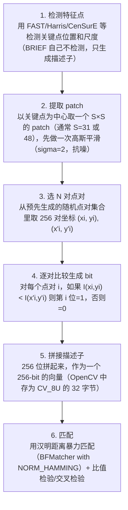

# BRIEF 二进制描述子 · 算法流程

<AlgorithmCard
  name="BRIEF 二进制描述子"
  enName="Binary Robust Independent Elementary Features"
  chapter="ch-8-local-feature"
  branch="feature-detection"
  year="2010"
  author="Michael Calonder et al."
  paper="—"
  level="mid"
  tagline="不再算浮点数直方图，只比 256 对像素大小，一个整数就能描述一个角点"
  analogy="SIFT/SURF 像做了一份 128 项血常规，BRIEF 只问 256 个「你比你旁边那个大吗」的是非题，用答案拼出一个 256 位的指纹"
  scene="资源受限的嵌入式设备、移动端、实时 SLAM 前端，毫秒级匹配几千个点"
  :pros='["描述子 256 位（32 字节）", "汉明距离匹配极快", "对光照模糊鲁棒", "构造简单"]'
  :cons='["不抗旋转", "不抗尺度", "对噪声敏感", "随机点对选择影响性能"]'
/>

## 完整算法流程

BRIEF 二进制描述子算法可以分解为以下关键步骤：

## 步骤详解

### 步骤 1：检测特征点

用 FAST/Harris/CenSurE 等检测关键点位置和尺度（BRIEF 自己不检测，只生成描述子）

### 步骤 2：提取 patch

以关键点为中心取一个 S×S 的 patch（通常 S=31 或 48），先做一次高斯平滑（sigma=2，抗噪）

### 步骤 3：选 N 对点对

从预先生成的随机点对集合里取 256 对坐标 (xi, yi), (x'i, y'i)

### 步骤 4：逐对比较生成 bit

对每个点对 i，如果 I(xi,yi) < I(x'i,y'i) 则第 i 位=1，否则=0

### 步骤 5：拼接描述子

256 位拼起来，作为一个 256-bit 的向量（OpenCV 中存为 CV_8U 的 32 字节）

### 步骤 6：匹配

用汉明距离暴力匹配（BFMatcher with NORM_HAMMING）+ 比值检验/交叉检验

## 在整体视觉 pipeline 中的位置

### 关键复杂度

| 维度 | 复杂度 |
|---|---|
| 时间 | 详见各实现 |
| 内存 | 与图像尺寸线性相关 |

