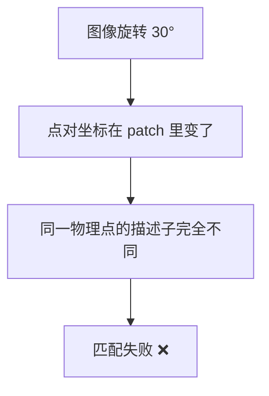

# BRIEF 二进制描述子 · 核心概念

<AlgorithmCard
  name="BRIEF 二进制描述子"
  enName="Binary Robust Independent Elementary Features"
  chapter="ch-8-local-feature"
  branch="feature-detection"
  year="2010"
  author="Michael Calonder et al."
  paper="—"
  level="mid"
  tagline="不再算浮点数直方图，只比 256 对像素大小，一个整数就能描述一个角点"
  analogy="SIFT/SURF 像做了一份 128 项血常规，BRIEF 只问 256 个「你比你旁边那个大吗」的是非题，用答案拼出一个 256 位的指纹"
  scene="资源受限的嵌入式设备、移动端、实时 SLAM 前端，毫秒级匹配几千个点"
  :pros='["描述子 256 位（32 字节）", "汉明距离匹配极快", "对光照模糊鲁棒", "构造简单"]'
  :cons='["不抗旋转", "不抗尺度", "对噪声敏感", "随机点对选择影响性能"]'
/>

🧪 公式看不懂？去 <a href="/math-lab/">原理实验室</a> 拖动滑块直观体验卷积/梯度/高斯/霍夫/角点/RANSAC/光流等核心概念；看完原理再去本页底部 <a href="./source">源码/真机实验室</a> 亲手调参数。

## BRIEF 二进制描述子的核心思想

不再算浮点数直方图，只比 256 对像素大小，一个整数就能描述一个角点。SIFT/SURF 像做了一份 128 项血常规，BRIEF 只问 256 个「你比你旁边那个大吗」的是非题，用答案拼出一个 256 位的指纹

**生活类比**：SIFT/SURF 像做了一份 128 项血常规，BRIEF 只问 256 个「你比你旁边那个大吗」的是非题，用答案拼出一个 256 位的指纹

**典型应用**：资源受限的嵌入式设备、移动端、实时 SLAM 前端，毫秒级匹配几千个点

## 核心概念详解

### 概念1：二进制描述子思想

传统描述子（SIFT 128 维浮点、SURF 64 维浮点）存储和距离计算都贵。BRIEF 反其道而行之：**不在邻域里统计梯度直方图，而是随机选 N 对像素点，比较每对谁更亮，把比较结果拼成一个 bit 串**。比如比较 256 对点，就得到 256 位（32 字节）的二进制串。

### 概念2：汉明距离

两个二进制描述子的距离怎么算？**汉明距离 = 两个串对应位不同的个数**。这在 CPU 上可以用一条 `POPCNT` 指令（算 64 位里有几个 1）加 `XOR` 实现，比欧氏距离快 50–100 倍。

### 概念3：随机点对选择

BRIEF 用高斯分布随机采样点对位置，采样后就固定下来（所有特征点都用同一组点对）。Calonder 论文里试了几种采样策略，发现 **(0, S²/25) 的高斯采样**效果最好。OpenCV 的实现内置了固定的 256 对随机位置。

### 概念4：为什么不抗旋转

如果图像旋转了，原来选的 256 对点对的位置相对中心就变了——原本比较的是「右上角 vs 左下角」，旋转后变成「右上角 vs 右上角」，比较结果大乱。**这就是 ORB 要做 rBRIEF（rotated BRIEF）的原因**：根据关键点方向把点对坐标旋转到一致朝向。

### 概念5：为什么对模糊/光照鲁棒

「两个像素谁大谁小」这个判据，在**单调亮度变换和小范围模糊下非常稳定**——整体加个常数、乘个系数，大小关系不变；模糊是邻域平均，大小关系也大多保留。所以 BRIEF 对线性光照变化有天然抵抗力。

