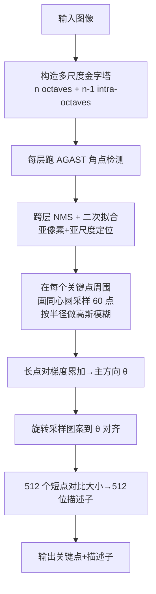

# 算法流程：BRISK 二进制鲁棒不变可伸缩关键点

## 整体流程图



## 步骤详解

### Step 1：构建尺度金字塔

建立 n 个 octave（每次下采样 2 倍，类似 SIFT），以及 n-1 个夹在中间的 intra-octave（下采样 1.5 倍左右），共 2n-1 层图像。在 OpenCV 实现中默认 n=4，共 7 层。

### Step 2：每层用 AGAST 找角点

AGAST 用训练好的决策树判断 Bresenham 圆上 16 个点的亮度，找出连续 N 个都比中心亮 t 档或暗 t 档的点，作为候选角点。比 FAST 快 ~15%，且支持多阈值。

### Step 3：跨尺度 NMS

对每个候选点，在同层 8 邻域 + 上下两层对应位置做 NMS，只保留**邻域里角点分数最大**的点。然后沿尺度轴做一维二次拟合，定位到亚尺度（不是离散层编号，而是连续的 σ 值）。

### Step 4：同心圆采样

在关键点的关键点尺度 σ 对应的半径上，画若干同心圆（默认 4–6 层），总共采样 60 个点，每个采样点做 σ_i 倍高斯模糊：

```
采样点位置：同心圆上均匀分布
每个点的模糊半径：σ_i = r_i · σ / 2（半径越大，模糊越狠）
```

### Step 5：长点对估主方向

遍历所有长距离点对（距离 > 9.75px），计算局部梯度 `(I_j - I_i) · (p_j - p_i) / |p_j - p_i|²`（其实就是把差值投影到点对方向），累加所有长点对贡献，得到一个 2D 向量 `g`，其角度就是主方向 θ。

### Step 6：旋转对齐 + 短点对比大小

把整个 60 点采样图案按主方向 θ 旋转，然后对预定义的 512 对**短距离**点对（距离 < 5.83px）逐一比较亮度，得到 512 个 bit。

### Step 7：输出

每个关键点带：位置 (x,y)、尺度 σ、方向 θ、响应值 score、512 位描述子。

## 参数对照（论文 vs OpenCV 默认 vs 工程建议）

| 参数 | 论文建议 | OpenCV 默认 | 工程建议 | 调参影响 |
|---|---|---|---|---|
| thresh | 60–80 | 30 | 30（默认），高纹理场景调到 60 | 值越大，点越少、越可靠 |
| octaves | 4 | 4 | 3–4（嵌入式可 2） | 层数越多，尺度覆盖越广、速度越慢 |
| patternScale | 1.0 | 1.0 | 1.0 基本不改 | 采样图案相对关键点尺度的缩放 |

## 复杂度分析

- 检测：O(N · W · H)，N 为决策树深度（与 ORB 同量级）
- 描述子：每个关键点 O(60²)=O(3600) 次像素比较，比 ORB 多，但常数很小
- 匹配：512 位汉明距离 = 8 条 POPCNT 指令/对，超快
- 工程实测：640×480 图上 10–30ms（CPU 单线程），比 SIFT 快 10×
