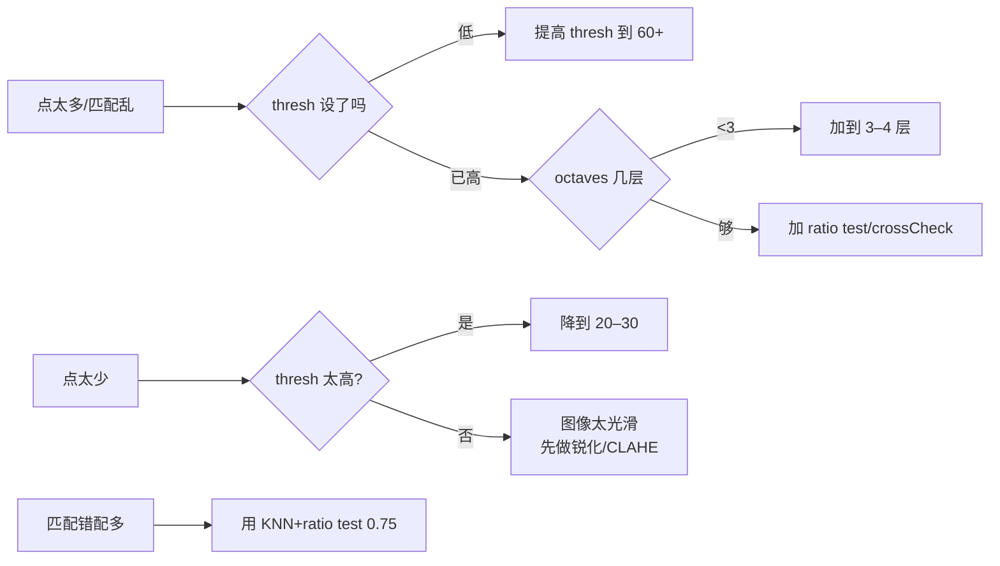

# 实战踩坑：BRISK 二进制鲁棒不变可伸缩关键点

## 最常见的 8 个坑

### 1. 阈值太低导致「满天星」
默认 thresh=30 在高纹理图上能出几千个点，RANSAC 匹配会慢到离谱。
**修法**：调到 60–80，或配合 `response` 排序只取 top-N。

### 2. 没做金字塔导致「尺度变了就找不到」
**修法**：octaves 至少设为 3（默认 4），金字塔是尺度不变的基础。

### 3. 误把 BRISK 当成「比 ORB 快」
BRISK **不比 ORB 快**——描述子更长、采样更复杂。它是「比 ORB 鲁棒」。追求速度用 ORB，追求鲁棒性用 BRISK/AKAZE。

### 4. 匹配时没用 crossCheck / ratio test
二进制描述子虽然快，但**误匹配率高于 SIFT**。**修法**：BFMatcher 设 `crossCheck=True`，或用 KNN + Lowe ratio test（ratio=0.8）。

### 5. 模糊图上点太多但都不准
BRISK 的采样点做了高斯模糊，比 ORB 抗模糊，但**严重失焦时**还是会产生很多不稳定点。**修法**：先加轻微高斯模糊再检测，或提高 thresh。

### 6. 跨大视角匹配失败
BRISK 只有旋转+尺度不变，**没有仿射不变**。视角变化 >45° 建议用 ASIFT 或 AKAZE。

### 7. 内存/存储忽略描述子长度
512 位 = 64 字节/点，1000 个点就是 64KB——没什么；但如果要做大规模检索（词袋），注意比 ORB（32 字节）大了一倍。

### 8. 搭配 BFMatcher 而不是 FLANN
FLANN 的 LSH 索引支持汉明距离，但配置复杂；点数 <10000 时 BFMatcher 反而更快。**修法**：点数少直接用 BF，点数大用 FLANN-LSH。

## 失败案例诊断流程

