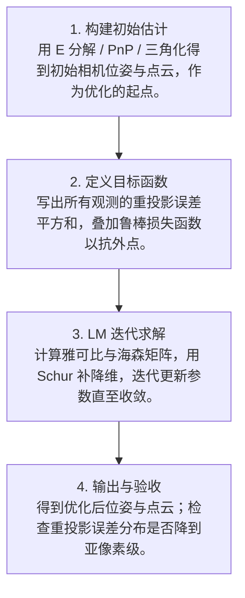
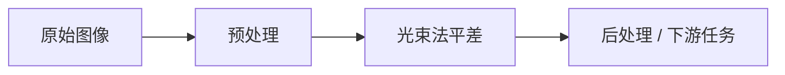

# 第 4 页 · 算法架构

## 完整流程图

## 每一步在做什么

### 步骤 1：构建初始估计

用 E 分解 / PnP / 三角化得到初始相机位姿与点云，作为优化的起点。

### 步骤 2：定义目标函数

写出所有观测的重投影误差平方和，叠加鲁棒损失函数以抗外点。

### 步骤 3：LM 迭代求解

计算雅可比与海森矩阵，用 Schur 补降维，迭代更新参数直至收敛。

### 步骤 4：输出与验收

得到优化后位姿与点云；检查重投影误差分布是否降到亚像素级。

## 在整体视觉管线中的位置

## 复杂度分析

时间复杂度取决于参数规模与迭代次数，借助稀疏结构后近似 O(迭代 × (相机数 + 点数))；空间复杂度与观测数成正比。

## 参数总览（论文建议 vs OpenCV 默认 vs 实战推荐）

| 参数 | 含义 | 论文建议 | OpenCV 默认 | 实战推荐 |
|------|------|----------|-------------|----------|
| optimizer | 优化器 | LM | LM | ****Levenberg-Marquardt**** |
| max_iter | 最大迭代次数 | — | — | **50~200** |
| loss | 损失函数 | Huber | — | ****Huber（抗外点）**** |
| fix_intrinsics | 是否固定内参 | — | — | **数据少时固定** |

## 边界情况与失败模式

- **初值太差不收敛**：位姿错得离谱时 BA 发散或陷局部最优。
- **误匹配污染**：错误对应点把优化带偏，需鲁棒损失或预剔除。
- **参数量爆炸导致卡死**：上万相机 + 百万点，不利用稀疏结构内存爆掉。
- **全优化（含内参）不稳**：数据不足时让内参参与优化会过拟合。
