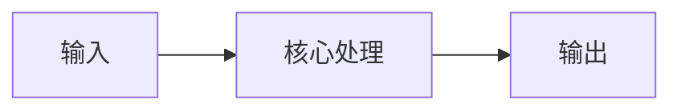
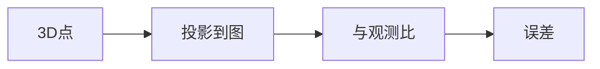

## 🧪 原理互动演示

<AlgoVisualizer type="bundle" />

# 第 3 页 · 核心概念

🧪 公式看不懂？去 <a href="/math-lab/">原理实验室</a> 拖动滑块直观体验卷积/梯度/高斯/霍夫/角点/RANSAC/光流等核心概念；看完原理再去本页底部 <a href="./source">源码/真机实验室</a> 亲手调参数。

## 先用生活直觉理解

你拍了 100 张照片重建一座雕像，结果发现模型有点歪。光束法平差像一位总导演：它同时指挥 100 台相机的站位和几万个 3D 点，让每个点投回每张照片时都尽可能落在原像素上——全局调到最齐。

**典型应用**：SfM/摄影测量最终优化、SLAM 后端全局一致、AR 大场景锚定、三维重建精修

## 概念逐个拆解

### 概念 1：重投影误差

把 3D 点投回图像得到的像素位置，与真实观测像素的差，就是误差。BA 要让所有误差的平方和最小。

### 概念 2：联合优化

不是单独调相机或单独调点，而是全部参数一起调——因为相机一动，所有点的误差都变，必须联立。

### 概念 3：为什么用 LM

LM 在高斯牛顿与梯度下降之间自适应切换，兼顾收敛速度与稳定性，是 BA 的标准优化器。

### 概念 4：稀疏结构与 Schur 补

每个 3D 点只被少数相机看到，雅可比矩阵高度稀疏。利用它消元后，求解规模大幅下降，百万点级 BA 才跑得动。

## 和其他算法的关系

| 关系 | 算法 | 说明 |
|------|------|------|
| 前置依赖 | 初始位姿 + 初始点云 + 匹配 | 通常先做这些再做本算法 |
| 同类对比 | PnP、三角化 | 解决同类问题，各有取舍 |
| 下游常用 | 稠密重建、网格化、纹理映射 | 本算法结果常交给它们处理 |

::: tip 记忆锚点
记住「BA = 最小化重投影误差，用 LM 迭代 + 稀疏矩阵加速」。
:::

<!-- AUTO-EXTENSION-2 -->

## 🧓 大白话：光束法平差 = "把所有相机和所有点一起微调，让重投影误差最小"

假设你已经有了 N 张照片，每张照片有相机位姿，场景里有 M 个 3D 点——理想情况下，每个 3D 点投到每张能看见它的照片上，应该精准落在它对应的像素上。但因为噪声，**投过去的位置和实际观测位置总有几像素偏差**。

**Bundle Adjustment（BA）** 就是把所有相机位姿（6×N 个参数）和所有 3D 点坐标（3×M 个参数）**一起当变量**，让"所有点在所有照片上的重投影误差平方和"最小。这是视觉 SLAM 和 SFM 的**最后一步黄金优化**，做一次 BA 往往能把总误差砍掉 50%+。

"Bundle" 指的是**从每个 3D 点发出、投影到各相机的光束**，"Adjustment" 就是微调这些光束让它们都经过对应像素。

## 为什么是"杀器"？

- **联合优化**相机和点，避免误差累积；
- 利用**稀疏性**（每个点只被少量相机看到），用 Levenberg-Marquardt + Schur Complement 快到能跑几万个点；
- 是 SFM/SLAM/三维重建**精度的最终保证**。
