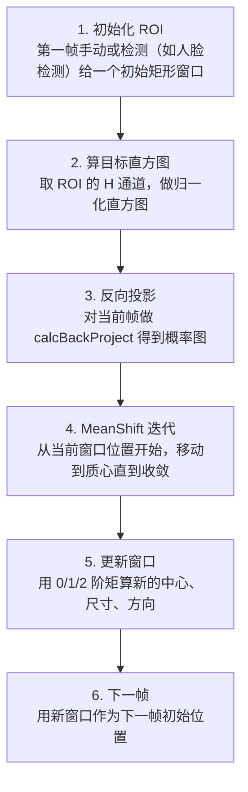

# CamShift 连续自适应 MeanShift · 算法流程

<AlgorithmCard
  name="CamShift 连续自适应 MeanShift"
  enName="Continuously Adaptive Mean-Shift"
  chapter="ch-11-object-detection"
  branch="detection"
  year="1998"
  author="Gary Bradski"
  paper="—"
  level="mid"
  tagline="MeanShift 的视频版——窗口大小自动跟着目标变，肤色跟踪的经典算法"
  analogy="MeanShift 像用放大镜盯跳蚤，大小不变；CamShift 像自适应聚光灯，跳蚤跳近光圈小、跳远光圈大，始终把跳蚤照亮在中间"
  scene="实时人脸/人手跟踪、肤色目标跟踪、视频会议人脸锁定、简单无模型跟踪、HCI 手势交互"
  :pros='["实现简单", "自适应窗口大小", "速度快", "非刚体变形容忍", "无需训练"]'
  :cons='["需初始化ROI", "同色背景易漂移", "光照敏感", "快速运动易丢", "只能跟踪颜色显著目标"]'
/>

## 完整算法流程

CamShift 连续自适应 MeanShift算法可以分解为以下关键步骤：

## 步骤详解

### 步骤 1：初始化 ROI

第一帧手动或检测（如人脸检测）给一个初始矩形窗口

### 步骤 2：算目标直方图

取 ROI 的 H 通道，做归一化直方图

### 步骤 3：反向投影

对当前帧做 calcBackProject 得到概率图

### 步骤 4：MeanShift 迭代

从当前窗口位置开始，移动到质心直到收敛

### 步骤 5：更新窗口

用 0/1/2 阶矩算新的中心、尺寸、方向

### 步骤 6：下一帧

用新窗口作为下一帧初始位置

## 在整体视觉 pipeline 中的位置

### 关键复杂度

| 维度 | 复杂度 |
|---|---|
| 时间 | 详见各实现 |
| 内存 | 与图像尺寸线性相关 |

