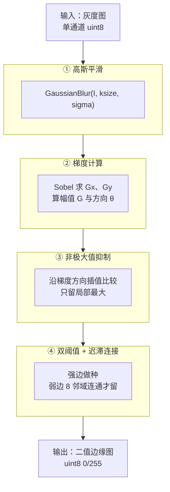
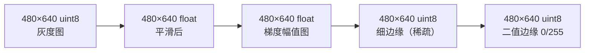
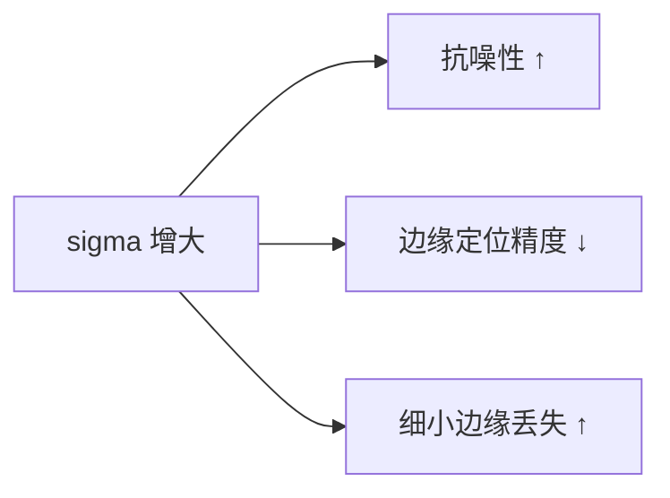
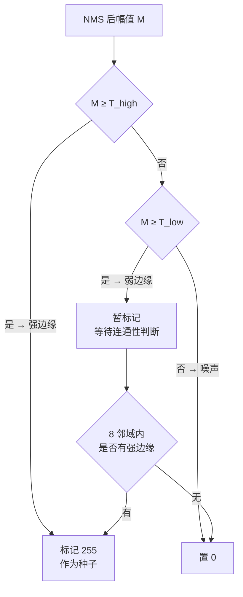

# Canny 算法流程

> 把 Canny 拆成四步，每一步的输入、输出、关键点都讲清楚。

## 总流程图



## 数据流转示例

假设输入是一张 **480×640** 的灰度图：



| 阶段 | 数据类型 | 取值范围 | 说明 |
|---|---|---|---|
| 输入 | uint8 | 0–255 | 必须是单通道灰度图 |
| ① 平滑 | float32 | 0–255 附近 | 高斯加权平均 |
| ② 梯度幅值 | float32 | 0–~1400 | 幅值可能远超 255 |
| ③ NMS 后 | float32 | 大量 0，少量非 0 | 边缘变稀疏、变细 |
| ④ 双阈值后 | uint8 | 只有 0 或 255 | 二值图 |

::: warning 注意
**梯度幅值会超过 255**。这也是为什么 Canny 的阈值参数范围通常写 `0–255` 但实际内部用浮点比较，而不是简单地做二值化。
:::

## ① 高斯平滑

**输入**：原灰度图
**输出**：平滑后的图
**目的**：抑制噪声，避免噪声被误判为边缘

**核大小与 sigma 的关系**（OpenCV 内部约定）：

$$
\sigma = 0.3 \times ((ksize - 1) \times 0.5 - 1) + 0.8
$$

**影响**：

| sigma | 效果 |
|---|---|
| 小（0.5） | 保留细节，但对噪声敏感 |
| 中（1.0–1.4） | 常用默认区间 |
| 大（2.0+） | 强去噪，但边缘会变模糊、细小边缘丢失 |



## ② 梯度计算

**输入**：平滑后的图
**输出**：梯度幅值图 $G$ + 梯度方向图 $\theta$
**目的**：找出每个像素的「变化强度」和「变化方向」

**做法**：用 Sobel 核分别在 x、y 方向求一阶导。

Sobel x 核：

$$
K_x = \begin{bmatrix} -1 & 0 & 1 \\ -2 & 0 & 2 \\ -1 & 0 & 1 \end{bmatrix}
$$

Sobel y 核：

$$
K_y = \begin{bmatrix} -1 & -2 & -1 \\ 0 & 0 & 0 \\ 1 & 2 & 1 \end{bmatrix}
$$

**幅值与方向**：

$$
G = \sqrt{G_x^2 + G_y^2}, \qquad \theta = \arctan\left(\frac{G_y}{G_x}\right)
$$

**优化**：OpenCV 用 $\text{dir} = \arctan\left(\frac{G_y}{G_x}\right) \times \frac{180}{\pi}$，再把方向归到 4 个扇区（0/45/90/135），避免浮点三角函数开销。

**方向量化表**：

| 角度区间 | 量化方向 | NMS 比较邻居 |
|---|---|---|
| [-22.5, 22.5) ∪ [157.5, 180) | 0° | 左、右 |
| [22.5, 67.5) | 45° | 左上、右下 |
| [67.5, 112.5) | 90° | 上、下 |
| [112.5, 157.5) | 135° | 右上、左下 |

## ③ 非极大值抑制

**输入**：梯度幅值图 + 方向图
**输出**：稀疏的细边缘图
**目的**：把粗边缘压成单像素宽

**核心逻辑**：

```mermaid
flowchart TB
  P["像素 (i,j)<br/>幅值 M，方向 θ"] --> Q{"θ 所属扇区"}
  Q -->|0°| A["比较 M(i,j-1) 与 M(i,j+1)"]
  Q -->|45°| B["比较 M(i+1,j-1) 与 M(i-1,j+1)"]
  Q -->|90°| C["比较 M(i-1,j) 与 M(i+1,j)"]
  Q -->|135°| D["比较 M(i-1,j-1) 与 M(i+1,j+1)"]
  A --> R{"M 是否最大"}
  B --> R
  C --> R
  D --> R
  R -->|是| K["保留 M"]
  R -->|否| Z["置 0"]
```



**为什么必须用「沿梯度方向」比较**：

边缘的方向是**垂直于梯度方向**的。所以压细边缘要在**梯度方向**上找极值——形象地说，就是「横切山脊」找山顶。


**45°/135° 的插值**（OpenCV 的精细处理）：

对 45° 情况，实际比较的是插值出来的两个点：

$$
M_1 = (1-t)\cdot M[i-1][j+1] + t \cdot M[i-1][j-1]
$$

$$
M_2 = (1-t)\cdot M[i+1][j-1] + t \cdot M[i+1][j+1]
$$

其中 $t$ 由实际梯度方向决定。这是为了让边缘在斜向时依然平滑，不会出现锯齿。

## ④ 双阈值 + 迟滞连接

**输入**：NMS 后的细边缘图
**输出**：最终二值边缘图
**目的**：区分真边缘与噪声引起的弱响应

**判定规则**：



**实现方式**：

- 常见的做法是**栈结构做深度优先搜索**（OpenCV 里的 `OcvDummyFloat` / `CannyConnect`）
- 从每个强边缘像素出发，把连通的弱边缘也标记为边缘
- 也可以用队列做广度优先搜索

**阈值比例建议**：

| 比例 | 适用场景 |
|---|---|
| $T_{high} = 2 T_{low}$ | 一般场景 |
| $T_{high} = 3 T_{low}$ | 噪声较强的图像 |
| $T_{high} = 1.5 T_{low}$ | 边缘很淡、需要高召回 |

## 复杂度分析

| 步骤 | 时间复杂度 | 说明 |
|---|---|---|
| ① 高斯平滑 | $O(N \cdot k^2)$ | N 为像素数，k 为核大小 |
| ② 梯度 | $O(N)$ | Sobel 3×3 固定 |
| ③ NMS | $O(N)$ | 每个像素常数次比较 |
| ④ 双阈值 | $O(N)$ | 连通搜索最坏 O(N) |

**总体**：$O(N)$，非常高效。在 1080p 图上，单核 CPU 也能跑到几十毫秒。

## 完整流程动画式理解


::: tip 一句话记住四步
**磨皮（去噪）→ 找变化（梯度）→ 掐尖（NMS）→ 留强去弱（双阈值）**
:::

## 与本体实例的对应

```yaml
- id: algo-canny
  type: Algorithm
  steps:
    - order: 1
      name: "高斯平滑"
      operator: "op-gaussian-blur"
    - order: 2
      name: "梯度计算"
      operator: "op-sobel-gradient"
      outputs: ["gradMagnitude", "gradDirection"]
    - order: 3
      name: "非极大值抑制"
      operator: "op-non-max-suppression"
    - order: 4
      name: "双阈值迟滞"
      operator: "op-hysteresis-threshold"
```
