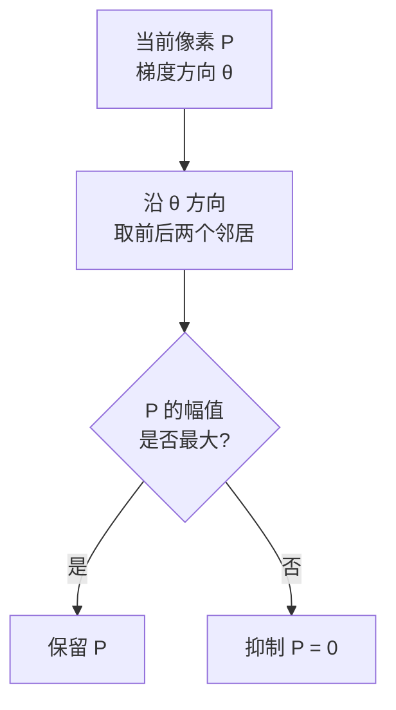
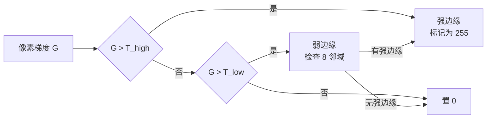
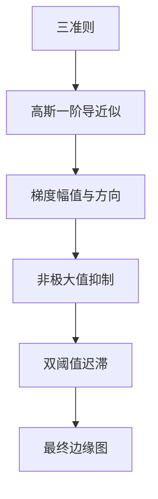

# Canny 核心概念

> Canny 论文里 5 个关键概念，逐个拆开讲清楚。

## Concept 1：最优边缘检测三准则

**一句话**：低误检 + 定位准 + 单像素响应，三条同时最优的边缘算子。

**通俗版**：描边要满足三条——不能把灰尘当线、线要画在真正的边界上、一条边只画一条线。

**数学化**：

| 准则 | 数学目标 |
|---|---|
| 低误检率 | 最大化信噪比 $\text{SNR} = \frac{\int_{-W}^{W} f(x)dx}{\sigma\sqrt{\int_{-W}^{W} f^2(x)dx}}$ |
| 高定位精度 | 最大化定位精度 $\text{Loc} = \frac{|f'(0)|}{\sigma\sqrt{\int f'^2(x)dx}}$ |
| 单像素响应 | 对单边缘的响应峰值唯一（去除多重响应） |

**为什么重要**：这是 Canny 的立论基础。没有这三条，「边缘检测好不好」就只是主观判断；有了这三条，就可以用变分法求出**唯一的最优解**。

**对应的本体实体**：`concept-optimal-edge-criteria`，`belongsTo: algo-canny`

## Concept 2：高斯一阶导近似

**一句话**：理论最优算子形状接近高斯函数的一阶导数，工程上用「高斯平滑 + 一阶差分」实现。

**通俗版**：理想中的「完美描边笔」不存在，但可以用「先磨皮去噪，再找明暗落差」来近似它，效果几乎一样。

**公式**：

一维最优算子：

$$
f(x) = -\frac{x}{\sigma^2} e^{-\frac{x^2}{2\sigma^2}}
$$

二维实现路径：

$$
\frac{\partial G}{\partial x} * I \approx \text{Sobel}( \text{Gaussian}(I) )
$$

**关键点**：

- 理论上「对图像求高斯一阶导」= 「先用高斯平滑图像，再求一阶差分」
- 卷积的**可结合性**让这两步可以合并，也可以分步做（OpenCV 是分步做）
- sigma 控制权衡：**大 sigma → 抗噪强、定位弱；小 sigma → 定位准、抗噪弱**

**对应的本体实体**：`concept-gaussian-derivative`

## Concept 3：梯度幅值与方向

**一句话**：用水平与垂直方向的导数，算出每个像素的「变化强度」和「变化朝向」。

**通俗版**：想象你站在每个像素上，感受四周哪里最亮哪里最暗——**变化最猛的方向就是梯度方向，变化有多猛就是梯度幅值**。

**公式**：

$$
G_x = \frac{\partial I}{\partial x}, \quad G_y = \frac{\partial I}{\partial y}
$$

$$
\text{幅值}: G = \sqrt{G_x^2 + G_y^2}
\quad (\text{近似}: G = |G_x| + |G_y|)
$$

$$
\text{方向}: \theta = \arctan\left(\frac{G_y}{G_x}\right)
$$

**关键点**：

- 方向 $\theta$ 会被**量化到 4 个方向**（0°、45°、90°、135°），用于下一步 NMS 的插值比较
- 幅值可以用 $|G_x| + |G_y|$ 近似，省一次开方，速度更快（OpenCV 用的就是这种近似）

## Concept 4：非极大值抑制（NMS）

**一句话**：沿梯度方向只保留局部最大的像素，把粗边缘压成单像素细线。

**通俗版**：一条边缘在梯度图里其实是一道「小山脊」，有好几像素宽。NMS 就是沿着山脊的横切方向看——**只有站在山顶的那个像素留下，两边坡上的全抹掉**。

**做法**：



**梯度方向的 4 个量化情况**：

| 方向范围 | 比较的邻居 |
|---|---|
| 0°（水平） | 左右 |
| 45° | 左上、右下 |
| 90°（垂直） | 上下 |
| 135° | 右上、左下 |

**插值**：严格做法是按下式在梯度方向上线性插值出两个虚拟邻居再比较：

$$
M_1 = (1-t)\cdot M_{a} + t \cdot M_{b}
$$

OpenCV 中对 45° 和 135° 情况做了这个插值（见源码走读）。

**影响深远**：这是**目标检测 NMS 的思想源头**。详见 [NMS 到 YOLO](/legacy/nms-to-yolo)。

## Concept 5：双阈值迟滞

**一句话**：强阈值定「确定边缘」，弱阈值找「疑似边缘」，只有连通到确定边缘的疑似边缘才保留。

**通俗版**：强边缘像城墙，弱边缘像淡痕。淡痕连着城墙就留下，孤零零的淡痕当划痕擦掉。

**流程**：



**参数关系**：

$$
T_{high} \approx 2 \sim 3 \times T_{low}
$$

**关键点**：

- 这是**唯一能在抗噪和连续性之间取得平衡**的简单机制
- 连通性用 8 邻域递归/广度优先搜索实现
- 比例 2:1 到 3:1 是经验值，正是 `cv2.Canny(低, 高)` 里两个参数的来历

## 概念之间的关系



**逻辑链**：

1. 三准则 → 决定要用什么算子（最优滤波器）
2. 最优滤波器 → 用高斯一阶导近似实现
3. 高斯一阶导 → 产出梯度幅值与方向
4. 幅值与方向 → 支撑 NMS 压细边缘
5. 压细后 → 用双阈值做最终筛选与连接

## 本体实例

上述 5 个概念在 `ontology/instances/` 里的对应关系：

```yaml
- id: algo-canny
  type: Algorithm
  concepts:
    - "concept-optimal-edge-criteria"
    - "concept-gaussian-derivative"
    - "concept-gradient-magnitude-direction"
    - "concept-nms"
    - "concept-double-threshold"
  dependsOn:
    - "op-gaussian-blur"
    - "op-sobel-gradient"
    - "op-non-max-suppression"
    - "op-hysteresis-threshold"
```
