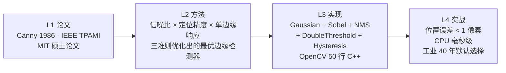

# Canny 边缘检测

<AlgorithmCard
  name="Canny 边缘检测"
  en-name="Canny Edge Detector"
  chapter="第4章 · 基元检测"  chapterLink="/chapters/ch04-primitives"
  branch="特征检测 · 边缘族"
  year="1986"
  author="John Canny"
  paper="https://doi.org/10.1109/TPAMI.1986.4767851"
  level="低层"
  tagline="30 多年稳坐边缘检测王座的「最优检测算子」"
  analogy="就像拿一支很细很稳的铅笔，沿着物体的真实轮廓画一圈——既不被噪点骗得画毛边，也不把真正的边漏掉，还保证一条边只画一笔。"
  scene="工业零件尺寸测量、文档/票据扫描的边界定位、道路车道线提取、医疗影像的器官轮廓勾勒、车牌定位前的预处理。"
  :pros="[
    '检测准确率高、定位精度高（边缘位置误差 < 1 像素）',
    '响应单一，一条边只产生一个响应（非极大值抑制）',
    '双阈值+滞后连接，抗小断裂能力强',
    'CPU 上几十毫秒就能跑一张大图，嵌入式完全无压力',
    '几乎所有视觉库（OpenCV / Matlab / Skimage / HALCON）都内置'
  ]"
  :cons="[
    '高斯+Sobel 是「各向同性」的，拐角和交接处会被磨圆',
    '高低阈值要人工设，不同光照/场景下需要调参',
    '只给边缘线，不知道哪边是前景哪边是背景',
    '对非常细的线（如发丝）和非常模糊的边不友好'
  ]"
/>

## TL;DR

**一句话**：**先高斯模糊去噪 → Sobel 算梯度找边 → 非极大值抑制细边 → 双阈值 + 滞后跟踪连边**，五步流水线输出细、净、连贯的边缘图。
**解决**：Sobel/Roberts 等早期算子找的边粗、噪点多、断裂多、定位不准的问题。
**代价**：高低阈值要人工调，各向同性高斯会磨圆拐角，只输出边缘位置不区分前景背景。
**前置阅读**：[🐣 入门第 3 页 Canny 样板](/for-beginners/p3-canny-deep-dive) → [💡 核心概念](./concepts)

## 3 分钟电梯演讲


## 四层闭环视图



## 核心贡献一览

| 贡献 | 一句话 | 代码落点 |
|---|---|---|
| 高斯预平滑 | 模糊抗噪，σ 决定"看多粗的边" | `cv2.GaussianBlur(img, (5,5), 1.4)` |
| Sobel 梯度 | 同时算水平/垂直差分，得幅值和方向 | `cv2.Sobel(..., 1,0)` + `Sobel(...,0,1)` |
| 非极大值抑制 | 沿梯度方向比邻居，只留局部最大 | OpenCV `canny.cpp` 内部 |
| 双阈值 | 高阈取强边、低阈留候选 | API 参数 `threshold1`, `threshold2` |
| 滞后跟踪 | 弱边连强边才留，孤立弱边压掉 | `cv2.Canny` 内部 8 连通 BFS |

## 📖 档案目录

| 页面 | 内容 |
|---|---|
| [📄 论文精读](/algorithms/canny/paper) | Canny 1986 原文的三准则：好检测/好定位/单响应 |
| [💡 核心概念](/algorithms/canny/concepts) | 梯度、非极大值抑制、双阈值、滞后连接——用大白话讲 |
| [🏗 算法流程](/algorithms/canny/architecture) | 五步流水线 + Mermaid 流程图 |
| [🔍 源码走读](/algorithms/canny/source) | OpenCV `cv2.Canny` 源码要点 |
| [💣 实战踩坑](/algorithms/canny/painpoints) | 实际项目中最常见的 7 个坑 |
| [🎛 调参技巧](/algorithms/canny/tricks) | 高低阈值、孔径、L2 梯度怎么选 |

## 🔗 所属网络

- **学习路径**：🟦 [第4章 基元检测](/learning-path) → 边缘族
- **技术分支**：🌿 [特征检测 → 边缘检测](/branches/feature-detection/edges)
- **上游依赖**：[高斯滤波](/branches/image-processing/filtering)、Sobel 梯度（第3章预处理）
- **下游输出**：边缘图 → 用于霍夫变换、轮廓查找、分割、形状分析
- **演化关系**：← Sobel/LoG（先驱）→ Canny-Deriche（扩展）→ 边缘闭合（Canny + 形态学）

## 🚀 一行代码

```python
import cv2
edges = cv2.Canny(img, threshold1=50, threshold2=150, apertureSize=3, L2gradient=True)
```


---

## 🚀 动手体验（浏览器里直接玩，不用装环境）

> 下面这些组件都在**你的浏览器本地运行**，不上传任何图片、也不用安装 OpenCV 或写代码。

### 🧪 先懂原理：梯度与边缘到底在算什么

拖动滑块，看数学是怎么一步步变成图像的——纯 Canvas 绘制，秒开。

<ClientOnly>
  <MathVisualizer initial-tab="grad" compact />
</ClientOnly>

### 🎮 再跑真机：在浏览器里真跑 Canny 边缘检测

换成你自己的照片也行；下面还会**实时生成**对应的 Python / C++ / JavaScript 代码，拖参数时代码同步更新。

<ClientOnly>
  <OpencvPlayground initial-algo="canny" compact />
</ClientOnly>

> 想换示例图、上传自己的照片、或切换别的算法？去 [🎮 真机实验室](/playgrounds/)；想看完整的 14 个数学原理互动？去 [🧪 原理实验室](/math-lab/)。
