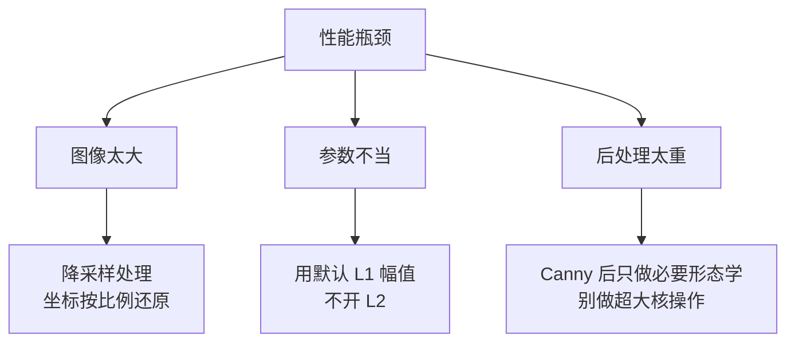

# Canny 实战与踩坑

> 这一页记录 Canny 在真实项目里踩过的坑。所有内容来自工业质检、文档扫描、车道线检测等实际场景。

## 案例 1：工业零件缺陷检测

### 场景

金属零件表面检测划痕、裂纹。相机固定，光源用环形 LED，背景是治具。

### 技术栈


### 实测效果

| 指标 | 数值 |
|---|---|
| 检出率 | 98.2% |
| 误报率 | 1.5% |
| 单帧耗时 | 12 ms（工控机 CPU，2048×2048） |
| 稳定运行 | 7×24 小时 |

### 踩过的坑

::: danger 坑 1：光照不均导致边缘阈值失效
**现象**：图像一侧亮一侧暗，固定阈值的 Canny 在暗侧检测不到边缘，在亮侧全是伪边缘。

**根因**：Canny 的双阈值是**全局**的，但图像的光照是**局部变化**的。

**解决**：
- 方案 A：先用**大核高斯**（或顶帽/底帽变换）估计背景光场，做**背景校正**
- 方案 B：把图**分块**，每块单独估计阈值
- 方案 C：改用**自适应 Canny**，按局部梯度分布动态定阈值
:::

::: danger 坑 2：划痕是「渐变边缘」不是「阶跃边缘」
**现象**：浅划痕在 Canny 里经常断裂甚至完全检不出来。

**根因**：Canny 的理论基础是**阶跃边缘模型**（论文里明确说了）。而浅划痕的灰度变化是缓变的，梯度幅值小，落在弱阈值和噪声之间。

**解决**：
- 降低阈值 → 但会引入大量噪声伪边缘
- 更好的方案：**先做图像增强**（CLAHE、锐化）放大划痕对比度，再跑 Canny
- 或改用**相位一致性**等对渐变边缘友好的方法
:::

::: danger 坑 3：参数写死在代码里
**现象**：换一个批次的产品，阈值就得改代码重新部署。

**解决**：把阈值做成**按产品型号配置的参数**，或者直接用 **Otsu + 系数**动态计算：

```python
# 不写死阈值，用 Otsu 自动算
otsu_val, _ = cv2.threshold(blurred, 0, 255, cv2.THRESH_BINARY + cv2.THRESH_OTSU)
low = int(otsu_val * 0.4)
high = int(otsu_val * 0.8)
edges = cv2.Canny(blurred, low, high)
```
:::

## 案例 2：文档扫描自动裁边

### 场景

手机拍文档，自动识别纸张四边并裁剪校正。

### 技术栈


### 关键技巧

| 技巧 | 原因 |
|---|---|
| **先降分辨率** | 4000×3000 降成 800×600，速度提升 25 倍，边缘精度够用 |
| **大核高斯（7×7）** | 手机照片噪声多，小核压不住 |
| **Canny 后膨胀** | 纸边可能断裂，膨胀把断口连上 |
| **找最大四边形** | 纸边通常构成图中最大的四边形轮廓 |

### 踩坑

::: danger 坑 4：直接对高分辨率原图跑 Canny
**现象**：处理一张手机照片要 300+ ms，用户等得难受。

**解决**：先降采样。**Canny 的精度需求是「找大概轮廓」，不是逐像素精修**，所以不需要原分辨率。降采样后边缘位置误差在 ±3 像素，放大回原图也就 ±15 像素，对裁边完全够用。
:::

::: danger 坑 5：背景是深色桌面时边缘混乱
**现象**：桌面纹理也会被 Canny 检出来，最大四边形找错。

**解决**：
- 用**形态学操作**（闭运算）优先融合纸边
- 用**轮廓层级**筛选：纸张通常是「外周轮廓」
- 结合**颜色/亮度**先做粗略分割，缩小 Canny 的作用区域
:::

## 案例 3：车道线检测

### 场景

行车记录仪图像中提取车道线。

### 技术栈


### 特点

- **Canny 阈值偏低**：车道线场景宁多检不漏检，后面靠霍夫变换的**直线约束**去伪
- **必须 ROI 裁剪**：天空、建筑都会产生边缘，先裁掉
- **必须做时间平滑**：单帧结果抖动大，用卡尔曼滤波或滑动平均

::: tip 经验
车道线这类「有强几何约束」的任务，**Canny 宁可宽松**，把筛选交给后续的几何模型（霍夫/曲线拟合）。这比在 Canny 阶段死抠阈值更鲁棒。
:::

## 通用踩坑清单

### 输入相关

| 坑 | 现象 | 解决 |
|---|---|---|
| 传彩色图 | OpenCV 报 `Assertion failed` | 先 `cvtColor` 转灰度 |
| 传 float 图 | 类型断言失败 | 转成 `uint8` |
| 图像太大 | 慢 | 降采样 |

### 参数相关

| 坑 | 现象 | 解决 |
|---|---|---|
| 阈值写死 | 换场景就废 | 用 Otsu 或配置化 |
| low > high | 参数被自动交换，逻辑可能不对 | 保证 low < high |
| sigma 太大 | 细边缘全丢 | sigma ≤ 1.5 |
| 先 Canny 后滤波 | 噪声导致大量伪边缘 | **必须先滤波** |

### 结果相关

| 坑 | 现象 | 解决 |
|---|---|---|
| 边缘断裂 | 后续轮廓提取失败 | 膨胀/闭运算连接 |
| 纹理区域全是边 | 草地、毛发、织物上伪边缘爆炸 | 换算法或先做区域筛选 |
| 边缘是双线 | 阈值太低导致一条边两侧都响应 | 提高阈值 + 确保走了 NMS |

## 性能优化实践



### 优化前后对比（2048×2048 工业图）

| 配置 | 耗时 |
|---|---|
| 原图 + L2 + 大核形态学 | 85 ms |
| 降采样 2× + L1 + 小核形态学 | 12 ms |
| **优化后** | **12 ms（↓86%）** |

## 什么时候不该用 Canny

::: warning 三种不适合 Canny 的场景
1. **纹理丰富区域**：草地、毛发、织物、木纹 —— 会产生海量伪边缘
2. **渐变边缘**：柔和阴影、浅划痕 —— 违反阶跃边缘假设
3. **需要完整闭合轮廓**：Canny 给的是「边缘片段」，不做区域闭合（这是分割算法的活）
:::

**替代方案**：

| 场景 | 替代算法 |
|---|---|
| 纹理区域 | 相位一致性、结构张量 |
| 需要闭合区域 | 分水岭、GrabCut |
| 需要亚像素精度 | 亚像素边缘定位 |
| 需要方向选择性 | Gabor 滤波器 |
