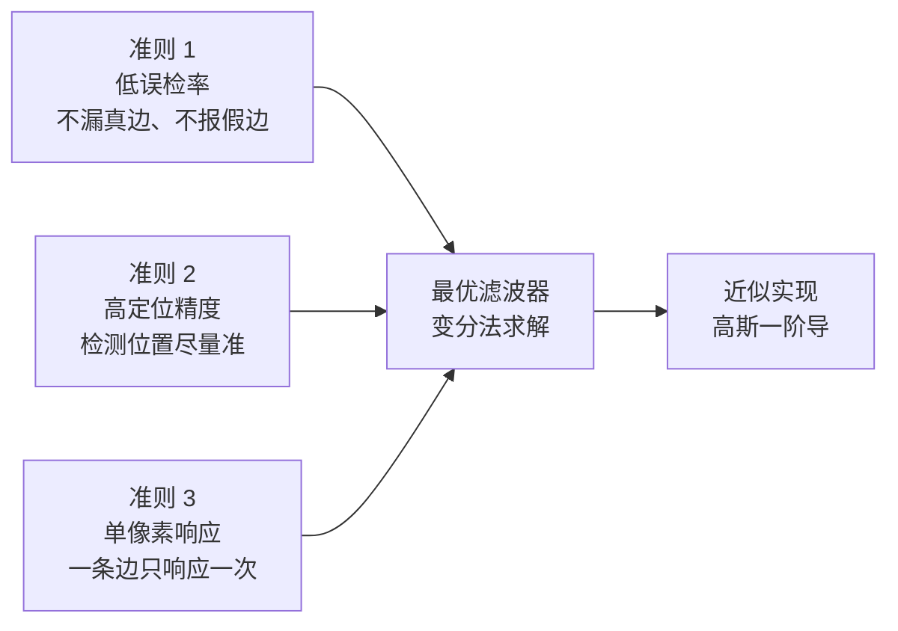
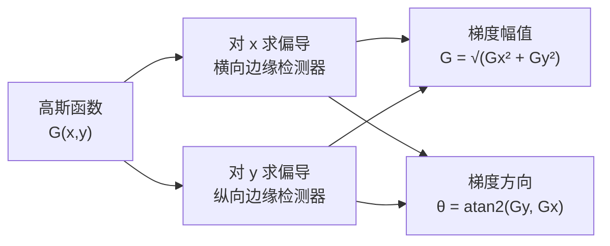
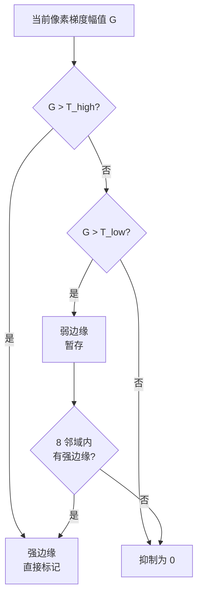
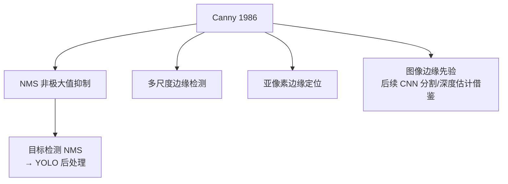

# Canny 论文精读

> **A Computational Approach to Edge Detection**
> John Canny, IEEE Transactions on Pattern Analysis and Machine Intelligence, 1986
> DOI: 10.1109/TPAMI.1986.4767851

## 论文要解决什么问题

1986 年之前，边缘检测的主流做法是「用一个固定的小卷积核（Sobel / Prewitt / Roberts）卷一下，超过阈值的算边缘」。这套做法的根本问题是——**没有任何理论指导**：

- 为什么用 3×3 的 Sobel 而不是 5×5？
- 阈值为什么是 100 而不是 150？
- 为什么 Sobel 检测出来的边缘是粗的、有断口的？

论文开篇就直接点出这个痛点：

> 边缘检测算子大多是被**提出**的，而不是被**推导**的。

Canny 的贡献就是把这件事**从「工程直觉」变成「最优化问题」**。

## Motivation：把「好边缘」定义清楚

论文第一个核心动作是——**先定义什么叫好的边缘检测**。他提出三条准则：

### 三条准则的数学化

| 准则 | 数学表述 | 直观含义 |
|---|---|---|
| 低误检率 | 信噪比 SNR 最大 | 信号（真边缘）相对噪声尽可能强 |
| 高定位精度 | 定位误差最小 | 检测到的边缘位置方差最小 |
| 单像素响应 | 对单边缘的响应峰值唯一 | 一条边不会被响应成多条 |

::: tip 为什么这三条能同时形式化
Canny 发现，把这三条写成数学表达式后，它们之间存在**权衡关系**：

- 想要信噪比高 → 滤波器要宽 → 但定位精度会下降
- 想要定位准 → 滤波器要窄 → 但抗噪性会下降

所以真正的「最优」是**在给定信噪比下的最佳定位**——这是一个可以用变分法求解的优化问题。
:::

## Innovation：最优滤波器长什么样

### 核心结论

在「阶跃边缘 + 高斯白噪声」的假设下，Canny 用变分法求出最优的一维边缘检测算子，其形状**近似为高斯函数的一阶导数**：

$$
G(x) = -\frac{x}{\sigma^2} e^{-\frac{x^2}{2\sigma^2}}
$$

二维情况下，用高斯函数先平滑再求一阶偏导：

$$
\frac{\partial G}{\partial x} = -\frac{x}{2\pi\sigma^4} e^{-\frac{x^2+y^2}{2\sigma^2}}
$$

### 为什么这个结论重要

它一举回答了几个之前没人能回答的问题：

1. **为什么要先高斯平滑？** ——因为高斯一阶导本身就等价于「高斯平滑 + 一阶差分」，平滑是理论推导出来的，不是工程凑的。
2. **sigma 该多大？** ——sigma 是准则之间权衡的旋钮：sigma 大 → 抗噪强但定位差；sigma 小 → 定位准但抗噪弱。
3. **为什么 Sobel 边缘粗？** ——因为 Sobel 的响应在边缘附近是一片「山脊」而不是一个「尖峰」，需要额外处理才能压细。

## 三个关键工程贡献

### 贡献一：非极大值抑制（NMS）

**做法**：对每个像素，沿其梯度方向看前后两个邻居的幅值，如果不是局部最大就抑制为 0。

**这一步的影响远超边缘检测**——后来目标检测里的 NMS（去掉重叠框）就是同一个思想的不同应用。详见 [传承脉络](/legacy/nms-to-yolo)。

### 贡献二：双阈值迟滞（Hysteresis Thresholding）

单一阈值永远两难：高了丢边，低了全是噪。Canny 用**两个阈值 + 连通性**解决：

**逻辑**：

- 强边缘（G > T_high）一定是真边缘，作为「种子」
- 弱边缘（T_low < G < T_high）只有当它**连通到某个强边缘**时才保留
- 孤立的弱边缘视为噪声丢弃

::: tip 通俗版
强边缘就像「确定无疑的城墙」，弱边缘像「淡淡的痕迹」。
如果一段淡痕迹连着城墙，那它是城墙的延伸，留下；
如果那段淡痕迹孤零零悬在荒地里，那大概率是地上的一道划痕（噪声），擦掉。
:::

### 贡献三：可工程实现的完整流程

论文不只给理论，还给了完整可实现的四步流程，这也是为什么它能迅速普及：

1. 高斯滤波
2. 计算梯度幅值与方向
3. 非极大值抑制
4. 双阈值检测与边缘连接

## Tradeoff：代价与妥协

| 维度 | Canny 的取舍 |
|---|---|
| **精度 vs 速度** | 四步流程比单次卷积慢，但换来质量大幅提升 |
| **抗噪 vs 定位** | 由 sigma 统一控制，是代码里的核心旋钮 |
| **通用性 vs 场景** | 对**纹理密集**场景（草地、毛发、织物）效果差，会产生大量伪边缘 |
| **需要灰度图** | 必须先转灰度，彩色信息被丢弃 |

### 论文里提到的局限

Canny 自己在论文里也承认，方法基于「阶跃边缘」假设。对于**屋顶边缘（roof edge）**、**渐变边缘**、**纹理区域**，最优滤波器形状会不同，需要重新推导。

这一点在现代仍然是痛点——所以后来出现了大量针对纹理场景的改进（如相位一致性边缘检测）。

## 论文的长期影响

**一篇 1986 年的论文，核心思想活到了今天的 YOLO 里。** 这是传统 CV 最迷人的地方。

## 一句话总结

> Canny 的最大贡献不是给了一个更好的算子，而是**第一次把「什么是好边缘」变成可以求解的数学问题**——从此边缘检测从手艺变成了科学。

## 延伸阅读

- 原文：Canny, J. (1986). *A Computational Approach to Edge Detection.* IEEE TPAMI, 8(6), 679–698.
- 后续工作：Marr-Hildreth 算子（LoG）、相位一致性边缘检测
- 工程实现：[源码走读](/algorithms/canny/source)（OpenCV）
