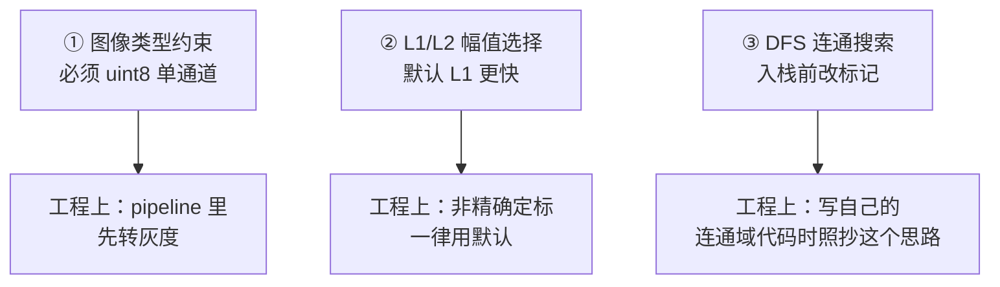

# Canny 源码走读

> 基于 **OpenCV 4.x** `modules/imgproc/src/canny.cpp` 的逐段注解。
> 源码仓库：`opencv/opencv` · 路径：`modules/imgproc/src/canny.cpp`

::: warning 说明
以下为**结构与逻辑示意**的伪代码注解，用于讲清实现思路。行号为大致位置，实际代码请以你本地的 OpenCV 版本为准。
:::

## 1. 函数入口

```cpp
// canny.cpp  Canny 主函数（简化示意）
void cv::Canny(InputArray _src, OutputArray _dst,
               double low_thresh, double high_thresh,
               int aperture_size, bool L2gradient)
{
    // 1. 取输入图，必须是单通道 8 位
    Mat src = _src.getMat();
    CV_Assert(src.depth() == CV_8U && src.channels() == 1);   // ← 必须是灰度图

    // 2. 阈值参数处理：如果 low > high，交换
    if (low_thresh > high_thresh) std::swap(low_thresh, high_thresh);

    // 3. 决定是否用 L2 范数（更准但更慢）
    //    L2gradient=false → 用 |Gx|+|Gy| 近似（默认，快）
    //    L2gradient=true  → 用 sqrt(Gx²+Gy²)（准，慢）

    // 4. 分配输出
    _dst.create(src.size(), CV_8UC1);
    Mat dst = _dst.getMat();

    // 5. 初始化内部缓冲，进入核心计算
    CannyImpl(src, dst, low_thresh, high_thresh, aperture_size, L2gradient);
}
```

**关键点**：

- `CV_Assert(src.depth() == CV_8U && src.channels() == 1)`：**Canny 只接受单通道 8 位图**。传彩色图会直接抛异常——这是最常见的入门报错。
- `low_thresh > high_thresh` 会被自动交换，但**不要依赖这个**，参数写反了逻辑仍然可能不对。

## 2. 高斯平滑

```cpp
// 步骤 ①：先用高斯滤波去噪
// 如果 aperture_size > 1，先做一次高斯模糊
if (aperture_size > 1) {
    // sigma 由 aperture_size 推导（找不到就用默认经验式）
    GaussianBlur(src, src, Size(aperture_size, aperture_size), 0, 0, BORDER_REPLICATE);
}
// 注意：kernel_size = aperture_size，必须是 3/5/7 这样的奇数
```

**实现细节**：

| 参数 | 默认 | 说明 |
|---|---|---|
| `aperture_size` | 3 | Sobel 核大小，同时用作高斯核大小 |
| `BORDER_REPLICATE` | — | 边界用复制填充，避免边缘伪响应 |
| `sigma = 0` | — | 传 0 表示由核大小自动推导 |

::: tip 为什么 sigma 传 0
OpenCV 里 `sigma = 0` 表示「按核大小自动计算」：
$$\sigma = 0.3 \times ((ksize-1)\times 0.5 - 1) + 0.8$$
这样你只调核大小，sigma 自动跟着变。
:::

## 3. 梯度计算（Sobel）

```cpp
// 步骤 ②：用 Sobel 算子求 Gx、Gy
Mat dx, dy;
Sobel(src, dx, CV_16S, 1, 0, aperture_size, 1, 0, BORDER_REPLICATE);  // 水平方向导数
Sobel(src, dy, CV_16S, 0, 1, aperture_size, 1, 0, BORDER_REPLICATE);  // 垂直方向导数

// 转成更宽的整型，防止平方溢出
// CV_16S → int32，因为 Gx²+Gy² 可能超过 int16 范围
convertScaleAbs(dx, ...);  // 取绝对值
convertScaleAbs(dy, ...);
```

**为什么用 `CV_16S`**：Sobel 结果有正有负，8 位无符号装不下，必须用 16 位有符号。

**为什么平方要升级位宽**：$G_x^2$ 最大约 $4 \times 255^2 \approx 260100$，超过 int16 上限 32767，所以必须升到 int32。

## 4. 计算幅值与方向

```cpp
// 步骤 ② 后半：算梯度幅值和方向
for (int i = 0; i < rows; i++) {
    for (int j = 0; j < cols; j++) {
        int gx = dx.at<short>(i, j);
        int gy = dy.at<short>(i, j);

        // 幅值：两种模式
        float mag;
        if (L2gradient)
            mag = std::sqrt((float)(gx*gx + gy*gy));      // L2：更准
        else
            mag = (float)(std::abs(gx) + std::abs(gy));   // L1：更快（默认）

        // 方向：算成角度，再量化到 4 个扇区
        float angle = std::atan2((float)gy, (float)gx) * 180.f / (float)CV_PI;
        map[i*cols + j] = std::make_pair(mag, angle);
    }
}
```

**L1 vs L2 的选择**：

| 模式 | 公式 | 速度 | 精度 |
|---|---|---|---|
| `L2gradient=false`（默认） | $\|G_x\| + \|G_y\|$ | 快 | 略差（最大约 8% 幅值偏差） |
| `L2gradient=true` | $\sqrt{G_x^2+G_y^2}$ | 慢（有开方） | 准 |

::: tip 实践建议
**默认用 L1 就够了**。边缘检测只需要「相对大小关系」，L1 近似虽然幅值不精确，但保序性基本一致，对最终结果影响很小。
只有当你的阈值是「按物理意义精确定标过」的时候，才需要 L2。
:::

## 5. 非极大值抑制

```cpp
// 步骤 ③：沿梯度方向只保留局部最大
for (int i = 1; i < rows - 1; i++) {
    for (int j = 1; j < cols - 1; j++) {
        float mag = map[i][j].first;
        if (mag == 0) continue;             // 已经是 0 就不用比

        float angle = map[i][j].second;     // 角度范围 (-180, 180]
        // 把角度归一到 [0, 180)
        if (angle < 0) angle += 180;

        float m1, m2;   // 梯度方向上前后两个邻居

        if (angle < 22.5 || angle >= 157.5) {
            // 0°：水平方向 → 比左右
            m1 = map[i][j-1].first;
            m2 = map[i][j+1].first;
        } else if (angle < 67.5) {
            // 45°：比左上、右下（带插值）
            float w = (angle - 22.5f) / 45.f;
            m1 = (1-w)*map[i-1][j+1].first + w*map[i-1][j-1].first;
            m2 = (1-w)*map[i+1][j-1].first + w*map[i+1][j+1].first;
        } else if (angle < 112.5) {
            // 90°：垂直方向 → 比上下
            m1 = map[i-1][j].first;
            m2 = map[i+1][j].first;
        } else {
            // 135°：比右上、左下（带插值）
            float w = (angle - 112.5f) / 45.f;
            m1 = (1-w)*map[i-1][j-1].first + w*map[i-1][j+1].first;
            m2 = (1-w)*map[i+1][j+1].first + w*map[i+1][j-1].first;
        }

        // 只有当前像素是局部最大才保留
        if (mag >= m1 && mag >= m2)
            map[i][j].first = mag;      // 保留
        else
            map[i][j].first = 0;        // 抑制
    }
}
```

**逐点理解**：

1. **角度归一化**：`atan2` 返回 $(-180°, 180°]$，统一加 180 归到 $[0°, 180°)$，这样 4 个扇区就覆盖整个范围。
2. **扇区边界为何是 22.5 / 67.5 / 112.5 / 157.5**：每个扇区中心是 0/45/90/135，边界取中点（22.5 等），保证划分对称。
3. **插值的关键**：45° 和 135° 情况下，邻居并不正好落在网格点上，所以按角度比例 $w$ 做**线性插值**，这样才能保证斜向边缘平滑无锯齿。

## 6. 双阈值与迟滞连接

```cpp
// 步骤 ④：双阈值 + 连通性判断
// 先做一遍扫描，标记强边缘、弱边缘、噪声
for (int i = 0; i < rows; i++) {
    for (int j = 0; j < cols; j++) {
        float mag = map[i][j].first;
        if (mag >= high_thresh)
            dst[i][j] = 2;      // 强边缘（内部标记）
        else if (mag >= low_thresh)
            dst[i][j] = 1;      // 弱边缘（待定）
        else
            dst[i][j] = 0;      // 噪声
    }
}

// 然后用栈/队列做连通搜索：从每个强边缘出发，把连通的弱边缘"点亮"
std::stack<Point> stk;
for (int i = 0; i < rows; i++) {
    for (int j = 0; j < cols; j++) {
        if (dst[i][j] != 2) continue;         // 只从强边缘出发
        stk.push({i, j});
        while (!stk.empty()) {
            Point p = stk.top(); stk.pop();
            dst[p.x][p.y] = 255;              // 标记为最终边缘
            // 遍历 8 邻域
            for (int di = -1; di <= 1; di++) {
                for (int dj = -1; dj <= 1; dj++) {
                    int ni = p.x + di, nj = p.y + dj;
                    if (ni < 0 || nj < 0 || ni >= rows || nj >= cols) continue;
                    if (dst[ni][nj] == 1) {   // 是弱边缘 → 也点亮
                        dst[ni][nj] = 2;      // 改成强标记，避免重复入栈
                        stk.push({ni, nj});
                    }
                }
            }
        }
    }
}

// 最后把非 255 的全部置 0，输出二值图
```

**实现要点**：

| 要点 | 说明 |
|---|---|
| 用**栈**（DFS） | 递归容易爆栈，迭代式 DFS 更安全 |
| 入栈前改标记 | `dst[ni][nj] = 2` 防止同一个点被反复入栈（否则会死循环） |
| 8 邻域 | 用 8 连通而非 4 连通，保证对角方向的边缘也能连上 |
| 最终归一化 | 内部标记 1/2 最后统一转成 0/255 |

::: warning 常见实现坑
如果**入栈前不修改标记**，遇到「两个弱边缘互相指向」的情况会无限循环。所以必须在 `push` 之前就把它标成「已访问」。
:::

## 7. 参数与默认值汇总

| 参数 | 类型 | 默认 | 说明 |
|---|---|---|---|
| `low_thresh` | double | 必填 | 弱阈值 |
| `high_thresh` | double | 必填 | 强阈值 |
| `aperture_size` | int | 3 | Sobel 核大小（3/5/7） |
| `L2gradient` | bool | false | 是否用 L2 范数算幅值 |

## 8. Python 调用示例

```python
import cv2
import numpy as np

# ① 读图并转灰度（Canny 必须单通道）
img = cv2.imread('part.jpg', cv2.IMREAD_GRAYSCALE)
if img is None:
    raise FileNotFoundError('读图失败')

# ② 先做一次高斯去噪（可选，但强烈推荐）
blurred = cv2.GaussianBlur(img, (5, 5), 1.4)

# ③ Canny：低阈值 = 高阈值 / 3
low, high = 50, 150
edges = cv2.Canny(blurred, low, high, apertureSize=3, L2gradient=False)

# ④ 保存
cv2.imwrite('edges.png', edges)
```

## 9. 源码学习的三个关键收获



## 参考

- OpenCV 源码：`opencv/modules/imgproc/src/canny.cpp`
- 官方文档：[OpenCV Canny](https://docs.opencv.org/4.x/da/d22/tutorial_py_canny.html)

## 🎮 动手试一试

原理看完了，现在就在你浏览器里跑一遍 **canny** 吧——拖动滑块调参数，下面的 Python/C++/JS 代码会自动跟着变，复制即可用。

<ClientOnly>
  <OpencvPlayground initial-algo="canny" compact />
</ClientOnly>

👉 想要更丰富的示例图、上传自己的照片、切换其他算法？去 [🎮 真机实验室](/playgrounds/)。
