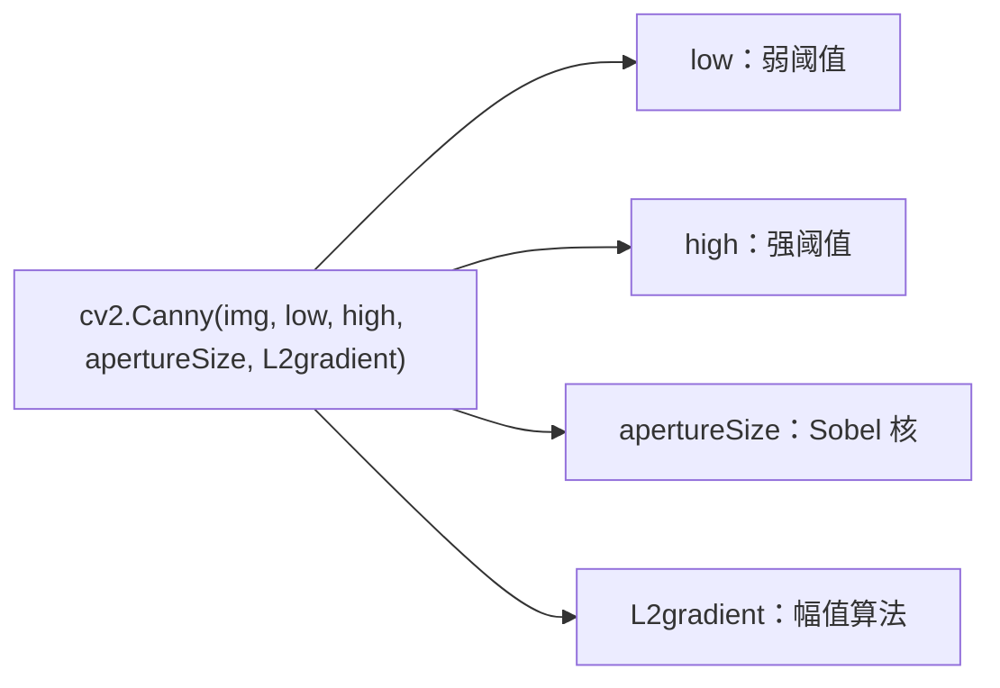
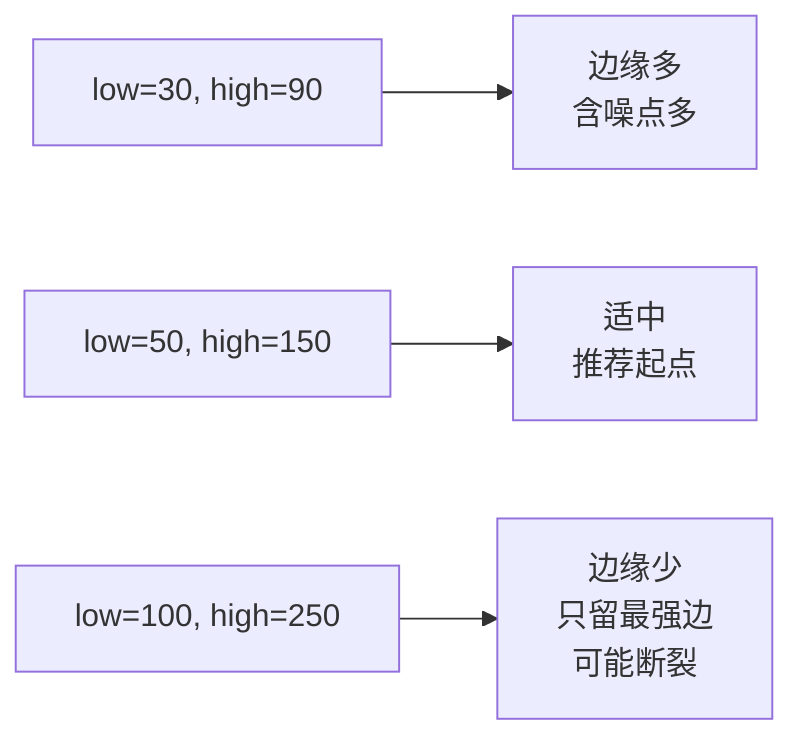
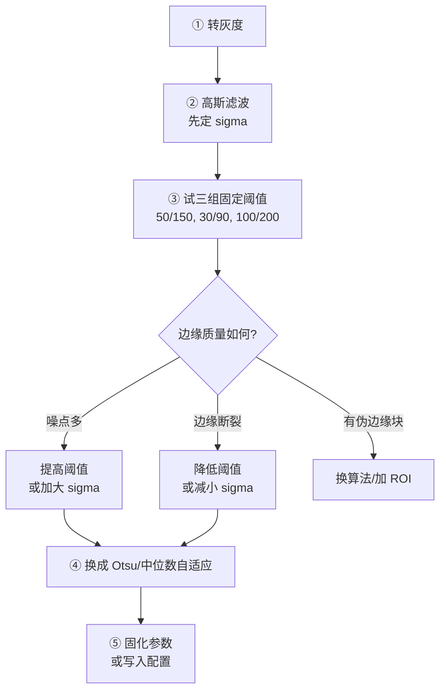
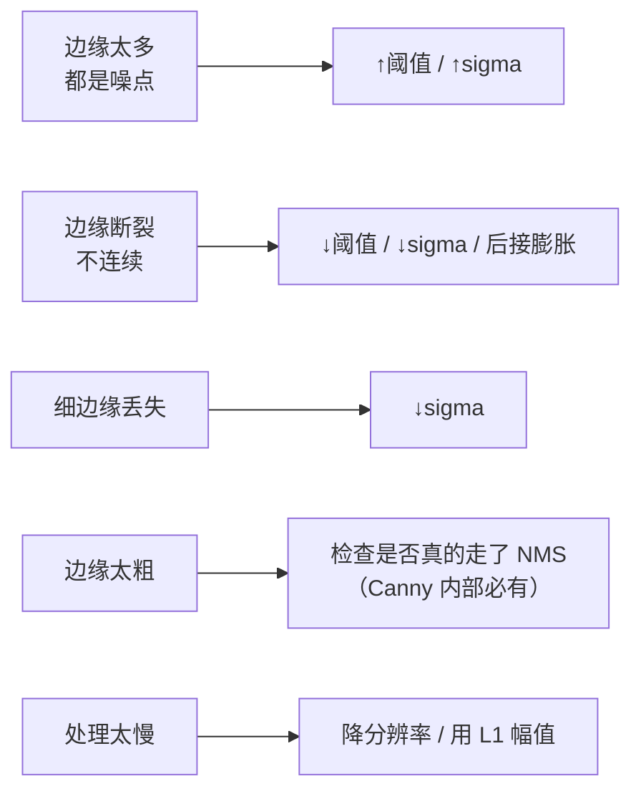

# Canny 调参技巧

> Canny 只有 4 个参数，但怎么定这两个阈值，是新手最头疼的问题。这一页给你可直接用的方法。

## 参数总览



| 参数 | 影响 | 优先级 |
|---|---|---|
| `low` | 弱边缘保留多少 | ⭐⭐⭐ 最重要 |
| `high` | 强边缘判定标准 | ⭐⭐⭐ 最重要 |
| `apertureSize` | 梯度计算精度与抗噪 | ⭐ 一般不用改 |
| `L2gradient` | 幅值精度 vs 速度 | ⭐ 默认就好 |

## 方法一：固定比例法（最常见）

$$
T_{high} = k \times T_{low}, \quad k \in [1.5, 3]
$$

```python
low = 50
high = 150   # high = 3 × low
edges = cv2.Canny(blurred, low, high)
```

**怎么选 k**：

| k | 适用场景 |
|---|---|
| 1.5 | 边缘很淡、要高召回 |
| 2 | 通用 |
| 3 | 噪声大、要低误报 |

::: tip 先这样试
拿到一张图，先试 `50/150`、`30/90`、`100/200` 三组，基本能找到一个可用区间，再微调。
:::

## 方法二：Otsu 自动阈值（推荐）

不写死数值，用 Otsu 自动算一个基准，再按比例分配：

```python
import cv2

# 先高斯去噪
blurred = cv2.GaussianBlur(gray, (5, 5), 1.4)

# 用 Otsu 算一个"全局分界值"
otsu_val, _ = cv2.threshold(blurred, 0, 255, cv2.THRESH_BINARY + cv2.THRESH_OTSU)

# 按经验比例分配
low = int(otsu_val * 0.4)
high = int(otsu_val * 0.8)

edges = cv2.Canny(blurred, low, high)
```

**优点**：光照变化时自动适应，不用换场景就重调参数。

**比例经验**：

| Otsu 系数 | 效果 |
|---|---|
| `low = 0.4×Otsu, high = 0.8×Otsu` | 通用，偏保守 |
| `low = 0.3×Otsu, high = 0.6×Otsu` | 偏召回，边缘更多 |
| `low = 0.5×Otsu, high = 1.0×Otsu` | 偏精确，边缘更少 |

## 方法三：中位数法（最稳）

用整幅图的**梯度幅值中位数**做基准，比 Otsu 更抗异常值：

```python
import numpy as np

# 手动算梯度幅值
gx = cv2.Sobel(blurred, cv2.CV_32F, 1, 0, ksize=3)
gy = cv2.Sobel(blurred, cv2.CV_32F, 0, 1, ksize=3)
mag = np.sqrt(gx**2 + gy**2)

# 用中位数定阈值
median = np.median(mag)
sigma = 0.33
low = int(max(0, (1.0 - sigma) * median))
high = int(min(255, (1.0 + sigma) * median))

edges = cv2.Canny(blurred, low, high)
```

::: tip 这个方法为什么流行
`sigma = 0.33` 是网上流传最广的自适应 Canny 经验值，出自 PyImageSearch 的经典教程。
它的逻辑是：**中位数代表「典型梯度强度」**，阈值围绕它上下浮动 33%，就能自动适应图像整体的对比度水平。
:::

## 参数与效果的关系

### 阈值越高 → 边缘越少



### 高斯 sigma 的影响

| sigma | 效果 | 适用 |
|---|---|---|
| 0.5 | 细节丰富，噪声也多 | 干净图、需要细边缘 |
| 1.0–1.4 | 平衡 | **推荐默认** |
| 2.0+ | 强去噪，细边丢失 | 噪声很大的图 |

::: warning sigma 和阈值要一起调
**sigma 变大等价于「阈值隐形提高」**——因为平滑把梯度幅值压小了。
如果你调大 sigma 后发现边缘变少，**别急着降阈值**，先确认是不是平滑过度了。
:::

## apertureSize 该不该改

| apertureSize | 效果 | 建议 |
|---|---|---|
| 3 | 标准，够用 | **默认，先别动** |
| 5 | 更抗噪，但定位变粗 | 噪声很大时试 |
| 7 | 很抗噪，定位差 | 极少用 |

::: tip 经验
**90% 的场景 apertureSize 用 3 就好。** 抗噪的活应该交给前面的高斯滤波，而不是这里。
:::

## 一个完整的调参流程



## 交互式调参工具（自写）

想让调参更直观，可以写一个带滑动条的小工具：

```python
import cv2

def nothing(x):
    pass

img = cv2.imread('test.jpg', cv2.IMREAD_GRAYSCALE)
cv2.namedWindow('canny')
cv2.createTrackbar('low', 'canny', 50, 255, nothing)
cv2.createTrackbar('high', 'canny', 150, 255, nothing)
cv2.createTrackbar('sigma_x10', 'canny', 14, 50, nothing)

while True:
    low = cv2.getTrackbarPos('low', 'canny')
    high = cv2.getTrackbarPos('high', 'canny')
    sigma = cv2.getTrackbarPos('sigma_x10', 'canny') / 10.0
    if sigma < 0.1:
        sigma = 0.1

    blurred = cv2.GaussianBlur(img, (0, 0), sigma)
    edges = cv2.Canny(blurred, low, high)
    cv2.imshow('canny', edges)
    if cv2.waitKey(1) & 0xFF == 27:
        break

cv2.destroyAllWindows()
```

**用法**：拖动滑动条，实时看边缘变化，找到最佳组合后记下数值。

## 不同场景的参数起点

| 场景 | sigma | low | high | 说明 |
|---|---|---|---|---|
| 文档扫描 | 1.4 | 50 | 150 | 通用起点 |
| 工业质检（高对比） | 1.4 | 80 | 200 | 要低误报 |
| 车道线 | 1.0 | 30 | 90 | 要高召回，靠霍夫筛 |
| 噪声很大的图 | 2.0 | 100 | 200 | 先重去噪 |
| 医学影像（细结构） | 0.8 | 40 | 120 | 保细节 |

## 调参速查表



## 最后一句建议

::: tip 不要迷信"最佳参数"
Canny 的参数是**场景相关**的，没有一组万能值。

真正稳的做法是：
1. **先做图像预处理**（去噪、增强、背景校正）把图像质量提上去
2. 再用**自适应方法**（Otsu / 中位数）定阈值
3. 最后把参数**配置化**，换场景只改配置不改代码
:::
