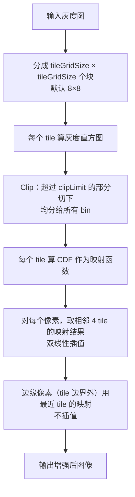

# 算法流程：CLAHE 限制对比度自适应直方图均衡

## 整体流程图

## 步骤详解

### Step 1：tile 初始化
把图像切成 tiles（默认 8×8，即每 tile 约 (H/8)×(W/8)）。图像尺寸不是 tile 倍数时做 reflect padding。

### Step 2：逐 tile 计算直方图
对每个 tile 统计 0–255 灰度的出现次数 h[i]，共 256 个 bin。

### Step 3：Clip
1. 计算 `limit = clipLimit × tileSize × tileSize / 256`
2. 累加所有 bin 中超出 limit 的部分，得 totalExcess
3. 每个 bin 裁剪到 min(h[i], limit)
4. 把 totalExcess 平均分给 256 个 bin（加 incr = totalExcess / 256）
5. 再迭代一轮，把因平均分配后仍可能超限的 bin 再次裁剪、剩余均摊

### Step 4：映射函数
对每个 tile 计算 CDF：`LUT[i] = sum_{k=0}^{i} h_clipped[k]`，归一化到 [0,255] 作为映射表。

### Step 5：双线性插值
对像素 (x,y)，找出它所在 tile 的左上角 (i0,j0)、右下角 (i1,j1)：
- 距离左上角 (x_frac, y_frac) 作为权重
- 四个 tile 的映射结果分别为 v00, v10, v01, v11
- 最终值 = 双线性插值：`(1-yf)[(1-xf)v00 + xf·v10] + yf·[(1-xf)v01 + xf·v11]`

### Step 6：边界处理
图像边缘（不足 4 个 tile 邻居的像素）直接用最近 tile 的映射，不插值。

## 参数对照（论文 vs OpenCV 默认 vs 工程建议）

| 参数 | 论文建议 | OpenCV 默认 | 工程建议 | 调参影响 |
|---|---|---|---|---|
| clipLimit | 2–4（推荐） | 2.0 | 2.0（图像噪声大→3–4，干净→1.5–2） | 越大对比度越强，越容易放大噪声 |
| tileGridSize | (8,8) | (8,8) | (8,8) 通用，(4,4) 局部性更强，(16,16) 更接近全局 HE | tile 越小，局部增强越狠 |

## 复杂度分析

- 直方图统计：O(W·H)
- Clip + CDF：每个 tile O(256)，总 O(tile²·256) = O(W·H)
- 双线性插值：O(W·H)
- 整体 O(W·H)，常数极小，640×480 图 <5ms
