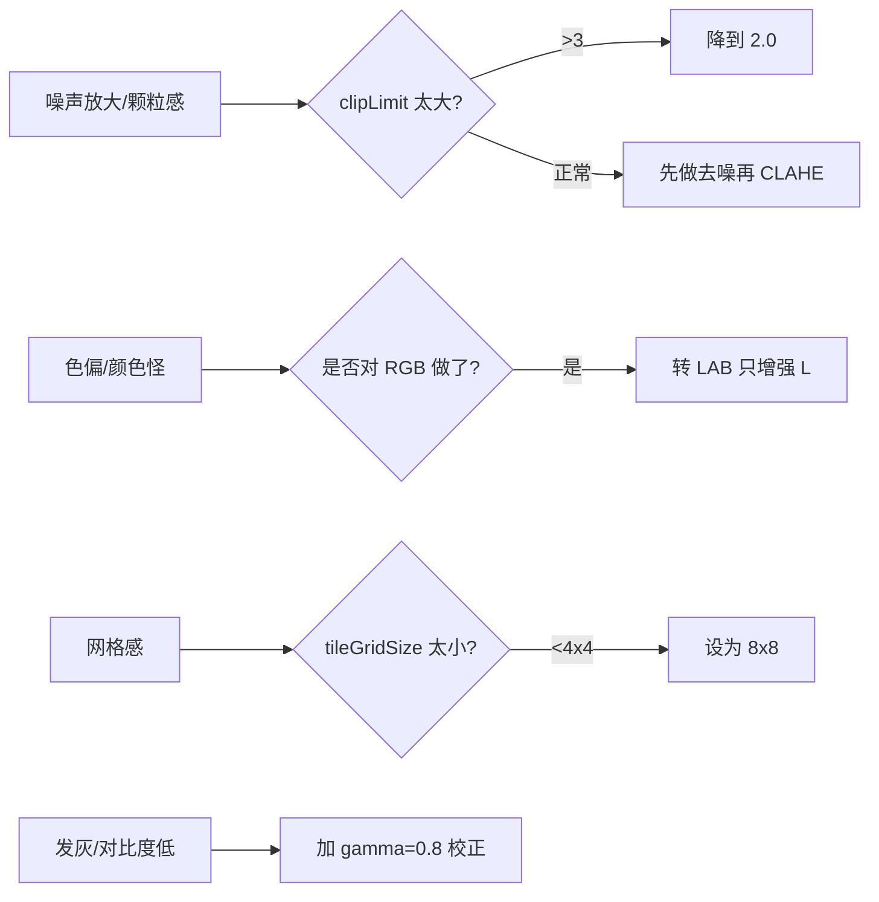

# 实战踩坑：CLAHE 限制对比度自适应直方图均衡

## 最常见的 8 个坑

### 1. 直接对 RGB 三通道做 CLAHE 导致色偏
**修法**：转到 LAB/YCrCb，只对 L/Y 做，再转回。

### 2. clipLimit 太大把噪声放大成颗粒
医学/低照度图默认 2.0 合适；如果图像本身有胶片颗粒/高 ISO 噪声，**先去噪再 CLAHE**（cv2.fastNlMeansDenoising），或 clipLimit 降到 1.5。

### 3. tileGridSize 太小出网格
tileGridSize=(2,2) 这种太小的值会出现明显的格子。**修法**：默认 8×8，至少 4×4。

### 4. 过度增强让图像「发灰」
CLAHE 让暗部亮起来的同时，也会让亮部的纯黑/纯白变灰。**修法**：CLAHE 后再做一次 gamma 校正（gamma=0.8–0.9）恢复对比度。

### 5. 逆光场景人脸局部过曝
逆光只照亮半边脸，CLAHE 可能把暗面拉出来但把亮面压灰。**修法**：配合 MOG2/人脸检测只对 ROI 做 CLAHE，或使用 Retinex。

### 6. 8-bit 假设
OpenCV CLAHE 只支持 8-bit 单通道。16-bit 医学影像要自己实现或用 `cv2.normalize` 先转 8-bit。

### 7. clipLimit=1 就是 AHE，噪声爆炸
不要把 clipLimit 设到 1 以下。

### 8. 彩色增强后饱和度降低
LAB 只增强 L 通道会让饱和度看起来变低。**修法**：CLAHE 后对 a/b 通道做轻微（×1.1–1.2）的饱和度增强。

## 失败案例诊断流程

