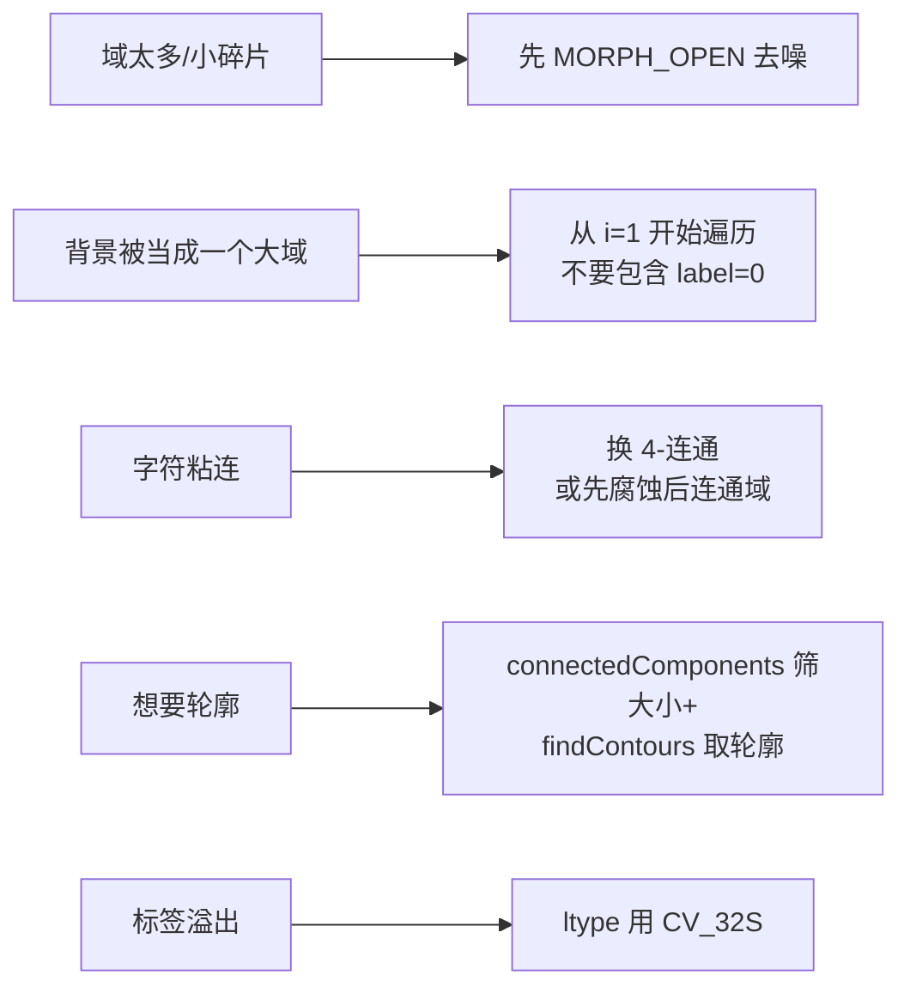

# 实战踩坑：连通域分析（Two-Pass）

## 最常见的 8 个坑

### 1. 二值图没做干净导致「碎片域」爆炸
阈值没调好，前景/背景边缘出现很多 1–2 像素的小碎片，connectedComponents 会返回几千个 label，后续处理极慢。
**修法**：先做 MORPH_OPEN（开运算）去掉小噪点，然后再连通域。

### 2. 忘记 label 0 是背景
直接 `for i in range(n)` 遍历会把背景当一个「大物体」。**修法**：从 i=1 开始遍历。

### 3. 4-连通 / 8-连通 选错
OCR 字符分割时，两个笔画斜对角相邻用 8-连通会连在一起（如"明"的日和月之间有个对角点就连成一个了），导致字被错误合并。**修法**：文字分割常用 4-连通，或加形态学闭运算补断裂。

### 4. 孔洞被算成独立域（错用 8+8）
前景 8-连通 + 没有对背景单独处理时，孔洞会被标成独立的前景标签。**修法**：要识别孔洞，再跑一次反向（背景作为前景）的连通域，或用 findContours + RETR_CCOMP 带层级。

### 5. ltype=CV_8U 溢出
如果图中有超过 255 个连通域，CV_8U 标签会溢出（最多 255）。**修法**：默认用 CV_32S。

### 6. 阈值用 THRESH_BINARY 而对象是黑底白字？
连通域关心的是「非零像素」，黑底白字 THRESH_BINARY 是正确的；白底黑字要 THRESH_BINARY_INV，否则整个白纸当成一个大域。

### 7. connectedComponents 没有轮廓信息
筛完大小之后想画轮廓/做形状分析——**修法**：对每个保留 label 用 `(labels==i).astype(np.uint8)*255` 生成 mask，再 `findContours(mask, RETR_EXTERNAL, CHAIN_APPROX_SIMPLE)`。

### 8. 速度变慢原因：图太大且域太多
4K 图上几千个域时，输出的 stats/centroids 会有几千行，但是算法本身仍是 O(N)。要加速：先 resize 到 1/2、二值化+腐蚀去小斑，再做。

## 失败案例诊断流程

