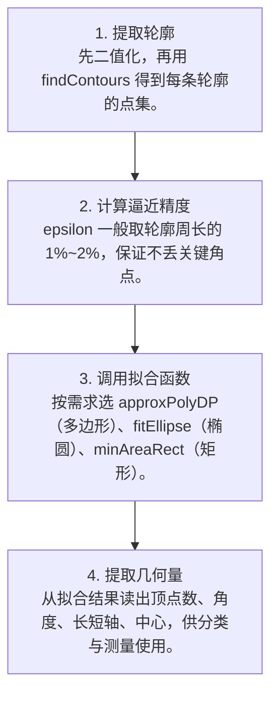

# 第 4 页 · 算法架构

## 完整流程图

## 每一步在做什么

### 步骤 1：提取轮廓

先二值化，再用 findContours 得到每条轮廓的点集。

### 步骤 2：计算逼近精度

epsilon 一般取轮廓周长的 1%~2%，保证不丢关键角点。

### 步骤 3：调用拟合函数

按需求选 approxPolyDP（多边形）、fitEllipse（椭圆）、minAreaRect（矩形）。

### 步骤 4：提取几何量

从拟合结果读出顶点数、角度、长短轴、中心，供分类与测量使用。

## 在整体视觉管线中的位置

## 复杂度分析

时间复杂度：Douglas-Peucker 平均 O(n log n)，最坏 O(n²)；椭圆拟合为 O(n) 的最小二乘。空间复杂度 O(n)。

## 参数总览（论文建议 vs OpenCV 默认 vs 实战推荐）

| 参数 | 含义 | 论文建议 | OpenCV 默认 | 实战推荐 |
|------|------|----------|-------------|----------|
| epsilon | 多边形逼近精度 | 周长 1% | 0.02 | ****0.01~0.02×周长**** |
| closed | 轮廓是否闭合 | True | True | **按形状定** |
| method | 拟合方式 | — | CHAIN_APPROX_SIMPLE | **CHAIN_APPROX_NONE** |
| robust | 椭圆是否鲁棒拟合 | — | False | **噪声大时 True** |

## 边界情况与失败模式

- **epsilon 过大丢角点**：逼近精度太粗，正方形的角被磨圆。
- **对断裂轮廓拟合失败**：fitEllipse 需要至少 5 个点，点太少或不封闭会报错。
- **离群点拉偏椭圆**：普通最小二乘拟合对少量远点极敏感，椭圆被拽歪。
- **把非闭合轮廓当闭合**：closed 参数写错会让首尾被强行连起来。
