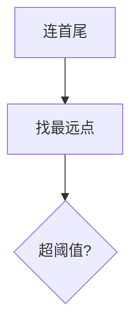
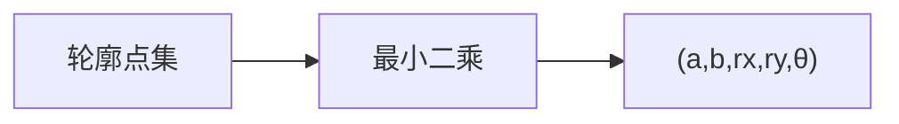

# 第 3 页 · 核心概念

🧪 公式看不懂？去 <a href="/math-lab/">原理实验室</a> 拖动滑块直观体验卷积/梯度/高斯/霍夫/角点/RANSAC/光流等核心概念；看完原理再去本页底部 <a href="./source">源码/真机实验室</a> 亲手调参数。

## 先用生活直觉理解

你沿着一个不规则湖岸走了 500 步，记下每步的位置。要跟别人描述这个湖，你不会报 500 个坐标，而会说「大概是个椭圆，长轴 3 公里」。轮廓拟合就是干这个——用最少的参数概括轮廓的形状。

**典型应用**：工业零件尺寸测量、车牌/纸面矫正、形状分类、手写笔迹简化、地图边界压缩

## 概念逐个拆解

### 概念 1：Douglas-Peucker 逼近

先连首尾成线，找最远的点，距离超过 epsilon 就在那里断开递归。相当于「只要弯曲程度不大就一笔带过」。

### 概念 2：最小外接矩形 vs 外接圆

minAreaRect 给旋转矩形，minEnclosingCircle 给最小圆。前者适合方件，后者适合圆件或粗判位置。

### 概念 3：椭圆拟合（Fitzgibbon 直接最小二乘）

用 5 个参数（中心、长短轴、旋转角）描述一个椭圆，比矩形更能表达「圆但不正」的形状。

### 概念 4：拟合的鲁棒性问题

普通最小二乘对离群点极敏感，少量远点就能把椭圆拽歪；噪声大时要用 RANSAC 版拟合。

## 和其他算法的关系

| 关系 | 算法 | 说明 |
|------|------|------|
| 前置依赖 | 二值化、边缘/轮廓提取（findContours） | 通常先做这些再做本算法 |
| 同类对比 | 霍夫变换、最小外接矩形 | 解决同类问题，各有取舍 |
| 下游常用 | 形状匹配、缺陷判定、尺寸测量 | 本算法结果常交给它们处理 |

::: tip 记忆锚点
记住「epsilon 是逼近精度，等于轮廓周长的百分比——越小越贴着原形」。
:::

<!-- AUTO-EXTENSION-2 -->

## 🧓 大白话：轮廓拟合 = "给一堆散点配一个规则形状"

`findContours` 返回的是像素点连成的折线，经常带锯齿、缺角、抖动。**轮廓拟合**就是把这些点套进一个规则几何形状：

| 拟合目标 | 函数 | 适用 |
| --- | --- | --- |
| **外接矩形**（正）| `boundingRect` | 求 ROI、画框 |
| **最小外接矩形**（可旋转）| `minAreaRect` | 斜着的物体（尺子、车牌）|
| **外接圆** | `minEnclosingCircle` | 硬币、孔、圆形零件 |
| **椭圆拟合** | `fitEllipse` | 椭圆、人脸、细胞 |
| **直线拟合** | `fitLine` | 车道线、边缘 |
| **多边形逼近** | `approxPolyDP` | 任意形状化简（ε 越大越粗糙）|
| **凸包** | `convexHull` | 手势识别、手掌形状 |

## ε 怎么选（approxPolyDP 的灵魂参数）

`epsilon = 精度系数 × arcLength(contour, True)`。
- `0.01`：几乎保留原形状（多边形点多）；
- `0.03~0.05`：通用甜点；
- `0.1`：非常粗糙，四边形可能退化成三角形。
