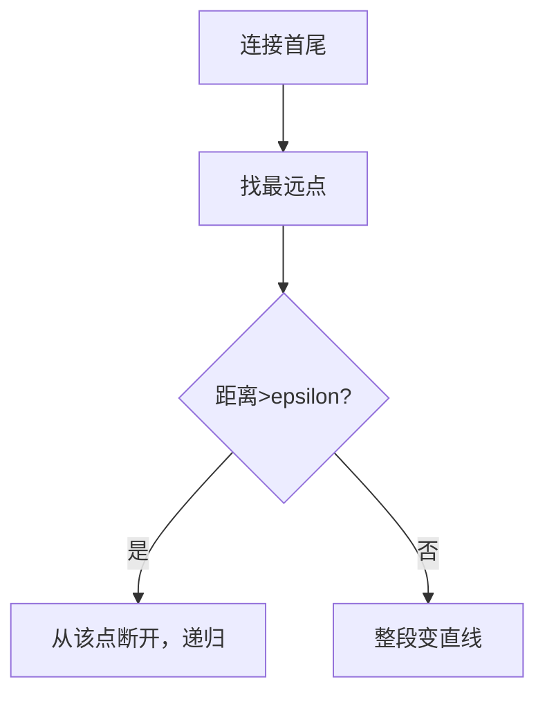

# 第 2 页 · 论文溯源

## 论文名片

| 项目 | 内容 |
|------|------|
| 标题 | **An Algorithm for the Reduction of the Number of Points Required to Represent a Line or its Caricature** |
| 作者 | Urs Ramer / David Douglas / Thomas Peucker；椭圆拟合见 Fitzgibbon 1996 |
| 年份 | 1973 |
| 发表 | Ramer (1972) / Douglas & Peucker (1973), Cartographica |
| 原文 | [https://en.wikipedia.org/wiki/Ramer%E2%80%93Douglas%E2%80%93Peucker_algorithm](https://en.wikipedia.org/wiki/Ramer%E2%80%93Douglas%E2%80%93Peucker_algorithm) |
| 一句话贡献 | 提出递归删点算法，用最少的点近似折线，误差可控。 |

## 1. 当时的问题

地图制图与计算机图形中，曲线由海量点表示，存储和计算都昂贵；需要一种「保留形状、删掉冗余点」的算法。

## 2. 核心思想

对一条折线，连接首尾成直线，找离这条直线最远的点。若该距离小于阈值 epsilon，则整段用这条直线代替；否则在该点处断开，递归处理两段。

## 3. 关键贡献

- 提出带误差上界的折线简化算法（DP 算法）
- 保证简化结果与原曲线的最大偏差不超过 epsilon
- 成为计算几何与制图的经典算法

## 4. 核心公式（看懂思路即可）

设某段首尾为 P1、Pn。求点 Pk 到直线 P1Pn 的距离 d_max。若 d_max ≤ ε，则该段用 P1Pn 近似；否则在 Pk 处分割递归。

## 5. 实验结果

在海岸线等复杂曲线上，epsilon 取 1% 周长即可把点数压掉 90% 以上，形状偏差肉眼几乎不可辨。

## 6. 局限与争议

只保证单段误差上界，整体不能保证最优点数（贪心）；对闭合轮廓需特殊处理首尾衔接。

## 7. 历史影响

成为 GIS、CAD、字体渲染里的标准曲线简化算法；OpenCV 的 approxPolyDP 直接实现它，是形状分析第一站。

## 8. 一句话总结

> 一个递归「扔点」的小算法，成了所有轮廓简化的默认起点。
