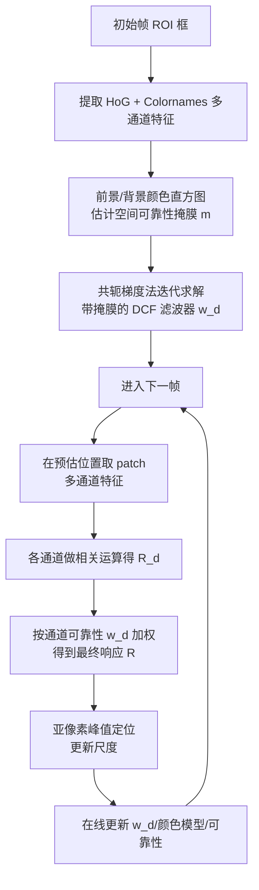

# 算法流程：CSRT 通道与空间可靠性跟踪

## 整体流程图

## 步骤详解

### Step 1：初始化
- 第一帧用户框选 ROI
- 提取颜色前景/背景直方图（在 ROI 内/外采样）
- 提取 HoG + Colornames 特征
- 构造初始空间掩膜 m（初始时是 Epanechnikov 椭圆，然后用颜色概率调整）
- CG 法求解初始滤波器 w_d

### Step 2：跟踪（每帧）
1. **位置预测**：从上一帧位置为中心取略大的 patch
2. **特征提取**：HoG + Colornames（可加灰度）
3. **通道响应**：每个通道 d，用当前 w_d 做相关（频域相乘）得到 R_d
4. **通道可靠性估计**：算每个 R_d 的 PSR 和稳定性，得到 w_d
5. **加权求和**：R = Σ w_d R_d，找亚像素峰值位置
6. **尺度估计**（可选）：类似 DSST 的多尺度搜索
7. **模型更新**：以学习率 η 在线更新滤波器、颜色直方图、通道可靠性

### Step 3：空间掩膜更新
- 每 N 帧（默认 4）重新估计颜色直方图
- 结合当前新位置的像素更新前景/背景模型
- 重新计算 m 并 CG 迭代求解 w

### Step 4：失败检测（可选）
- 如果最终响应 R 的 PSR 低于阈值（比如 5–8），判定为"跟踪丢失"
- 可触发重检测模块

## 参数对照（论文 vs OpenCV 默认 vs 工程建议）

| 参数 | 论文建议 | OpenCV 默认 | 工程建议 | 调参影响 |
|---|---|---|---|---|
| padding | 3.0 | 3.0 | 2–4 | 搜索区域大小相对目标的倍数，大了易漂移、小了跟不住快目标 |
| template_size | 32 | 32 | 32–64 | 模板大小（像素），越大特征越细 |
| gsl_sigma | 1.0 | 1.0 | 1.0 | 空间可靠性高斯带宽 |
| hog_orientations | 9 | 9 | 9 | HoG 方向 bin 数 |
| num_hog_channels_used | 18 | 18 | 18（取前 18 通道）| HoG 使用通道数 |
| histogram_bins | 16 | 16 | 16 | 颜色直方图 bin 数 |
| filter_lr | 0.02 | 0.02 | 0.01（稳）~0.05（快适应）| 滤波器学习率 |
| admm_iterations | 4 | 4 | 4–6 | CG/ADMM 迭代次数，越多越准越慢 |

## 复杂度分析

- 检测：C 通道 FFT + 频域相乘，O(C · K · log K)（K 是模板像素数）
- 更新：CG 迭代 ~4 次，每次 O(C · K · log K)
- 实测 CPU：640×480 上 ~25–50 FPS，略慢于 KCF（150 FPS）但明显快于深度学习跟踪器
