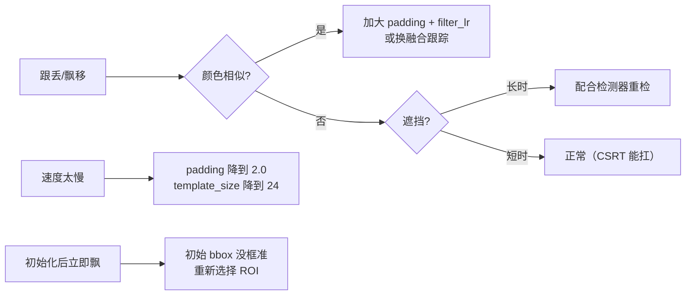

# 实战踩坑：CSRT 通道与空间可靠性跟踪

## 最常见的 8 个坑

### 1. 没有安装 opencv-contrib-python
`cv2.TrackerCSRT_create` 只在 contrib 里。**修法**：`pip install opencv-contrib-python`。

### 2. 速度比预期慢（<20 FPS）
原因可能是 padding 过大（默认 3.0 取了 9 倍面积）或 template_size 过大。**修法**：padding=2.0，template_size=24，速度能翻倍但精度略降。

### 3. 目标与背景颜色相似时跟踪飘
空间掩膜依赖颜色直方图区分前/背景，颜色相近时掩膜失效，退化成接近 KCF 的矩形模板。**修法**：调大 filter_lr 快速适应，或改用 DeepSORT/Transformer 跟踪器。

### 4. 长时完全遮挡后跟丢
CSRT 本身没有重检测模块，遮挡超过十几帧滤波器会被污染。**修法**：结合检测器（如 YOLO）做 tracking-by-detection，响应 PSR 低于阈值触发重检。

### 5. 第一帧 bbox 框得太大/太小
CSRT 依赖初始框内/外像素建立颜色直方图，框得不准颜色模型就错。**修法**：bbox 尽量紧贴目标，留 5–10 像素余量即可（padding 参数会扩展）。

### 6. 快速运动目标跟丢
padding=3.0 默认能覆盖单帧 ±1 倍目标尺寸的运动；更快运动需 padding=4–5，但背景干扰增大。**修法**：加大 padding 或用 Kalman 滤波做运动预测。

### 7. 多目标跟踪直接套 CSRT 会慢
CSRT 是单目标跟踪器。**修法**：多目标用 `cv2.MultiTracker_create()` 管理多个 CSRT 实例，但注意 N 个实例速度 ×1/N。

### 8. 尺度变化大时没开尺度估计
默认 scale 估计是开的，但如果显式关了（use_scale=false），大小变化大就会跟丢。

## 失败案例诊断流程

