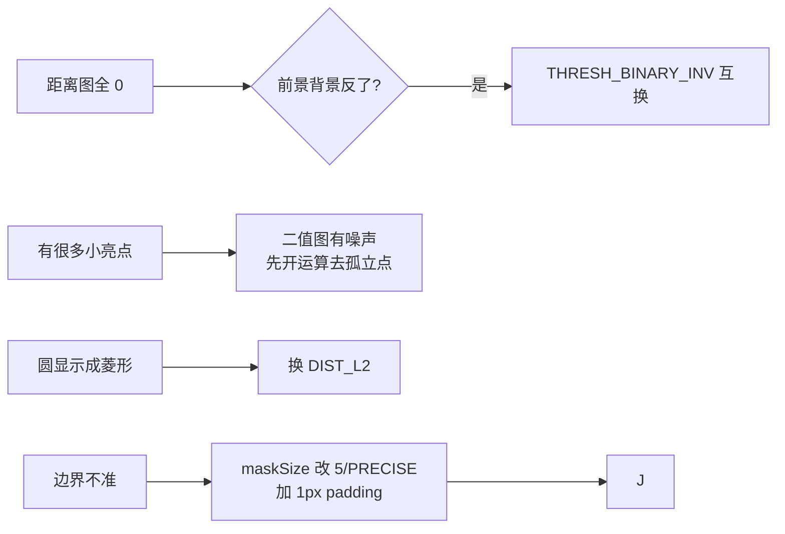

# 实战踩坑：距离变换

## 最常见的 8 个坑

### 1. 前景背景搞反
距离变换默认算的是「非零像素到零像素的距离」。很多人 THRESH_BINARY_INV 之后忘了图已经反了，距离图全是 0。
**修法**：打印 D.max()，如果是 0 就知道前景背景反了。

### 2. 二值图没做干净（有噪点）
一个孤立白噪点在黑色背景上会产生一个距离 =1 的小峰，后续分水岭/骨架提取会多出一条小刺。**修法**：做距离变换前先开运算（morphologyEx MORPH_OPEN）去掉孤立点。

### 3. 用 DIST_L1 然后以为是欧氏距离
DIST_L1 算的是曼哈顿距离，圆会显示成菱形；DIST_L2 才是真实圆形。**修法**：需要圆形距离图（比如找最大内切圆）必须用 DIST_L2。

### 4. distanceTransform 返回的是 float32，忘记归一化直接 imshow
直接 imshow 会溢出/全白。**修法**：用 `cv2.normalize(dist, None, 0, 255, cv2.NORM_MINMAX, cv2.CV_8U)`。

### 5. maskSize=3 在大物体中心距离偏大/偏小
3×3 chamfer 误差 5%。找圆形种子（分水岭）建议 maskSize=5 或 DIST_LABEL_CCOMP。

### 6. 没注意边界像素
边界的前景点只有部分邻居参与递推，结果可能偏小。**修法**：输入前加 BORDER_CONSTANT 做 1 像素 0 padding。

### 7. 骨架化后没有剪枝
直接从距离图取局部极大当骨架，会有很多小毛刺。**修法**：骨架后做形态学细化剪枝，或使用 Hilditch/Zhang-Suen 细化算法。

### 8. 距离变换当「宽度测量」忘了校准
DIST_L2 的输出单位是像素，但如果是倾斜拍摄，像素宽度不等于物理宽度。**修法**：要物理测量先做透视矫正/相机标定。

## 失败案例诊断流程

