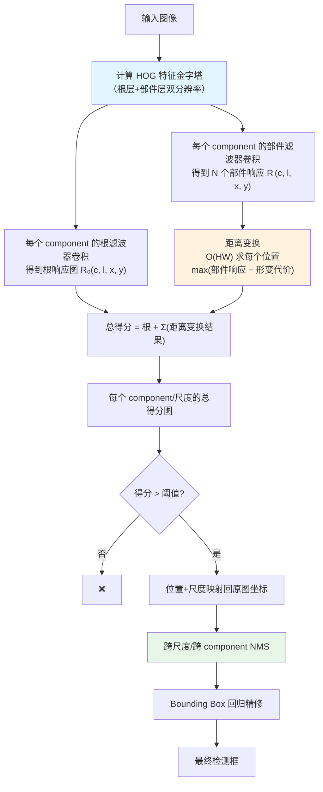
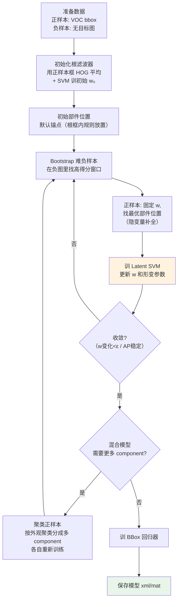

# DPM 算法流程

DPM 同样分为**检测阶段**（推理）和**训练阶段**（Latent SVM）。检测阶段流程固定；训练阶段是 DPM 真正的难点。

## A. 检测流程（推理）

---

### A.1 计算 HOG 金字塔

对图像按固定倍率（每层 × 1/1.05 ≈ 0.95）不断缩小，每层计算 HOG 特征。部件层是根层分辨率的两倍（即部件层比根层高一个 octave）。

### A.2 卷积根滤波器

对每个 pyramid level l、每个 component c，用根权重 w₀(c) 做**滑动窗口点积**（其实是相关）：

$$
R_0(c, l, x, y) = w_0(c) \cdot \phi(H_l, x, y) + b_0(c)
$$

其中 b₀(c) 是根偏置。

由于根滤波器在 HOG cell 网格上滑动，这其实就是**模板匹配**——HOG 特征向量和权重向量点积。

### A.3 卷积部件滤波器（对每个部件）

对每个 component c、每个部件 i，在部件层（比根层细一倍）做滑动点积：

$$
R_i(c, l', x, y) = w_i(c) \cdot \phi(H_{l'}, x, y) + b_i(c)
$$

l' 是部件所在的金字塔层（是根层 l 向上一级，分辨率 2×）。

### A.4 距离变换：求每个位置的最优部件放置

对每个部件 i，**先偏移到锚点位置**，再做距离变换：

1. 把部件响应图 R_i 按锚点 (dxᵢ, dyᵢ) 平移（使得锚点位置对齐到对应根位置）
2. 应用距离变换：

$$
D_i(c, l', x, y) = \max_{dx, dy}\big[R_i(c, l', x+dx, y+dy) - \alpha_i dx^2 - \beta_i dx - \gamma_i dy^2 - \delta_i dy\big]
$$

D_i(x,y) 的含义：**"如果根放在 (x,y)，部件 i 能给出的最好净贡献（含形变代价）"**。

### A.5 总得分

因为部件层分辨率是根层的 2 倍，先把 D_i 下采样到根层分辨率，然后相加：

$$
\text{score}(c, l, x, y) = R_0(c, l, x, y) + \sum_{i=1}^{n} D_i(c, l, x, y)
$$

这就是每个 component、每个尺度、每个位置的最终得分。

### A.6 阈值 + NMS + BBox Regression

- 找出 score > threshold 的所有候选
- 跨尺度、跨 component 做 NMS（重叠 >0.3 取最高分）
- 对保留的框做**线性 BBox 回归**（后期版本），精修位置

---

## B. 训练流程（Latent SVM + Bootstrap）

训练比检测复杂得多，是 DPM 真正的门槛。

---

### B.1 数据准备
- **正样本**：PASCAL VOC 等数据集给的 bbox（没有部件位置）
- **负样本**：不含目标类别的图像（通常用 VOC 的其他类别图 + 无目标背景图）

### B.2 初始化根滤波器
- 把所有正样本 bbox warp 到同一大小（比如 64×128 for 行人）
- 计算每个样本的 HOG，取平均作为根初始模板，然后用标准线性 SVM 训初始 w₀

### B.3 初始部件放置
常用启发式：根框上方放头部（40%~60% 位置），四角放四肢，中间放躯干——大约 6~8 个部件。

### B.4 难负样本挖掘（Bootstrap / Hard Negative Mining, Data Mining）
1. 用当前模型在负样本图像金字塔上**滑窗检测**
2. 任何得分 > 阈值（可能很低，比如 -1）的窗口都当成"难负样本"加入训练集
3. 重训 SVM
4. 重复几轮直到难负样本数量收敛

这是**所有传统检测器（HOG/DPM）和早期 CNN 检测器（R-CNN/Fast R-CNN）的标准流程**。

### B.5 隐变量重标注（Relabel Positives）
对每个正样本：
1. 固定当前模型 w
2. 在 bbox 周围一定范围内**搜索最优的根位置 + 部件位置**（仍然用距离变换加速）
3. 用找到的最优配置作为该正样本的"潜在正确标注"

注意：这里**允许根位置轻微偏离标注框**——这是 latent SVM 自动对齐标注误差的重要机制。

### B.6 Latent SVM 优化
w 更新的目标是带隐变量的 hinge loss：

$$
\min_{w} \frac{1}{2}\|w\|^2 + C\sum_{i} L(w, x_i, y_i)
$$

- 正样本损失：max_z [1 − w·Φ(x_i, z)]₊（找最容易过的部件配置，最小化损失）
- 负样本损失：max_z [1 + w·Φ(x_i, z)]₊（找最像正样本的部件配置，最大化损失）

这是一个**非凸但部分凸**的问题，用坐标下降 +  cutting plane 方法优化（参考 voc-release5 的 `learn.cc`）。

### B.7 混合模型（Mixture Components）训练
DPM 不是手动给每个 component 单独标视角，而是**自动聚类**：
1. 训完一个单 component 模型
2. 对所有正样本，看它们在根模板上的**最佳放置位置 / 响应模式**
3. 按这些特征用 k-means 或启发式规则**把正样本分成若干簇**（比如面向左的放一起、面向右的放一起）
4. 对每簇重新初始化根+部件，训一个独立 component
5. 所有 component 合起来就是混合模型

### B.8 BBox 回归训练
在最后阶段，用**已检测到的候选框**和**真值框**之间的差值训一个线性回归，预测 (Δx, Δy, Δw, Δh)：

$$
\hat{b} = b + \sum_i w_i^{\text{bbox}} \cdot \phi_i
$$

输入特征通常是根+部件的 HOG 特征拼接。

---

## 速度分析（单张 640×480 图，CPU）

| 阶段 | 占时 | 说明 |
|---|---|---|
| HOG 金字塔计算 | ~15% | 固定成本，每层 HOG |
| 根+部件卷积 | ~25% | 主要是 FFT 加速的卷积（或直接点积） |
| 距离变换 | ~5% | O(HW)，非常快 |
| 跨尺度/跨 component 扫描 | ~30% | 金字塔层数×component 数 |
| NMS + 后处理 | ~5% | 快 |
| 其他开销 | ~20% | 内存/IO |

**合计**：voc-release5 在 2010 年的 CPU 上是 **3~10 秒/帧**；OpenCV 版本快一些但仍然达不到实时。

---

## 典型超参数（voc-release5 默认）

| 参数 | 默认值 | 含义 |
|---|---|---|
| 部件数 n | 8 | 通常 6~8 |
| 部件大小 | 6×6 cell | HOG cell 单位 |
| 根大小 | 8×16 cell（行人） | 取决于类别 |
| 部件搜索范围 | ±2~3 cell | 距离变换中 dx, dy 允许范围 |
| 金字塔间隔 | 8 层/octave（每层 ≈ 1.058×） | 比 HOG+SVM 的 1.2× 密 |
| 负样本挖掘轮数 | 3~5 | 每次数据挖掘加一批难负样本 |
| component 数 | 1~6 | 类别相关（行人通常 3，车辆 6） |
| SVM 正则 C | 0.001~0.01 | 通过验证集调 |
