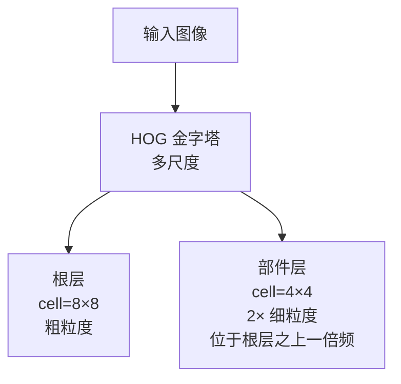
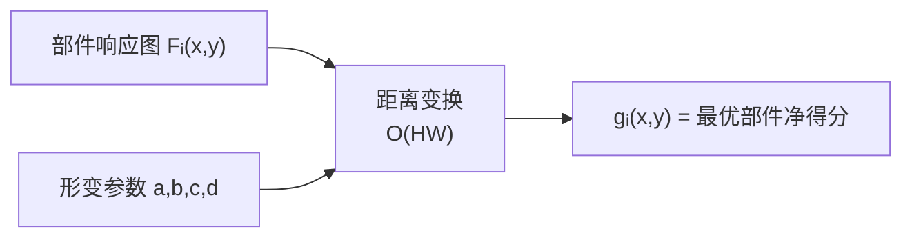
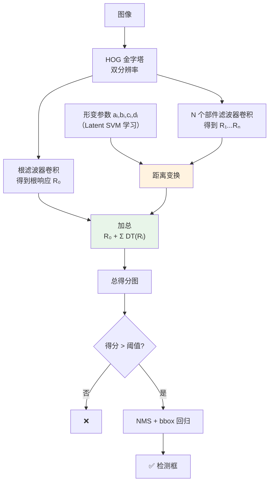

## 🧪 原理互动演示

<AlgoVisualizer type="dpm" />

# DPM 核心概念

理解 DPM 需要搞懂六样东西：**HOG 特征金字塔**、**根滤波器**、**部件滤波器**、**形变代价**、**距离变换**、**隐变量 SVM**。

<div class="tip custom-block"><p>🧪 公式看不懂？去 <a href="/math-lab/">原理实验室</a> 拖动滑块直观体验卷积/梯度/高斯/霍夫/角点/RANSAC/光流等核心概念；看完原理再去本页底部 <a href="./source">源码/真机实验室</a> 亲手调参数。</p></div>


## ① HOG 特征金字塔（双分辨率）

### 单层 HOG 特征回顾
HOG 把图像分成 8×8 的 cell，每 cell 算 9 方向梯度直方图，每 2×2 cell 组成一个 block 归一化，最终每 cell 产生 31 或 32 维特征（含对比敏感/不敏感方向+纹理能量）。

### DPM 的金字塔有两层分辨率
- **根层（Root level）**：标准 HOG，每 cell 8×8 像素
- **部件层（Part level）**：**分辨率是根的 2 倍**（即每 cell 4×4 像素），特征更细，用来精确放部件

这样做的原因：整体轮廓可以粗看（低分辨率足够），但部件位置需要精确对齐（高分辨率敏感）。



## ② 根滤波器（Root Filter）

根滤波器就是一个**矩形 HOG 模板**，和 HOG+SVM 的 w 向量本质相同：
- 比如行人检测根滤波器尺寸为 8×16 cell（≈ 64×128 像素）
- 根权重 w₀ 和特征向量点积 → 根得分：F₀·φ(H, x₀)

根滤波器是**粗定位**的主力——它先告诉"这个位置大概有个目标"，再交给部件去精修。

## ③ 部件滤波器（Part Filters）

每个部件是一个**更小的 HOG 模板**，比如 6×6 cell：
- 行人模型通常 8 个部件：头、左肩、右肩、左髋、右髋、左脚、右脚、中胸
- 每个部件有一个**锚点位置 (dxᵢ, dyᵢ)**，表示它在根框里的"理想位置"
- **部件不一定要放在锚点上**，可以在锚点附近一定范围内滑动（典型搜索范围 ±2~3 cell）

### 关键直觉
部件可以"微调位置"——比如人抬手时，左手部件向上移动 2 cell，其他部件还在原位置，模型仍然能命中。

```
根框（粗略）     部件（精细，允许偏移）
┌────────┐       ┌────────┐
│        │       │  [头]  │
│        │       │[左肩][右肩]
│        │       │[左手][右手]← 允许偏移
│        │       │  [身]  │
│        │       │[左脚][右脚]
└────────┘       └────────┘
```

## ④ 形变代价（Deformation Cost）

部件偏移不能没代价（否则部件可以乱跑，随便凑分）。DPM 用**二次形变代价**：

$$
d_i(\Delta x, \Delta y) = \alpha_i \cdot \Delta x^2 + \beta_i \cdot \Delta x + \gamma_i \cdot \Delta y^2 + \delta_i \cdot \Delta y
$$

其中 (Δx, Δy) = 部件实际位置 − 锚点位置。

### 为什么是二次函数

1. **凸函数**：保证最优点唯一，可以用距离变换快速求
2. **物理直觉**：像弹簧——偏离越远，弹力越大，"拉回来"的代价越高
3. **β 和 δ 允许不对称**：比如头可能更倾向于偏上而非偏下（线性项的存在打破对称性）

### 参数如何确定
α, β, γ, δ **不是手工设的，是 Latent SVM 训出来的**——训练过程自动学会每个部件的"允许偏移范围"。比如头的 α,γ 比较大（头不能跑太远），而手的 α,γ 比较小（手可以摆动）。

## ⑤ 距离变换（Distance Transform）——加速核心

### 问题
对于每个根位置 x₀ 和第 i 个部件，要在 (Δx, Δy) 的搜索范围内找：

$$
\max_{dx, dy}\big[ F_i \cdot \phi(H, (x,y)+(dx,dy)) - (\alpha\,dx^2 + \beta\,dx + \gamma\,dy^2 + \delta\,dy) \big]
$$

如果搜索范围是 K×K，直接做 O(HW·K²) 太慢。

### 距离变换做什么

给定一个输入图 f 和一个二次惩罚项，输出图 g：

$$
g(x,y) = \max_{dx,dy}\big[ f(x+dx, y+dy) - (a\,dx^2 + b\,dx + c\,dy^2 + d\,dy) \big]
$$

**距离变换能在 O(HW) 时间算完所有点的最优值**，和搜索半径 K 无关。

### 算法直觉（1 维情况）

一维时：

$$
g(x) = \max_z [f(z) - a(x-z)^2]
$$

这是**每个 x 找最近的"高峰"z，按距离平方打折**——经典的抛物线包络问题，可以用**单调队列**在 O(n) 内求解（Felzenszwalb 2004 年的距离变换经典算法）。推广到二维因为形变是可分的（x 和 y 独立），可以先对每列再对每行做两次一维变换。



### 这是 DPM 能用的关键
无距离变换：DPM 速度和穷举所有部件位置差不多，单图几十秒到几分钟。
有距离变换：单图**几秒钟**，虽然还是慢，但进入了"能跑完实验"的范畴。

## ⑥ 隐变量 SVM（Latent SVM）

### 问题
训练数据只有目标的 bounding box，没有部件位置。部件位置 zᵢ = (xᵢ, yᵢ) 是**隐变量**。

### 解法：MI-SVM 风格的迭代优化
类似多实例学习（Multiple Instance Learning）：
- **正样本**：在正样本框内，**自动找**让模型得分最高的部件配置作为"真值"（这是隐变量补全）
- **负样本**：在负样本图里，找**得分最高的错误窗口**加入难负样本集
- 然后用这些"补全后"的样本重新训线性 SVM

### 数学形式
训练目标：

$$
\min_{w} \frac{1}{2}\|w\|^2 + C\sum_{i} \max\big(0, 1 - y_i f_w(x_i)\big)
$$

其中 f_w(x) = max_z w·Φ(x, z)（对正样本，z 可以任意选；对负样本，z 也选最像的——这就是 MI-SVM 的"argmax violation"）。

优化用**坐标下降 + 割平面法**（难负样本挖掘 / data mining hard negatives）：
1. 固定 w，找每个样本的"最违反"隐变量 z*
2. 固定 z*，用标准 SVM 目标训 w
3. 重复直到收敛

## ⑦ 混合模型（Mixture Components）

单个 DPM 模型只能覆盖一个姿态/视角。DPM 把多个 component（每个 component 是一个独立的 root+parts 模型）放在一起：

$$
\text{score}(x) = \max_{c \in \text{components}} \text{score}_c(x)
$$

典型配置：
- 行人：正面 + 侧面 + 背面 = 3 component
- 车辆：正面 / 侧面 / 斜前 / 斜后 / 背面 = 5~6 component
- 动物：更多姿态，component 数更多

每个 component 单独训，检测时取最高分。

## ⑧ 包围框回归（Bounding Box Regression）

DPM 后期版本加了一个简单线性回归：在检测出的根框基础上，根据根+部件的得分模式，回归一个更精确的 (Δx, Δy, Δw, Δh)。这是 **Fast/Faster R-CNN 中 bbox regression 的前身**。

## 概念关系图



## 相关算子

| 算子 | 作用 |
|---|---|
| HOG（方向梯度直方图） | DPM 的底层特征（DPM 的 F 就是 HOG 模板） |
| 图像金字塔 | 多尺度检测 |
| SVM 训练 | Latent SVM 是 SVM 的隐变量扩展 |
| 非极大值抑制 | 多个重叠检测框合并 |
