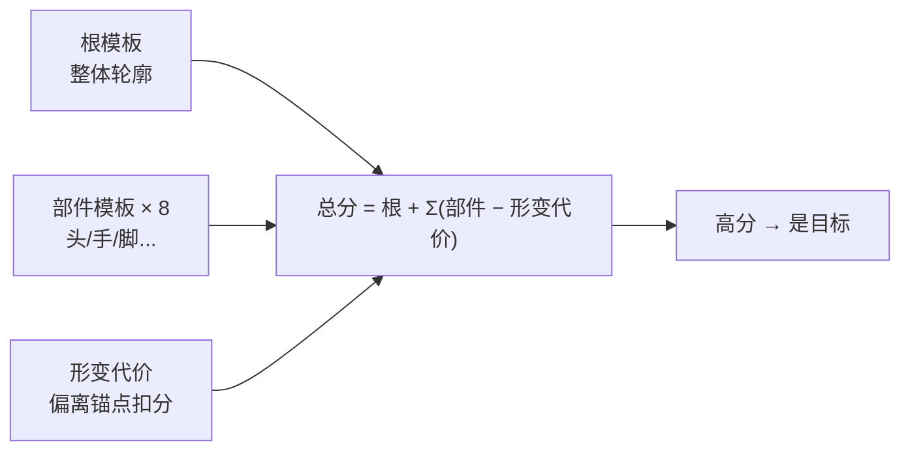
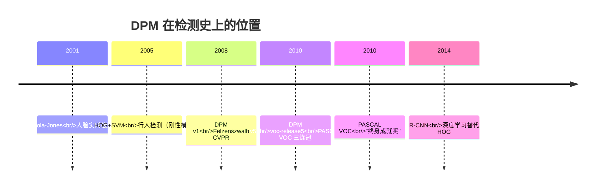

# DPM 可变形部件模型

## 🧪 原理互动演示

<AlgoVisualizer type="dpm" />


## 🚀 动手体验

> 🧪 **先懂原理**：翻到下一节「核心概念」，页面里直接嵌入了可拖动滑块的原理动画（SIFT高斯金字塔、FLANN KD树、GrabCut迭代、KCF响应峰、ICP配准等），拖一拖就懂。

> 🎮 **再跑真机**：跳到第5页「源码实现」，底部有真机实验室（OpenCV.js 浏览器本地运行），选图调参即可看到真实效果与三语代码。

---

<AlgorithmCard
  name="DPM"
  enName="Deformable Part-based Model"
  chapter="第12章 · 景物识别"  chapterLink="/chapters/ch12-recognition"
  branch="detection"
  year="2008"
  author="Pedro Felzenszwalb / Ross Girshick / David McAllester / Deva Ramanan"
  paper="https://ieeexplore.ieee.org/document/4483614"
  level="high"
  tagline="传统目标检测的巅峰——整体+部件+形变代价，容忍姿态变化"
  analogy="认人不是看整张脸模板死卡，而是看「脸在头的位置、眼睛在脸上、鼻子在中间」，部件可以晃但不能跑太远——偏了要扣分"
  scene="多视角行人检测、车辆检测、动物姿态不固定的物体识别，在深度学习之前是 PASCAL VOC 的冠军"
  :pros="['能处理非刚性形变（传统检测器唯一真正做到的）','混合模型支持多视角','HOG+隐SVM框架理论漂亮','拿过 PASCAL VOC 终身成就奖','部件思想影响后续深度学习（anchor/DCN）']"
  :cons="['慢：单图数秒到几十秒，做不了实时','训练复杂（隐变量SVM迭代）','参数极多，调参地狱','OpenCV 支持有限','2014后被深度学习全面超越']"
/>

## 一句话理解

**HOG+SVM 是一个硬模板（要求整个窗口匹配），DPM 是「软模板」**——

1. **根滤波器（Root）**：看整体轮廓（类似 HOG 模板）
2. **N 个部件滤波器（Parts，一般 8 个）**：分头、左手、右手、左脚、右脚……各自独立找自己最像的位置
3. **形变代价（Deformation Cost）**：部件偏离"理想锚点位置"要扣分，越远扣越多

总分 = 根得分 + Σ(部件得分 − 形变代价)。高分意味着「整体像、部件都在合理位置上」。



## 生活类比：拼图不卡死位置

普通 HOG 模板像"透明胶片对齐"——差一像素就对不上。

DPM 像"带磁吸的拼图"：
- 每个零件（部件）都有一个"理想位置"
- 零件有点歪没关系（磁吸范围内能吸过去）
- 但歪太多就扣"形跑分"
- 最终拼起来"整体合理"就算匹配成功

所以一个人走路（手在摆、腿在迈）也能被检测到——只要头在身体上、手在身体两侧、腿在下方大致合理位置。

## 算法时间线



## 你会在这里看到什么

| 页面 | 内容 |
|---|---|
| [论文精读](/algorithms/dpm/paper) | Felzenszwalb 等人 2008/2010 两篇经典论文 |
| [核心概念](/algorithms/dpm/concepts) | 根滤波器、部件滤波器、形变代价、距离变换、隐变量 SVM、混合模型 |
| [算法流程](/algorithms/dpm/architecture) | HOG 金字塔 → 根/部件响应 → 距离变换 → 得分图 → Latent SVM 训练 |
| [源码走读](/algorithms/dpm/source) | voc-release5 / OpenCV DPMDetector 调用，HOG 金字塔简化实现 |
| [实战踩坑](/algorithms/dpm/painpoints) | 速度慢、部件数怎么选、上下文重扫、NMS 问题 |
| [调参技巧](/algorithms/dpm/tricks) | 部件数量/分辨率、Hard Negative Mining、与深度学习选型 |

## 快速上手（OpenCV 版）

```python
import cv2
# ⚠️ DPM 在 opencv-contrib 里
detector = cv2.dpm.DPMDetector_create(
    "inriaperson.xml",  # 预训练模型
    "inriaperson.xml"   # 类别名
)
rects, scores, class_ids = detector.detect(img)
for (x, y, w, h), s in zip(rects, scores):
    cv2.rectangle(img, (x,y), (x+w,y+h), (0,255,0), 2)
```

::: warning DPM 的现状
DPM 是**传统 CV 检测的巅峰**，也是**深度学习时代的分水岭**。现在几乎没有人在生产中直接用 DPM，但它的三个思想（部件模型、Anchor、难负样本挖掘）被 R-CNN/SSD/YOLO 全面继承。**学习 DPM，就是理解现代检测器的前世**。
:::

## 适用/不适用场景

| ✅ 适用 | ❌ 不适用 |
|---|---|
| 研究/教学：理解从刚性 HOG 到可形变模型 | 实时检测（数秒/帧，太慢） |
| 多视角/姿态变化的传统检测基线 | 工业实时落地（用 YOLO） |
| 行人、车辆、动物等可形变物体 | 嵌入式设备 |
| 需要可解释性（部件响应可视化） | 大规模多类别通用检测 |
