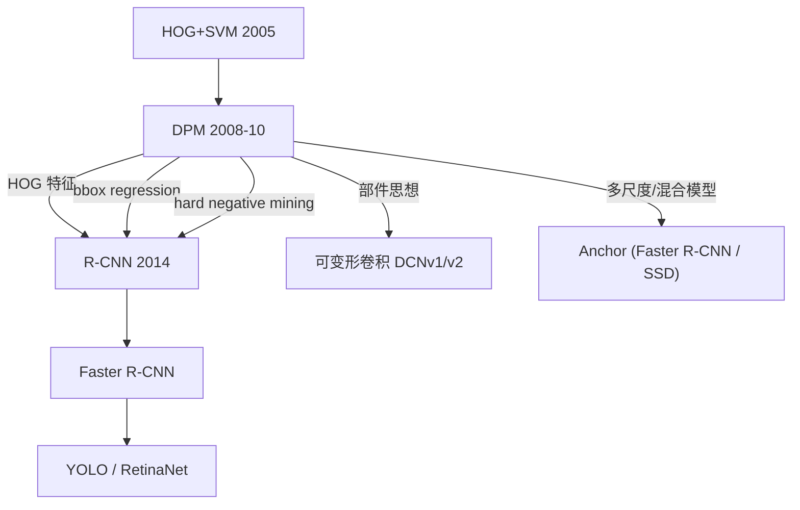

# DPM 论文精读：Discriminatively Trained Deformable Part Models (CVPR 2008 / IJCV 2010)

## 论文信息

| 字段 | 内容 |
|---|---|
| 标题 | Object Detection with Discriminatively Trained Part-Based Models（IJCV 2010 扩展版）|
| 会议首发 | CVPR 2008: *A Discriminatively Trained, Multiscale, Deformable Part Model* |
| 作者 | Pedro F. Felzenszwalb, Ross B. Girshick, David McAllester, Deva Ramanan |
| 机构 | U. Chicago / TTIC / Brown / UC Irvine |
| 引用量 | ~17000+ |
| DOI | 10.1109/TPAMI.2009.167（IJCV） |
| 代码 | voc-release5（作者官方 Matlab/C++）；OpenCV `cv2.dpm.DPMDetector` |

## 写作背景：HOG+SVM 的天花板

Dalal & Triggs 2005 的 HOG+SVM 在行人检测上一战成名，但它有个致命弱点：**模板是刚性的**——一个人走路时手摆一下、腿迈一下，HOG 模板就对不上了。多视角车辆、动物、姿态变化大的物体更是没法用一个 HOG 模板搞定。

Felzenszwalb 等人从 2007 年开始，把自己之前做**图像结构模型（Pictorial Structure，用于人体姿态估计）**的工作和判别式训练结合起来，最终在 2008 CVPR 提出了 DPM，在 2010 IJCV 给出完整版。它在 PASCAL VOC 2007/2008/2009 上**连续三年夺冠**，并在 2010 年被授予 PASCAL VOC "Lifetime Achievement Award"（终身成就奖）。

## 三大核心创新

### 创新 ①：星型部件模型（Star-structured Part Model）

一个 DPM 模型由三部分组成：

1. **根滤波器 F₀（Root Filter）**：低分辨率（如 8×8 HOG cell 为单位），捕捉整体轮廓，类似 HOG 模板
2. **N 个部件滤波器 F₁...Fₙ（Part Filters）**：高分辨率（空间分辨率是根的 2 倍），每个负责一个局部部件（如头/手/脚），**可以在锚点周围一定范围内自由放置**
3. **形变代价 dᵢ(Δx, Δy)**：每个部件偏离理想锚点位置 (dxᵢ, dyᵢ) 时的扣分，一般用**二次函数**：

$$
d_i(\Delta x, \Delta y) = a_i \Delta x^2 + b_i \Delta x + c_i \Delta y^2 + d_i \Delta y
$$

这是一个关于偏移 (Δx, Δy) 的**凸函数**——偏离越远，扣分越多。

### 总分公式（DPM 全部核心）

$$
\text{score}(x_0) = F_0 \cdot \phi(H, x_0) + \sum_{i=1}^{n} \max_{\Delta x_i, \Delta y_i} \left[ F_i \cdot \phi(H, x_i) - d_i(\Delta x_i, \Delta y_i) \right]
$$

其中：
- φ(H, x) 是 HOG 特征金字塔中位置 x 处的特征向量
- x₀ 是根滤波器的位置
- xᵢ = (2·(x₀+dxᵢ) + Δxᵢ, 2·(y₀+dyᵢ) + Δyᵢ) 是第 i 个部件的位置（部件分辨率 2×，所以 ×2）
- Δxᵢ, Δyᵢ 是部件相对锚点的偏移
- max 对每个部件选一个"局部最优放置"：既要和部件模板像（Fᵢ·φ 高），又不能偏离锚点太远（dᵢ 小）

### 创新 ②：距离变换（Distance Transform）让 max 快速求解

直接对每个根位置、每个部件做 O(k²) 穷举太慢。Felzenszwalb 发现：

当形变代价是二次函数时，

$$
g(x,y) = \max_{dx,dy} \big[ f(x+dx, y+dy) - (a\, dx^2 + b\, dx + c\, dy^2 + d\, dy) \big]
$$

这个"带二次惩罚的平移最大值"可以用**广义距离变换（Generalized Distance Transform）**在 **O(HW)** 时间算完（和搜索范围 k 无关！）。这是 DPM 能从"论文想法"变成"可运行系统"的技术关键。

直观理解：对每个位置，找一个"不太远"范围内响应最大的位置并扣掉距离代价——用动态规划，每个点只看邻居就能 O(n) 算全局最优。

### 创新 ③：隐变量 SVM（Latent SVM）训练

训练的难点是**部件位置在标注里没有**——PASCAL VOC 数据集只给了整体 bounding box，没标"头在哪、手在哪"。部件位置是**隐变量（latent variable）**。

作者提出 **Latent SVM (LSVM)**：
1. **初始化**：先把部件放在根框里的某些默认位置（比如上方 1/3 为头，四角为手/脚）
2. **迭代**：
   - **正样本**：固定模型参数 w，对每个正样本找使得分最高的部件位置（这就是 latent 的"补全"）
   - **负样本**：找得分最高的"非目标"位置（hard negatives）
   - 用补全后的标注重新训 SVM（更新 w）
3. **Bootstrap 难负样本**：类似 Viola-Jones，每轮把"被误判为正"的负窗加进来再训

这是 MI-SVM（Multiple Instance SVM）的隐变量推广，收敛性和凸性有理论保证（部分凸）。

### 创新 ④：混合模型（Mixture Model）处理多视角

单个根+部件模型只能覆盖一个视角（比如正面人）。为了处理多视角（正面/侧面/背面/不同大小），DPM 把多个子模型（component）混合在一起：

- 行人模型：正面 + 侧面 + 背面 = 3 个 component
- 车辆模型：正/侧/斜/背 = 4~6 个 component
- 检测时：把所有 component 的得分都算一遍，取最高分

这本质上是**用多个"离散视角模板"覆盖连续视角变化**。

## 关键贡献表

| 贡献 | 一句话 | 影响力 |
|---|---|---|
| 星型部件模型 | Root + Parts + Deformation Cost | 后续所有部件模型基础 |
| HOG 金字塔双层分辨率 | 根低分辨率、部件 2× 分辨率 | 上下文/超列特征的雏形 |
| 距离变换加速 | 形变代价二次型 → O(HW) 求解 | 工程化关键 |
| Latent SVM | 不标部件也能训部件模型 | weakly supervised 训练先声 |
| 难负样本挖掘 | Data Mining Hard Negatives | 后续所有检测器必备 |
| 混合模型 | 多 component 覆盖多视角 | 启发了 Anchor/Anchor-free 设计 |
| Bounding Box 回归 | 线性回归精修位置 | Faster R-CNN bbox reg 源头 |

## 实验结果（原论文）

| 数据集 | DPM mAP | 同期 HOG+SVM |
|---|---|---|
| PASCAL VOC 2007 | **26~30%** | ~15% |
| INRIA Person | 89% recall @ 1 FPPI | ~80% |
| PASCAL VOC 2008 | **冠军** | — |
| PASCAL VOC 2009 | **冠军** | — |

## 论文的关键 takeaway

1. **"Deformation must be modeled, not ignored"**：姿态形变是检测精度天花板的关键，必须建模
2. **"Star models are enough"**：不需要树形全连接部件，星型（所有部件挂根下）就够了
3. **"Latent variables can be learned discriminatively"**：隐变量（部件位置）可以通过隐 SVM 自动学出，不需要人工标注
4. **"Distance transforms make star models fast"**：没有距离变换的 O(n) 加速，DPM 根本跑不动

## 局限与被超越

1. **速度慢**：单图数秒（CPU），离实时差 1~2 个数量级
2. **HOG 特征瓶颈**：部件再强，底层用 HOG 还是手设计特征，在 PASCAL VOC 上 mAP 顶到 30% 多就再也涨不动了
3. **训练麻烦**：参数（部件数、形变系数、component 数）全靠经验调
4. **2014 年 R-CNN 横空出世**：Girshick（DPM 二作本人！）用 CNN 特征代替 HOG，mAP 直接从 30% 跳到 50%+，宣告 DPM 时代结束

## 与后续算法的关系

