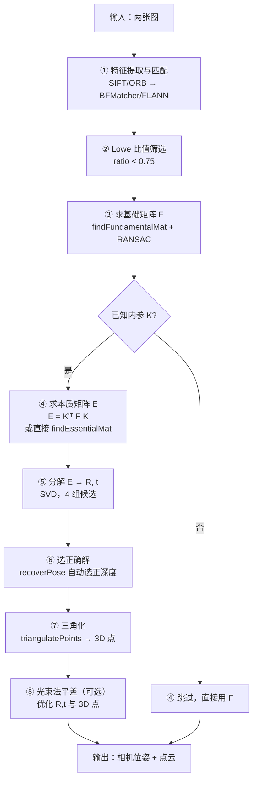
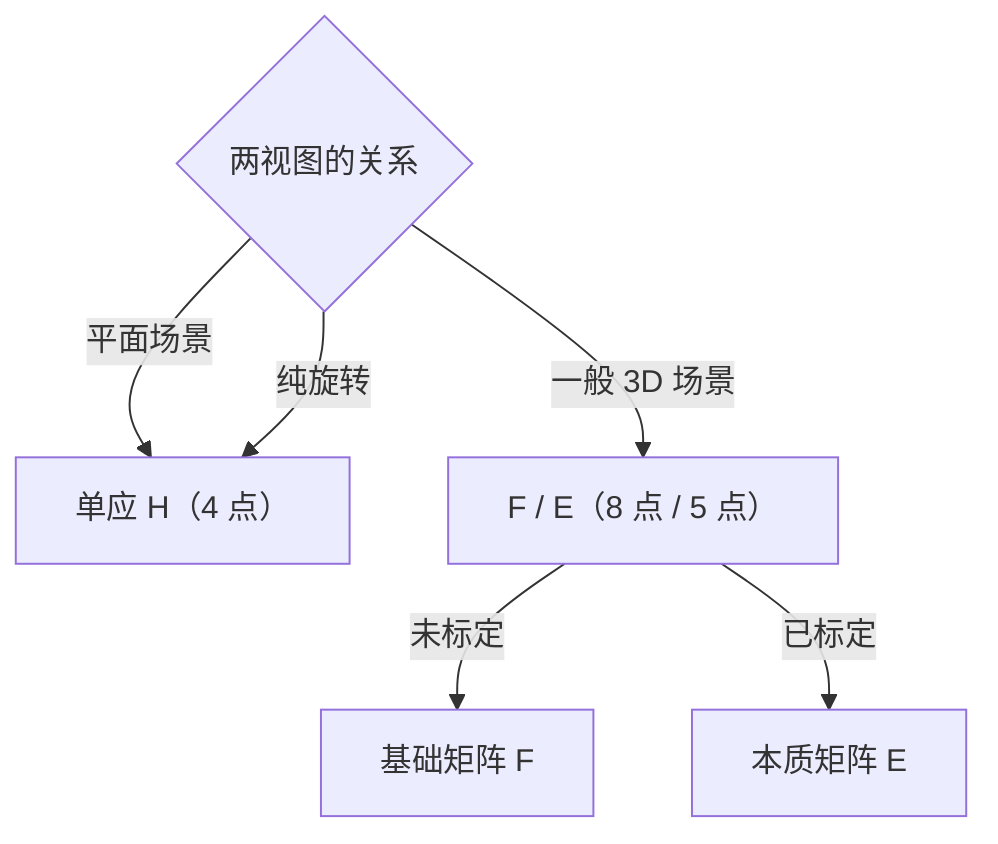

# 对极几何算法流程

> 从「匹配好的点对」到「三维点云 + 相机位姿」，一共 8 步。这一页把每一步的输入输出和实现讲透。

## 完整管线



## 步骤拆解

| 步骤 | 输入 | 输出 | 关键点 |
|---|---|---|---|
| ① 特征匹配 | 两图 | 匹配点对 | SIFT/ORB 均可；点要**分布均匀** |
| ② 比值筛选 | 匹配点 | 干净匹配 | Lowe ratio < 0.75 剔误匹配 |
| ③ 求 F | 像素点对 | $F$ (3×3) | **必须 RANSAC**；点需归一化 |
| ④ 求 E | $F$ + $K$ | $E$ (3×3) | $E = K'^TFK$；已标定可直接求 E |
| ⑤ 分解 E | $E$ | $R, t$ 候选 | SVD，得到 4 组 |
| ⑥ 选解 | 4 组候选 | 唯一 $(R,t)$ | 三角化后深度全为正的那组 |
| ⑦ 三角化 | $(R,t)$ + 匹配点 | 3D 点 | 剔除夹角太小的点 |
| ⑧ BA（可选） | 全部参数 | 优化结果 | 第一次重建后用它精化 |

## Numpy 手写：归一化八点法

```python
import numpy as np

def normalize_points(pts):
    """Hartley 归一化：平移居中 + 缩放到平均距离 √2"""
    centroid = pts.mean(axis=0)
    shifted = pts - centroid
    mean_dist = np.sqrt((shifted ** 2).sum(axis=1)).mean()
    scale = np.sqrt(2) / mean_dist
    T = np.array([
        [scale, 0, -scale * centroid[0]],
        [0, scale, -scale * centroid[1]],
        [0, 0, 1]
    ])
    pts_h = np.column_stack([pts, np.ones(len(pts))])
    pts_n = (T @ pts_h.T).T
    return pts_n[:, :2], T

def fundamental_8point(pts1, pts2):
    """归一化八点法求基础矩阵"""
    # ① 归一化
    p1, T1 = normalize_points(pts1)
    p2, T2 = normalize_points(pts2)

    # ② 构造 A 矩阵（每对匹配一行）
    n = len(p1)
    A = np.column_stack([
        p2[:, 0] * p1[:, 0], p2[:, 0] * p1[:, 1], p2[:, 0],
        p2[:, 1] * p1[:, 0], p2[:, 1] * p1[:, 1], p2[:, 1],
        p1[:, 0], p1[:, 1], np.ones(n)
    ])

    # ③ SVD，最小奇异值对应的向量就是 F
    _, _, Vt = np.linalg.svd(A)
    F = Vt[-1].reshape(3, 3)

    # ④ 强制秩 2
    U, S, Vt2 = np.linalg.svd(F)
    S[-1] = 0
    F = U @ np.diag(S) @ Vt2

    # ⑤ 反归一化
    F = T2.T @ F @ T1
    return F / F[2, 2]        # 归一化到 f33 = 1
```

**20 行不到，核心就是四次操作**：归一化 → 构造 A → SVD → 强制秩 2 → 反归一化。

## OpenCV 对应实现（省心）

```python
import cv2
import numpy as np

# 求 F（不需要内参）
F, mask = cv2.findFundamentalMat(
    pts1, pts2,
    method=cv2.FM_RANSAC,
    ransacReprojThreshold=1.0,   # 到极线的距离阈值（像素）
    confidence=0.999
)

# 求 E（需要内参 K）
E, mask = cv2.findEssentialMat(
    pts1, pts2, K,
    method=cv2.RANSAC,
    prob=0.999,
    threshold=1.0
)
```

## 三角化

```python
# 投影矩阵
P1 = K @ np.hstack([np.eye(3), np.zeros((3, 1))])       # 左相机为参考
P2 = K @ np.hstack([R, t])                               # 右相机

# 三角化（DLT）
pts4d = cv2.triangulatePoints(P1, P2, pts1.T, pts2.T)
pts3d = (pts4d[:3] / pts4d[3]).T        # 齐次 → 非齐次
```

## 算法对比：F / E / H 的求解器

| 求解器 | OpenCV API | 最小点 | 需要内参 | 适用 |
|---|---|---|---|---|
| 八点法 | `findFundamentalMat(FM_8POINT)` | 8 | 否 | 点干净时 |
| 七点法 | `findFundamentalMat(FM_7POINT)` | 7 | 否 | 点少时 |
| **RANSAC 八点** | `findFundamentalMat(FM_RANSAC)` | 8 | 否 | **推荐** |
| LMedS | `findFundamentalMat(FM_LMEDS)` | 8 | 否 | 外点多时 |
| 五点法 | `findEssentialMat` | 5 | **是** | 已标定，最准 |
| 单应 | `findHomography` | 4 | 否 | 平面 / 纯旋转 |

## 复杂度与精度

| 环节 | 复杂度 | 主要误差来源 |
|---|---|---|
| 八点法 | $O(N)$（$N$ 为点数） | 噪声、未归一化 |
| RANSAC 迭代 | $O(I \cdot N)$ | 外点率决定迭代次数 |
| 分解 E | $O(1)$（固定 3×3 SVD） | — |
| 三角化 | $O(N)$ | 基线夹角、匹配误差 |

## 与其他几何方法的边界



::: tip 一句话选型
**平面或纯旋转 → H；三维场景未标定 → F；三维场景已标定 → E。**
:::

[← 上一篇：核心概念](./concepts) · [下一篇：源码走读 →](./source)
