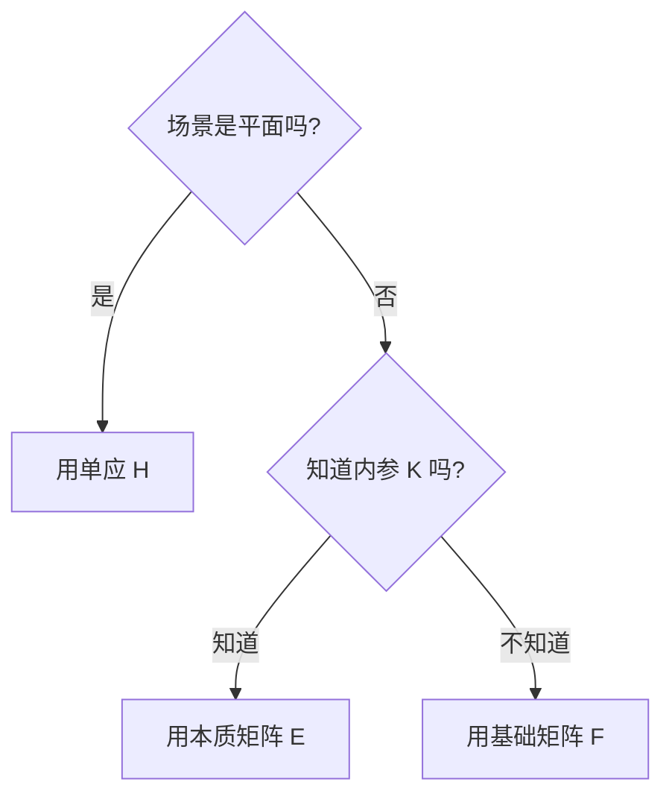
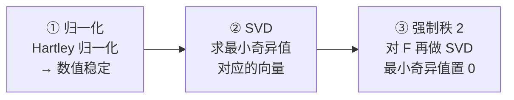
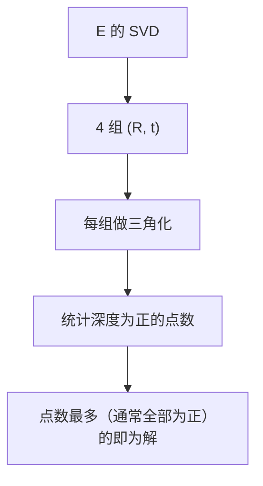
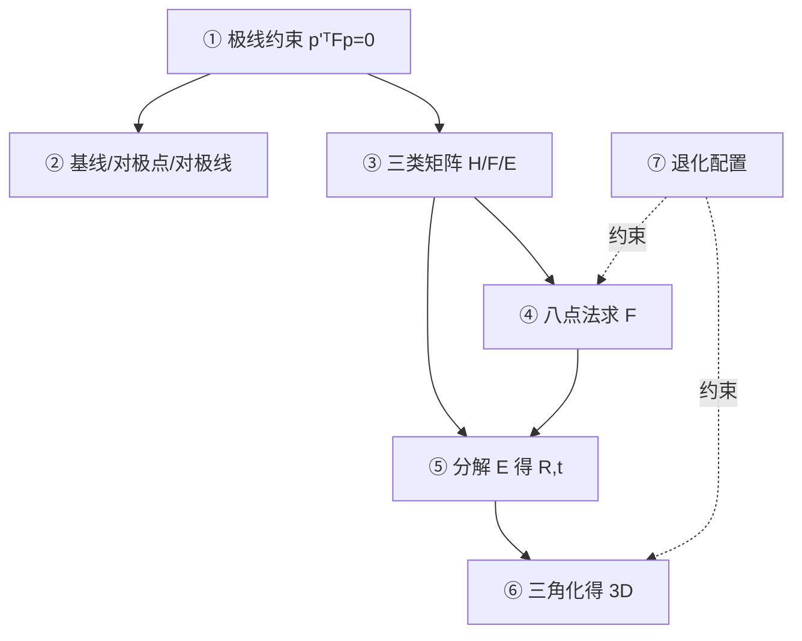

# 对极几何核心概念

> 对极几何的数学看起来吓人，但其实只有「一条线、三个矩阵、两个算法、一个三角化」。逐个拆开。

## Concept 1：极线约束（一句话的核心）

**一句话**：给定左图一个点，它在右图的对应点**一定落在一条确定的直线上**（对极线），不必全图搜索。

**通俗版**：你知道朋友在左边房间某处，他在右边房间的投影位置**必定在一条特定的线上**——沿着这条线找就行。

**数学化**：

$$
\mathbf{p}'^T F \mathbf{p} = 0
$$

其中 $\mathbf{p}, \mathbf{p}'$ 是两图的像素齐次坐标。

**为什么成立（几何直觉）**：

1. 左相机看到空间点 $P$，但不知其深度
2. $P$ 可能在射线 $C \to \mathbf{p}$ 上的**任何位置**
3. 这条射线在右图的投影就是**一条直线**（对极线）
4. 所以 $P$ 在右图的像必在这条线上

**对应本体实体**：`concept-epipolar-geometry`

## Concept 2：四个基本名词

| 名词 | 定义 | 直觉 |
|---|---|---|
| **基线** | 两个相机光心的连线 $CC'$ | 左右眼之间的距离 |
| **对极平面** | 包含基线 + 空间点 $P$ 的平面 | 「眼睛—点」构成的平面 |
| **对极点 e** | 基线在本图上的投影点 | 对方相机中心在你眼里的位置 |
| **对极线 l'** | 对极平面在另一图上的投影线 | 「必须在这条线上找」的那条线 |

**最关键的关系**：

$$
l' = F\mathbf{p}
\qquad (\text{左图点 } \mathbf{p} \text{ 决定右图的对极线 } l')
$$

$$
F\mathbf{e} = 0
\qquad (\text{对极点 } \mathbf{e} \text{ 是 } F \text{ 的右零空间})
$$

**对应本体实体**：`concept-epipolar-geometry`

## Concept 3：三类矩阵（H / F / E）

**一句话**：约束两视图的矩阵有三种，取决于「场景是不是平面」和「有没有内参」。

| 矩阵 | 适用 | 坐标类型 | 最小点数 | 自由度 |
|---|---|---|---|---|
| **单应 H** | 平面场景 / 纯旋转 | 像素 | **4** | 8 |
| **基础矩阵 F** | 一般运动 | 像素 | **8**（八点法） | 7 |
| **本质矩阵 E** | 一般运动 + 已知内参 | 归一化 | **5**（五点法） | 5 |

**F 与 E 的关系**：

$$
E = K'^T F K
\qquad \Longleftrightarrow \qquad
F = K'^{-T} E K^{-1}
$$

**E 的额外性质（很有用）**：

$$
E = [\mathbf{t}]_\times R,
\qquad \text{两个奇异值相等 } \sigma_1 = \sigma_2 \ne \sigma_3
$$

> 这个「两个奇异值相等」的约束可以用来**校验和优化** E——它是 E 比 F 更「干净」的原因。

**三者选择判据**：



**对应本体实体**：`concept-fundamental-matrix`

## Concept 4：八点法原理

**一句话**：把 $\mathbf{p}'^T F \mathbf{p} = 0$ 展成关于 $F$ 元素的**线性方程组**，8 对点凑够 8 个方程，解出 $F$。

**构造方程**（每对匹配一行）：

$$
[u'u,\ u'v,\ u',\ v'u,\ v'v,\ v',\ u,\ v,\ 1] \cdot \mathbf{f} = 0
$$

其中 $\mathbf{f} = (f_{11}, f_{12}, \dots, f_{33})^T$ 是 $F$ 展平成的 9 维向量。

**解法（三步）**：



**为什么必须归一化**：图像坐标动辄几百上千，9 个元素的乘积到 $10^{12}$ 量级，矩阵条件数爆炸 → 解不可信。归一化后坐标接近 1，条件数降到个位数。

**为什么强制秩 2**：$F$ 理论上是「反对称矩阵 × 可逆矩阵」，秩必为 2；但数值解出的 $F$ 通常是满秩 3。用 SVD 把最小奇异值置零，就是投影到「秩 2 流形」上。

**对应本体实体**：`concept-fundamental-matrix`

## Concept 5：从 E 恢复位姿（4 组解）

**一句话**：$E$ 分解后得到 4 组可能的 $(R, t)$，用「三角化后深度是否为正」选出唯一正确的那组。

$$
E = [\mathbf{t}]_\times R
$$

**分解流程**：

| 步骤 | 做什么 |
|---|---|
| ① SVD | $E = U\,\text{diag}(\sigma,\sigma,0)\,V^T$ |
| ② 得到两个 R 候选 | $R_a = UWV^T$，$R_b = UW^TV^T$（$W$ 是固定旋转） |
| ③ 得到 t 候选 | $\mathbf{t} = \pm \mathbf{u}_3$（$U$ 第三列） |
| ④ 组合 | 共 $2 \times 2 = 4$ 组 $(R, t)$ |
| ⑤ 验证 | 三角化，取「所有点深度为正」的那组 |



**OpenCV 的 `cv2.recoverPose` 自动完成这套选择**。

**对应本体实体**：`concept-fundamental-matrix`

## Concept 6：三角化（2D → 3D）

**一句话**：已知两相机位姿 + 匹配点，求空间点——两条视线理论上相交，实际因噪声不相交，取**最近点**（最小二乘）。

**两种方法**：

| 方法 | 原理 | 说明 |
|---|---|---|
| **DLT（直接线性变换）** | 构造 $4\times4$ 齐次方程求最小奇异向量 | `cv2.triangulatePoints` 用的就是它 |
| **中点法** | 求两条射线最近点 | 几何直观，但不一定最优 |

**精度问题（工程上最该记住的）**：

三角化的深度误差**随距离平方增长**，且**随基线夹角的减小而急剧恶化**：

$$
\text{深度误差} \ \propto \ \frac{Z^2}{f \cdot B}
\qquad (\text{其中 } B \text{ 是基线长度})
$$

**质量判据——三角化夹角**：

| 两视线夹角 | 深度可靠性 |
|---|---|
| $< 0.5°$ | 不可信（近似平行） |
| $0.5° \sim 2°$ | 一般 |
| $> 2°$ | 可信 |

**所以 SLAM / SFM 会主动剔除夹角太小的三角化点**。

**对应本体实体**：`concept-triangulation`

## Concept 7：退化配置（什么时候会失效）

**一句话**：对极几何在三种「特殊场景」下会退化——点全共面、纯旋转、基线太小。

| 退化情形 | 后果 | 应对 |
|---|---|---|
| **所有点共面** | $F$ 有无穷多解 | 改用单应 $H$ |
| **纯旋转（t ≈ 0）** | 无法恢复平移 | 用 $H$；或确保有平移 |
| **基线太小** | 三角化极不稳定 | 增大基线 / 剔除远点 |
| **共线点** | 方程退化 | 保证点的空间分布 |

**判断平面场景的实用方法**：

```python
# 分别用 H 和 F 求内点率，谁高用谁
H, mask_H = cv2.findHomography(pts1, pts2, cv2.RANSAC, 3.0)
if mask_H.sum() > 0.7 * len(pts1):
    print("平面场景，用 H")
else:
    print("有深度变化，用 F")
```

**对应本体实体**：`concept-degenerate-configuration`

## 概念之间的关系



**逻辑链**：约束 → 名词 → 矩阵 → 求解（八点法）→ 分解位姿 → 三角化 → 3D。退化配置是横贯全链的「红线」，随时可能让某一步失效。

## 本体实例映射

```yaml
- id: algo-epipolar
  type: Algorithm
  concepts:
    - "concept-epipolar-geometry"
    - "concept-fundamental-matrix"
    - "concept-triangulation"
    - "concept-ransac"
  dependsOn:
    - "algo-sift"
    - "algo-ransac"
  papers:
    - "paper-longuet-higgins-1981"
    - "paper-hartley-1997"
    - "paper-hartley-zisserman-2003"
```

[← 返回总览](./) · [下一篇：算法流程 →](./architecture)
