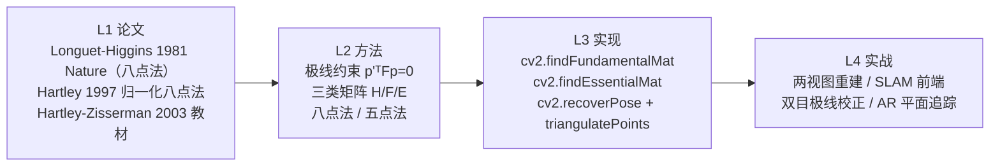
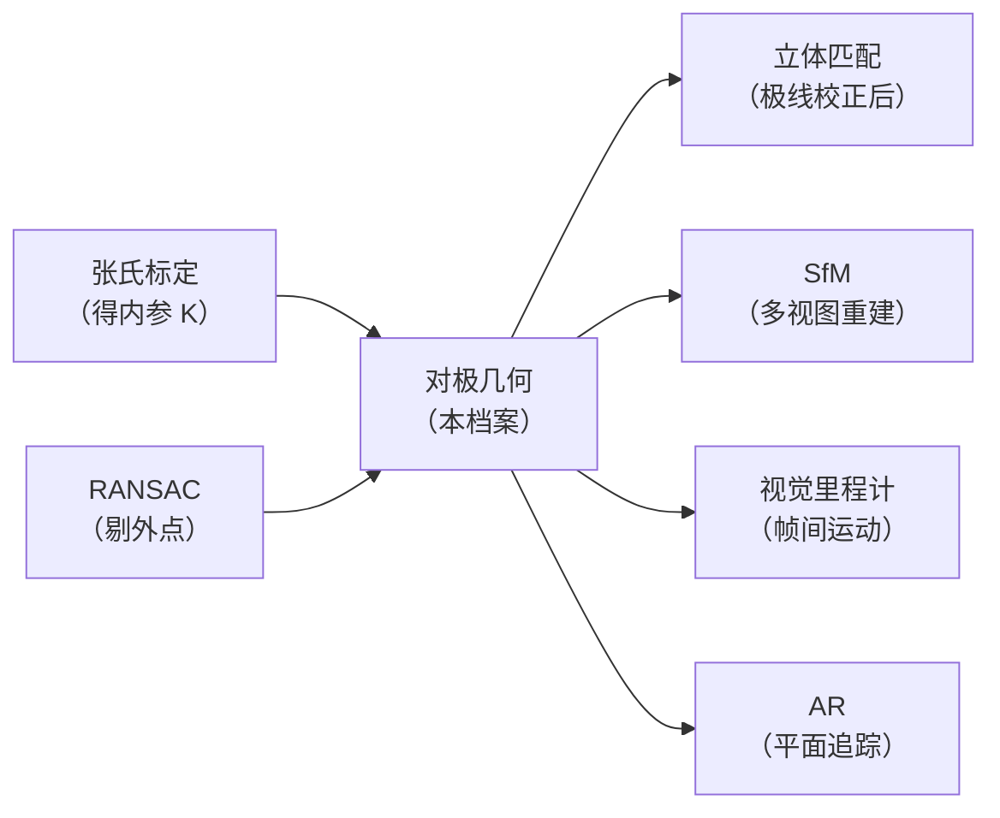

# 对极几何与三角化

## 🧪 原理互动演示

<AlgoVisualizer type="epipolar-geometry" />

## 🚀 动手体验

> 🧪 **先懂原理**：翻到下一节「核心概念」，页面里直接嵌入了可拖动滑块的原理动画（SIFT高斯金字塔、FLANN KD树、GrabCut迭代、KCF响应峰、ICP配准等），拖一拖就懂。

> 🎮 **再跑真机**：跳到第5页「源码实现」，底部有真机实验室（OpenCV.js 浏览器本地运行），选图调参即可看到真实效果与三语代码。

---

<AlgorithmCard
  name="对极几何与三角化"
  en-name="Epipolar Geometry & Triangulation"
  chapter="第9章 · 立体视觉"  chapterLink="/chapters/ch09-stereo"
  branch="几何视觉 · 双视图几何族"
  year="1981"
  author="Longuet-Higgins（八点法）· Hartley & Zisserman（体系化）"
  paper="https://www.nature.com/articles/293133a0"
  level="中层"
  tagline="「同一个点，在第二张图里只需要沿一条线找」——把二维搜索降成一维"
  analogy="你在左边房间看到朋友，想知道他在右边房间的投影位置。不用把整个右房间扫一遍——只需要沿着一条特定的直线找就行。这条线，就是对极线。"
  scene="三维重建（SfM）、视觉 SLAM 前端、双目立体匹配的极线校正、AR 平面追踪、无人机/机器人视觉里程计、全景拼接的几何对齐。"
  :pros="[
    '把匹配搜索从「二维全图」降到「一维直线」，复杂度从 O(N²) 降到 O(N)',
    '一次性剔除大量误匹配——不在极线上的匹配必然是错的',
    '是两视图重建、SLAM、双目视觉的共同地基，几乎所有三维视觉都绕不开',
    '八点法只需 8 对匹配，五点法只需 5 对，工程上极其省数据',
    '约束是「物理」的——深度学习再强，匹配结果也必须满足对极一致性'
  ]"
  :cons="[
    '对噪声敏感：不做归一化时八点法数值上几乎不可用（Hartley 归一化是必须的）',
    '退化配置会失效：所有点共面、纯旋转、基线太小都会让求解不稳定',
    '三角化精度对基线敏感——基线小或点太远时，深度误差急剧放大',
    '需要先用 RANSAC 剔外点，原始匹配里的误匹配会直接毁掉 F/E 估计',
    '从 E 恢复 R/t 有 4 组解，还要靠三角化选正深度的那组'
  ]"
/>

## TL;DR

**一句话**：两张图的匹配点之间存在一个代数约束 $\mathbf{p}'^T F \mathbf{p} = 0$——求出 $F$ 后，左图任一点在右图的对应点必落在一条直线（对极线）上；再结合相机位姿，两条视线相交即可**三角化**出三维点。

**解决**：双目/多视图匹配时「全图乱找对应点」的组合爆炸问题，以及「从两张 2D 图恢复 3D 结构」这一核心命题的数学基础。

**代价**：数值敏感（必须归一化）、有退化配置（共面/纯旋转）、三角化精度依赖基线长度。

**前置阅读**：[张氏相机标定](./../zhang-calibration/) → [RANSAC 外点剔除](./../ransac/) → [🔧 几何视觉分支](/branches/geometry/)

## 3 分钟电梯演讲

**一句话流程**：**匹配 → 求 F/E → 分解出位姿 → 三角化出 3D**。几何视觉里最经典的一条四步链。

## 四层闭环视图

## 核心贡献一览

| 贡献 | 一句话 | 代码落点 |
|---|---|---|
| 极线约束 | 点 → 另一图的一条线，2D 搜索降 1D | `F` 与 `p` 的乘积给出对极线 |
| 基础矩阵 F | 像素坐标下的两视图约束，秩 2、7 自由度 | `cv2.findFundamentalMat` |
| 本质矩阵 E | 归一化坐标下的约束，仅 5 自由度，含 R/t | `cv2.findEssentialMat` |
| 八点法 / 五点法 | 8 对点解 F、5 对点解 E | `FM_8POINT` / `FM_RANSAC` |
| 归一化八点法 | 平移居中 + 缩放到平均距离 √2，数值稳定 | `findFundamentalMat` 内部 |
| 从 E 恢复位姿 | SVD 分解出 R 与 t（4 组解中选一） | `cv2.recoverPose` |
| 三角化 | 两视线最近点，恢复 3D 坐标 | `cv2.triangulatePoints` |

## 📖 档案目录

| 页面 | 内容 |
|---|---|
| [论文精读](./paper) | Longuet-Higgins 1981（八点法）+ Hartley 1997（归一化）+ 2003 教材 |
| [核心概念](./concepts) | 极线约束、F/E/H 三类矩阵、八点法原理、三角化、退化配置 |
| [算法流程](./architecture) | 完整管线 + 8 步拆解 + Numpy 手写八点法 + OpenCV API |
| [源码走读](./source) | 两视图重建完整代码 / 立体校正 / SLAM 前端用法 |
| [实战与踩坑](./painpoints) | 未归一化、点共面、纯旋转、阈值设错等 10 个坑 |
| [调参技巧](./tricks) | F vs E vs H 选择、RANSAC 阈值、三角化质量判据 |

## 它在几何视觉里的位置

**一句话定位**：对极几何是**几何视觉的「心脏」**——它上承相机标定（要 K），下接三角化、双目、SfM、SLAM。张氏标定给你「相机怎么成像」，对极几何给你「两个视角之间怎么对应」。两者合起来，才是完整的三维视觉。

[算子词典](/operators/) · [场景反查](/scenarios/) · [几何视觉分支](/branches/geometry/)
