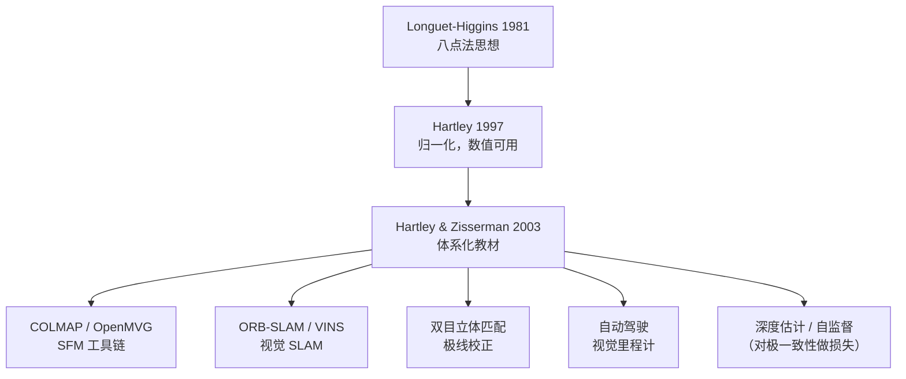

# 对极几何与三角化 · 论文精读

> 对极几何不是「一篇论文」的成果，而是**三块拼图**：1981 年 Longuet-Higgins 的八点法给出可解性，1997 年 Hartley 的归一化让它数值可用，2003 年 Hartley & Zisserman 把它整理成体系。这一页把三块拼图讲清楚。

## 论文名片

| 项 | 内容 |
|---|---|
| ① 标题 | *A Computer Algorithm for Reconstructing a Scene from Two Projections* |
| 作者 | H. Christopher Longuet-Higgins |
| 年份 | 1981 |
| 出处 | Nature, Vol. 293 |
| 本体 ID | `paper-longuet-higgins-1981` |
| ② 标题 | *In Defense of the Eight-Point Algorithm* |
| 作者 | Richard I. Hartley |
| 年份 | 1997 |
| 出处 | IEEE TPAMI |
| 本体 ID | `paper-hartley-1997` |
| ③ 标题 | *Multiple View Geometry in Computer Vision (2nd Ed.)* |
| 作者 | Richard Hartley、Andrew Zisserman |
| 年份 | 2003 |
| 出处 | Cambridge University Press |
| 本体 ID | `paper-hartley-zisserman-2003` |

## 一、当时的问题：两张图能还原出 3D 吗？

1980 年前后，一个悬而未决的问题困扰着计算机视觉：

> **只给两张同一个场景的照片（不知道相机在哪、参数是什么），能不能还原出场景的三维结构和两个相机的相对位置？**

难点在于：

| 难点 | 说明 |
|---|---|
| 相机未知 | 内参、外参都不知道，只有像素坐标 |
| 对应关系不确定 | 匹配有误匹配，噪声大 |
| 约束未知 | 不知道两个视图之间到底存在什么代数关系 |

之前的工作（如 Longuet-Higgins 自己的早期研究）知道「存在某种约束」，但**没给出实用、可编程的算法**。

## 二、Longuet-Higgins 1981：八点法

### 核心贡献：把几何约束写成线性方程

Longuet-Higgins 的洞察是：两视图匹配点之间存在一个**双线性约束**，可以写成一个矩阵 $F$ 的形式：

$$
\mathbf{p}'^T F \mathbf{p} = 0
$$

其中 $\mathbf{p} = (u, v, 1)^T$、$\mathbf{p}' = (u', v', 1)^T$ 是两图的**像素齐次坐标**，$F$ 是 $3\times3$ 的**基础矩阵**。

**关键洞察**：这个方程对 $F$ 的 9 个元素是**线性的**！

把它展开：

$$
u'u\,f_{11} + u'v\,f_{12} + u'\,f_{13} + v'u\,f_{21} + v'v\,f_{22} + v'\,f_{23} + u\,f_{31} + v\,f_{32} + f_{33} = 0
$$

**每对匹配点给出一个线性方程**。$F$ 有 9 个未知数（差一个尺度，所以是 8 个自由度），**8 对匹配就够解出来**——这就是「八点法」。

### 更深的意义：从两张图到 3D

Longuet-Higgins 证明：求出 $F$（或已知内参时的本质矩阵 $E$）后，可以通过**分解**得到两相机的相对旋转 $R$ 和平移 $t$，再用**三角化**恢复三维点。这是「从投影重建场景」的第一个完整回答。

> 论文标题 *Reconstructing a Scene from Two Projections* 精准点明了目标——**这是 SFM（Structure from Motion）的思想起点**。

### 局限

八点法在 1981 年提出后，**实践中一直不稳定**：图像坐标动辄上百上千，直接构造线性方程会让矩阵条件数极差，解出的 $F$ 完全不能用。这个「理论漂亮、工程难用」的尴尬持续了 16 年。

## 三、Hartley 1997：归一化八点法（关键补丁）

### 核心贡献：数值稳定性

Hartley 1997 年那篇 *In Defense of the Eight-Point Algorithm* 干了一件事：**证明八点法只要加上一步「归一化」，就能变得稳定可靠**，不需要复杂的非线性方法。

**归一化步骤（Hartley 归一化）**：

1. 把每张图的点**平移**，使**质心在原点**
2. **缩放**，使点到原点的**平均距离为 $\sqrt2$**
3. 记录变换矩阵 $T_1, T_2$
4. 在归一化坐标下用八点法求 $F_{norm}$
5. **反归一化**：$F = T_2^T F_{norm} T_1$

**为什么有效**：归一化后坐标量级接近 1，矩阵条件数从 $10^{12}$ 降到个位数，SVD 结果可信。

> 这是「一个技巧救活一个算法」的经典案例。今天的 `cv2.findFundamentalMat` 内部默认就做 Hartley 归一化。

### 附带贡献

- **强制秩 2**：$F$ 理论上秩为 2，但直接解出的是秩 3，需对它做 SVD 并把最小奇异值置 0
- **与 RANSAC 结合**：给出「最小子集 + 假设验证」的标准范式
- **比较了不同归一化策略**：坐标归一化优于其他方案

## 四、Hartley & Zisserman 2003：体系化

### 核心贡献：把散落的几何整理成理论

这不是一篇论文，而是一本把**多视图几何**从零散论文整合成自洽体系的书。它统一了：

| 概念 | 在书里的地位 |
|---|---|
| 相机模型与标定 | 第 6-7 章 |
| 单应 H | 第 2、4 章 |
| 基础矩阵 F / 本质矩阵 E | 第 9 章 |
| 三角化 | 第 12 章 |
| 光束法平差（BA） | 附录 |
| RANSAC / LMedS | 第 4 章 |

**为什么它重要**：在它之前，「对极几何怎么做」散落在几十篇论文里；在它之后，**所有人有了一本可查的字典**。今天的 COLMAP、OpenMVG、ORB-SLAM 等工具链，理论根基都在这本书里。

## 五、对后世的影响

**结论**：对极几何从 1981 年的一个 Nature 短文，长成了 2003 年的一本教科书，再从教科书里长出了今天几乎所有的三维视觉系统。**即使深度学习独大的今天，学出来的匹配点、估计出的深度，仍然要用对极约束做几何校验**——因为它是物理约束，不会被替代。

## 六、值得抄的一句话

> Hartley 1997 的思想（意译）：**「八点法没有问题，有问题的是你没做归一化。」**

这句话既是对一个算法的辩护，也是一条工程教训：**很多「算法不work」，其实是「数据没预处理」**。

[← 返回总览](./) · [下一篇：核心概念 →](./concepts)
