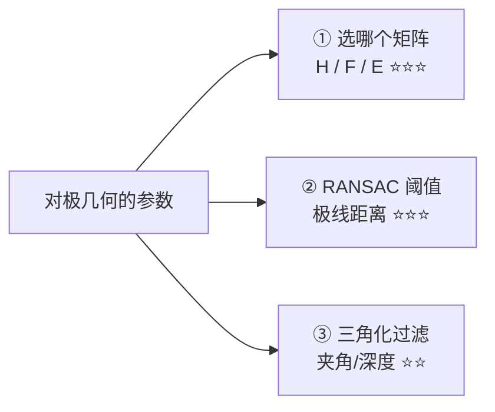
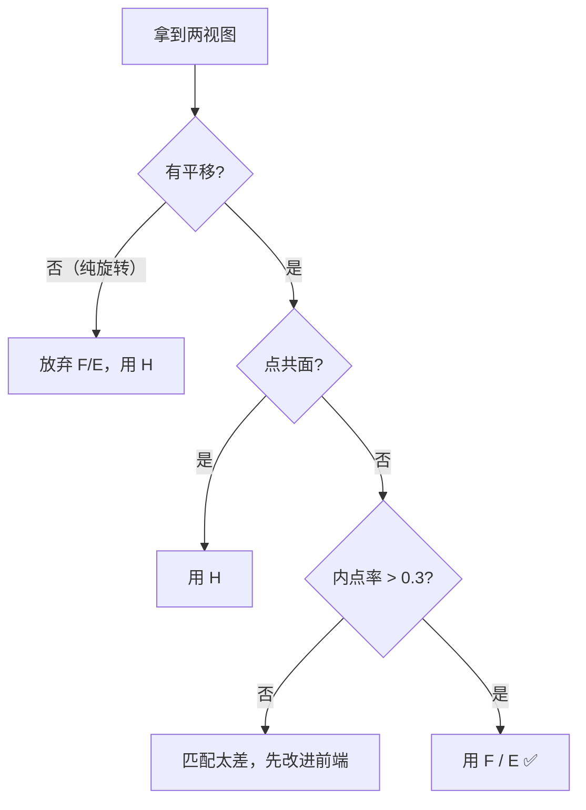

# 对极几何调参技巧

> 对极几何没有「一个阈值调好就行」的说法——它的成败取决于**场景判断**（用 H 还是 F/E）和**质量过滤**（RANSAC + 夹角）。这一页给你可抄的配方。

## 参数总览



## 技巧 1：先判断用哪个矩阵（最重要）

```python
def choose_geometry_model(pts1, pts2, K=None):
    """返回最适合的几何模型"""
    H, mask_H = cv2.findHomography(pts1, pts2, cv2.RANSAC, 3.0)
    F, mask_F = cv2.findFundamentalMat(pts1, pts2, cv2.FM_RANSAC, 1.0, 0.999)

    rH = mask_H.mean() if mask_H is not None else 0
    rF = mask_F.mean() if mask_F is not None else 0

    if rH > 0.7 * rF and rH > 0.6:
        return 'H', rH      # 平面 / 纯旋转
    elif K is not None:
        return 'E', rF      # 已标定 + 有深度
    else:
        return 'F', rF      # 未标定 + 有深度
```

**判据**：

| 场景 | 用 | 判据 |
|---|---|---|
| 平面 / 纯旋转 | **H** | $H$ 内点率 > 0.7 |
| 一般 3D，未标定 | **F** | $H$ 内点率低 |
| 一般 3D，已标定 | **E** | 有 K |

## 技巧 2：RANSAC 阈值怎么定

| 场景 | 到极线距离阈值 |
|---|---|
| 高精度标定过的图像 | 0.5 px |
| **一般场景** | **1.0 px** |
| 匹配质量差 / 分辨率低 | 2.0 ~ 3.0 px |

```python
F, mask = cv2.findFundamentalMat(pts1, pts2, cv2.FM_RANSAC, 1.0, 0.999)
```

::: warning 别和 findHomography 的阈值搞混
`findFundamentalMat` 阈值 = **点到对极线的距离**
`findHomography` 阈值 = **重投影误差**
两者量纲不同，不能直接套用同一数值。
:::

## 技巧 3：匹配点预处理（决定成败）

```python
# ① Lowe 比值筛选
bf = cv2.BFMatcher()
matches = bf.knnMatch(d1, d2, k=2)
good = [m for m, n in matches if m.distance < 0.75 * n.distance]

# ② 双向一致性检查（互相匹配才留）
matches_12 = {m.queryIdx: m.trainIdx for m in good}
# 反向匹配一次，只留双向一致的
```

| 预处理 | 作用 |
|---|---|
| Lowe 比值 | 剔除模糊匹配 |
| 双向检查 | 剔除单向误匹配 |
| 空间均匀化 | 防止点挤在一角 |

## 技巧 4：三角化质量过滤（两条）

```python
def quality_filter(pts3d, R, t, min_angle=2.0, max_depth_pct=95):
    C1 = np.zeros(3)
    C2 = -R.T @ t.ravel()

    keep = []
    for i, P in enumerate(pts3d):
        # ① 深度必须为正
        if P[2] <= 0:
            continue
        # ② 夹角必须够大
        v1, v2 = P - C1, P - C2
        n1, n2 = np.linalg.norm(v1), np.linalg.norm(v2)
        if n1 < 1e-6 or n2 < 1e-6:
            continue
        ang = np.degrees(np.arccos(np.clip(np.dot(v1, v2)/(n1*n2), -1, 1)))
        if ang < min_angle:
            continue
        keep.append(i)

    pts3d = pts3d[keep]
    # ③ 剔除深度离群点（如太远的点）
    depth = pts3d[:, 2]
    limit = np.percentile(depth, max_depth_pct)
    return pts3d[depth <= limit]
```

## 技巧 5：三个场景抄作业参数表

| 场景 | 矩阵 | 阈值 | 过滤 | 说明 |
|---|---|---|---|---|
| **SLAM 初始化** | H 与 F 都算 | F: 1.0 / H: 3.0 | 夹角 > 1° | 按内点率选 |
| **双目极线校正** | — | 立体标定 | — | 直接 stereoRectify |
| **单目 SFM 初始化** | F → E | 1.0 | 夹角 > 2° | 已标定用 E |
| **AR 平面追踪** | H | 3.0 | — | 平面场景 |
| **无人机 VO** | E | 1.0 | 夹角 > 2° | 帧间小基线，需多帧 |

## 技巧 6：用极线距离检查 F 的质量

```python
def epipolar_error(F, pts1, pts2):
    """算每对匹配点到对极线的平均距离，越小越好"""
    lines = (F @ np.hstack([pts1, np.ones((len(pts1), 1))]).T).T   # l' = F p
    a, b, c = lines[:, 0], lines[:, 1], lines[:, 2]
    dist = np.abs(a*pts2[:, 0] + b*pts2[:, 1] + c) / np.sqrt(a**2 + b**2)
    return dist.mean()

print('平均极线距离 =', epipolar_error(F, pts1_in, pts2_in), '像素')
```

**经验值**：好的 $F$ 平均极线距离 **< 1 px**；**> 3 px** 说明估计有问题。

## 技巧 7：什么时候该放弃对极几何



## 技巧 8：基于 RANSAC 的参数速查

| 参数 | 推荐值 | 说明 |
|---|---|---|
| `ransacReprojThreshold`（F） | 1.0 | 极线距离 |
| `confidence` | 0.999 | 置信度 |
| Lowe ratio | 0.75 | 匹配筛选 |
| 三角化最小夹角 | 2.0° | 深度可信度 |
| 最少匹配点数 | ≥ 30 | 太少不稳 |

## 调参顺序建议

1. **先判断场景**：平面 → H；非平面 → F/E
2. **清洗匹配**：Lowe 比值 + 双向检查
3. **求 F 或 E**：阈值 1.0，RANSAC
4. **检查极线距离**：> 3 px 就回头改匹配
5. **恢复位姿**：`recoverPose`
6. **三角化 + 质量过滤**：正深度 + 夹角 > 2°
7. **接 BA**：精化位姿与 3D 点

## 一句话口诀

> **平面旋转上单应，三维场景分 F/E；阈值一点零，三角化看夹角。**

[← 上一篇：实战与踩坑](./painpoints) · [返回总览](./)
