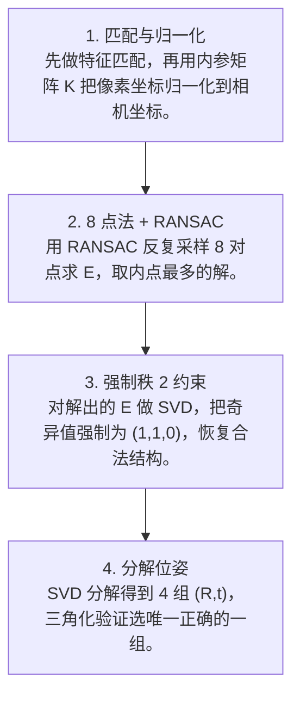

# 第 4 页 · 算法架构

## 完整流程图

## 每一步在做什么

### 步骤 1：匹配与归一化

先做特征匹配，再用内参矩阵 K 把像素坐标归一化到相机坐标。

### 步骤 2：8 点法 + RANSAC

用 RANSAC 反复采样 8 对点求 E，取内点最多的解。

### 步骤 3：强制秩 2 约束

对解出的 E 做 SVD，把奇异值强制为 (1,1,0)，恢复合法结构。

### 步骤 4：分解位姿

SVD 分解得到 4 组 (R,t)，三角化验证选唯一正确的一组。

## 在整体视觉管线中的位置

## 复杂度分析

时间复杂度 O(n) 用于构建方程 + O(RANSAC 迭代 × 8 点求解)；空间复杂度 O(n)。

## 参数总览（论文建议 vs OpenCV 默认 vs 实战推荐）

| 参数 | 含义 | 论文建议 | OpenCV 默认 | 实战推荐 |
|------|------|----------|-------------|----------|
| method | 求解方法 | 8点法 | RANSAC | ****RANSAC（阈值 1.0）**** |
| threshold | 内点阈值（像素） | — | 1.0 | **0.5~2.0** |
| confidence | 置信度 | — | 0.99 | **0.99** |
| K | 内参矩阵 | 必须先标定 | — | ****务必准确**** |

## 边界情况与失败模式

- **未用内参归一化**：直接用像素坐标算，得到的是基础矩阵 F 而非本质矩阵 E。
- **纯旋转导致退化**：相机只旋转不平移时 E 不可解，应改用单应矩阵。
- **平面场景退化**：所有点在同一个平面上时，E 的求解不稳定。
- **解出的位姿有 4 种**：E 分解出 4 组 (R,t)，必须用三角化选唯一正确的。
