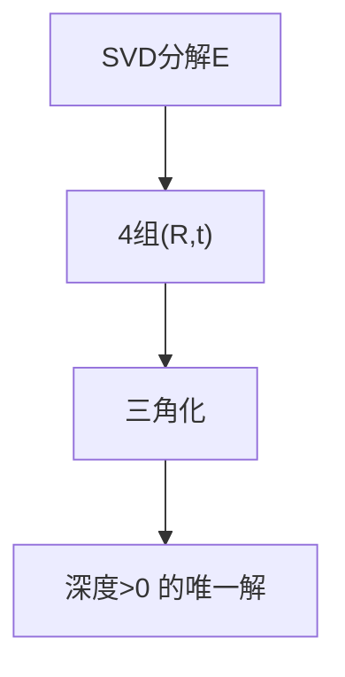

# 第 3 页 · 核心概念

## 先用生活直觉理解

你和朋友站在两个位置各拍一张同一间屋子。相同家具在两图中的位置差，其实编码了你们俩「相距多远、朝向差多少」。本质矩阵就是破译这组位置差的密码本——解出它，就知道了相机之间的运动。

**典型应用**：SfM 运动恢复结构、视觉里程计、SLAM 初始化、相机外参标定

## 概念逐个拆解

### 概念 1：对极几何

空间一点 P 与两个相机光心，确定一个平面（对极平面）。P 在第二幅图的投影必然落在一条线上（极线），这条线由 E 决定。

### 概念 2：E 与 F 的区别

E 作用于归一化相机坐标（内参已知），F 作用于像素坐标（内参未知）。F = K₂⁻ᵀ E K₁⁻¹。

### 概念 3：E 的结构

E = [t]× R，表明它同时编码了旋转 R 与平移方向 t；它秩为 2，两个非零奇异值相等——这是可分解的前提。

### 概念 4：分解与 4 选 1

SVD 分解得到 4 组 (R,t)，其中只有一组能让所有点在两个相机前方。用三角化验证深度为正即可筛选。

## 和其他算法的关系

| 关系 | 算法 | 说明 |
|------|------|------|
| 前置依赖 | 特征匹配 + 内参矩阵 K | 通常先做这些再做本算法 |
| 同类对比 | 基础矩阵 F、单应矩阵 H | 解决同类问题，各有取舍 |
| 下游常用 | 三角化、PnP、光束法平差 | 本算法结果常交给它们处理 |

::: tip 记忆锚点
记住「E = [t]×R，秩 2，两个相等奇异值」——它是归一化坐标下的对极约束。
:::
