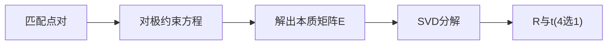

# 第 2 页 · 论文溯源

## 论文名片

| 项目 | 内容 |
|------|------|
| 标题 | **A Computer Algorithm for Reconstructing a Scene from Two Projections** |
| 作者 | H. Christopher Longuet-Higgins |
| 年份 | 1981 |
| 发表 | Nature, 1981 |
| 原文 | [https://www.sciencedirect.com/science/article/abs/pii/0025556481900255](https://www.sciencedirect.com/science/article/abs/pii/0025556481900255) |
| 一句话贡献 | 提出用 8 对以上对应点线性求解本质矩阵，从两视图恢复相机运动与场景结构。 |

## 1. 当时的问题

在此之前，从两张照片恢复 3D 需要已知相机位姿；如何只凭图像对应点直接解出相机运动，是计算机视觉尚未攻克的核心难题。

## 2. 核心思想

两幅图的对应点受「对极约束」限制：存在一个 3×3 矩阵 E，使得 x₂ᵀ E x₁ = 0 对所有对应点成立。把 E 的 9 个元素当未知数，每对点给一个方程，8 对即可线性求解。矩阵 E 随后可分解为旋转与平移。

## 3. 关键贡献

- 提出 8 点法线性求解本质矩阵
- 揭示 E = [t]× R 的结构：秩 2、两个相等奇异值
- 证明可从 E 直接分解出相机相对位姿
- 奠定对极几何与两视图重建的理论基础

## 4. 核心公式（看懂思路即可）

对极约束：x₂ᵀ E x₁ = 0，其中 x 为归一化相机坐标。结构：E = [t]× R，[t]× 为 t 的反对称矩阵。SVD 分解 E = U diag(1,1,0) Vᵀ，则 R = U W Vᵀ 或 U Wᵀ Vᵀ，t = ±U 的第三列。

## 5. 实验结果

合成与实拍数据上，8 点法在无噪声下精确，含噪声时配合归一化（Hartley）与 RANSAC 方能稳健。

## 6. 局限与争议

纯旋转或平面场景退化；对噪声与误匹配敏感；需内参已知；分解出的 4 组位姿需额外筛选。

## 7. 历史影响

成为 SfM、视觉里程计、SLAM 的基石；后续 Hartley 归一化 8 点法、Nistér 5 点法、RANSAC 求解框架都在此基础上发展。

## 8. 一句话总结

> 一个约束方程 x₂ᵀEx₁=0，把「看清相机怎么动」变成了可解的方程组。
