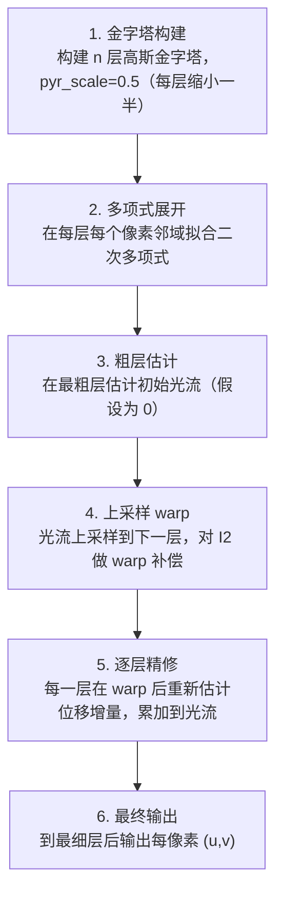

# Farnebäck 稠密光流 · 算法流程

<AlgorithmCard
  name="Farnebäck 稠密光流"
  enName="Gunnar Farnebäck Dense Optical Flow"
  chapter="ch-13-motion-analysis"
  branch="geometry"
  year="2003"
  author="Gunnar Farnebäck"
  paper="—"
  level="mid"
  tagline="用二次多项式拟合邻域，根据多项式系数变化估计稠密光流，CPU 上的经典稠密选择"
  analogy="在一张地图上你看不清路牌（像素值），但你能看清每块地形的坡度（多项式系数）。两帧之间坡度形状不变，只是整体平移了一点——Farnebäck 通过比较两块地形的坡度差算出平移"
  scene="视频运动分析、动作识别稠密光流输入、视频稳像、图像配准、稠密对齐、传统视频插帧"
  :pros='["稠密输出", "OpenCV原生calcOpticalFlowFarneback", "参数直观", "精度优于HS(工程上)", "多尺度金字塔"]'
  :cons='["速度慢(1080p几百ms)", "光照敏感", "运动边界模糊", "实时性差", "参数组合多"]'
/>

## 完整算法流程

Farnebäck 稠密光流算法可以分解为以下关键步骤：

## 步骤详解

### 步骤 1：金字塔构建

构建 n 层高斯金字塔，pyr_scale=0.5（每层缩小一半）

### 步骤 2：多项式展开

在每层每个像素邻域拟合二次多项式

### 步骤 3：粗层估计

在最粗层估计初始光流（假设为 0）

### 步骤 4：上采样 warp

光流上采样到下一层，对 I2 做 warp 补偿

### 步骤 5：逐层精修

每一层在 warp 后重新估计位移增量，累加到光流

### 步骤 6：最终输出

到最细层后输出每像素 (u,v)

## 在整体视觉 pipeline 中的位置

### 关键复杂度

| 维度 | 复杂度 |
|---|---|
| 时间 | 详见各实现 |
| 内存 | 与图像尺寸线性相关 |

