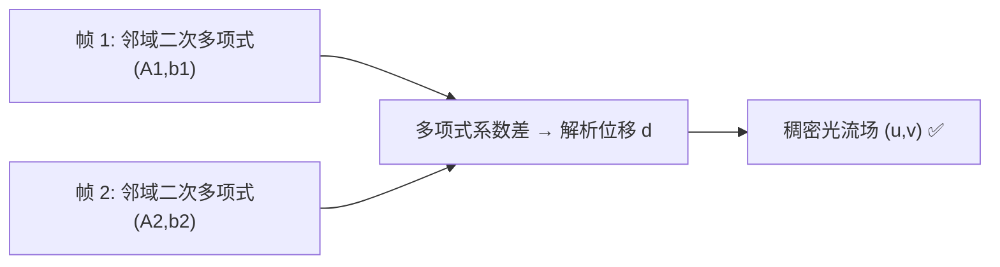

# Farnebäck 稠密光流 · 核心概念

<AlgorithmCard
  name="Farnebäck 稠密光流"
  enName="Gunnar Farnebäck Dense Optical Flow"
  chapter="ch-13-motion-analysis"
  branch="geometry"
  year="2003"
  author="Gunnar Farnebäck"
  paper="—"
  level="mid"
  tagline="用二次多项式拟合邻域，根据多项式系数变化估计稠密光流，CPU 上的经典稠密选择"
  analogy="在一张地图上你看不清路牌（像素值），但你能看清每块地形的坡度（多项式系数）。两帧之间坡度形状不变，只是整体平移了一点——Farnebäck 通过比较两块地形的坡度差算出平移"
  scene="视频运动分析、动作识别稠密光流输入、视频稳像、图像配准、稠密对齐、传统视频插帧"
  :pros='["稠密输出", "OpenCV原生calcOpticalFlowFarneback", "参数直观", "精度优于HS(工程上)", "多尺度金字塔"]'
  :cons='["速度慢(1080p几百ms)", "光照敏感", "运动边界模糊", "实时性差", "参数组合多"]'
/>

🧪 公式看不懂？去 <a href="/math-lab/">原理实验室</a> 拖动滑块直观体验卷积/梯度/高斯/霍夫/角点/RANSAC/光流等核心概念；看完原理再去本页底部 <a href="./source">源码/真机实验室</a> 亲手调参数。

## Farnebäck 稠密光流的核心思想

用二次多项式拟合邻域，根据多项式系数变化估计稠密光流，CPU 上的经典稠密选择。在一张地图上你看不清路牌（像素值），但你能看清每块地形的坡度（多项式系数）。两帧之间坡度形状不变，只是整体平移了一点——Farnebäck 通过比较两块地形的坡度差算出平移

**生活类比**：在一张地图上你看不清路牌（像素值），但你能看清每块地形的坡度（多项式系数）。两帧之间坡度形状不变，只是整体平移了一点——Farnebäck 通过比较两块地形的坡度差算出平移

**典型应用**：视频运动分析、动作识别稠密光流输入、视频稳像、图像配准、稠密对齐、传统视频插帧

## 核心概念详解

### 概念1：多项式展开

每个像素邻域（约 11×11）用**二次多项式**近似：$f(x) \approx x^T A x + b^T x + c$，其中 A 是 2×2 对称矩阵（描述邻域曲面曲率），b 是 2×1 向量（梯度），c 是常数。

### 概念2：根据多项式系数变化求位移

理想情况下，运动 d 会让多项式变换成可观测的形式，通过比较两帧的 A 和 b，能解析地解出每个像素的位移 d（d = -½A⁻¹(Δb)）。

### 概念3：多尺度金字塔 coarse-to-fine

多项式展开假设小运动，直接用在大运动上失败。Farnebäck 构建高斯金字塔，从最粗层开始估计光流，上采样作为下一层先验——逐层精修。

### 概念4：邻域融合

每个像素的位移估计会在邻域内做加权平均（用多项式拟合的确定性作为权重），增加鲁棒性。

