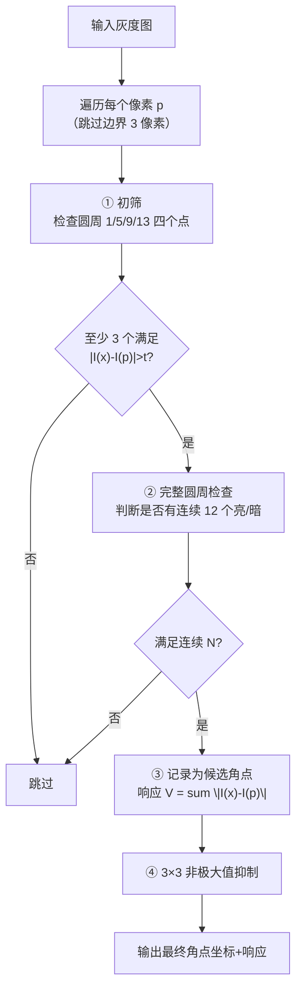
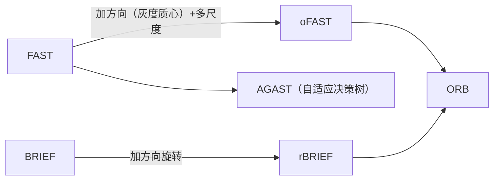

# FAST 角点检测

<AlgorithmCard
  name="FAST 角点检测"
  enName="Features from Accelerated Segment Test"
  chapter="ch-8-local-feature"
  branch="feature-detection"
  year="2006"
  author="Edward Rosten / Tom Drummond"
  paper="—"
  level="mid"
  tagline="用一个圆圈 16 个邻居，一眼认出角点，速度比 Harris 快 10 倍"
  analogy="FAST 像一个哨兵：不进屋检查，只趴在窗户上数——窗外 16 个邻居里如果连续 12 个都比屋里亮或都比屋里暗，那这间房肯定是个「犄角旮旯」"
  scene="SLAM、AR、实时物体识别里做特征点检测，毫秒级返回几千个点，CPU 上就能跑 60fps"
  :pros='["速度极快（比 Harris 快 10 倍以上）", "实现简单", "角点重复率高", "OpenCV 高度优化"]'
  :cons='["不具备尺度不变性", "不具备旋转不变性", "阈值敏感", "需要 NMS", "不含描述子"]'
/>
## FAST 算法完整流程

## 步骤详解

### 步骤 0：选择 FAST 变种

| 变种 | 连续点数 | 圆周点数 | 特点 |
|---|---|---|---|
| FAST-5-8 | 5 | 8 | 最快，误检多 |
| FAST-7-12 | 7 | 12 | 折中 |
| **FAST-9-16** | **9** | **16** | **OpenCV 默认，推荐** |
| FAST-12-16 | 12 | 16 | 最严格，漏检多 |

### 步骤 1：四像素初筛

对于候选中心 p，先只检查圆周上**上下左右四个对称点**：
- 位置：p 坐标 (x,y) → (x-3,y)、(x+3,y)、(x,y-3)、(x,y+3)
- 如果这 4 个点中**至少 3 个**都比 I(p)+t 亮，或都比 I(p)-t 暗，才值得继续查 16 点
- 否则直接淘汰

### 步骤 2：完整 16 点检查

顺时针编号 1–16（从 (x+3,y) 开始）。判断是否存在长度 ≥ N 的连续弧段，满足所有像素亮度都 > I(p)+t 或都 < I(p)-t。

**高效实现小技巧**：不必真的遍历所有可能起始位置。只要看到连续 N 个就可以停。

### 步骤 3：非极大值抑制

- 对每个候选角点算响应分数：$V = \max\left(\sum_{x\in S_{bright}} |I(x)-I(p)| - t, \sum_{x\in S_{dark}} |I(p)-I(x)| - t\right)$
- 在 3×3 邻域内，只保留 V 最大的候选
- 这一步去掉"一个真角点周围检测出 7、8 个假角点"的问题

### 步骤 4：（可选）网格均匀化

FAST 检测出的点容易扎堆在纹理丰富区域。工程上常做：

## 复杂度分析

| 环节 | 复杂度（每像素） |
|---|---|
| 初筛 | O(1)——4 次比较 |
| 完整检查（通过初筛的 ~10%） | O(16)，平均 ~2.7 次（决策树） |
| 总体 | **接近 O(1)** |

所以整张图的时间复杂度是 **O(W×H)**，与图像大小线性关系。

## 与其他角点检测的关系

- **FAST 本身只是检测器**，不产描述子
- **ORB = oFAST（带方向的 FAST） + rBRIEF（旋转 BRIEF）**
- **AGAST** 是 FAST 的加速版，自适应决策树，再快 ~30%

## 相关链接

- [FAST 核心概念](/algorithms/fast/concepts)
- [FAST 源码实现](/algorithms/fast/source)
- [ORB 完整档案](/algorithms/orb/)
