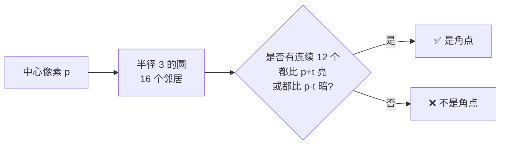
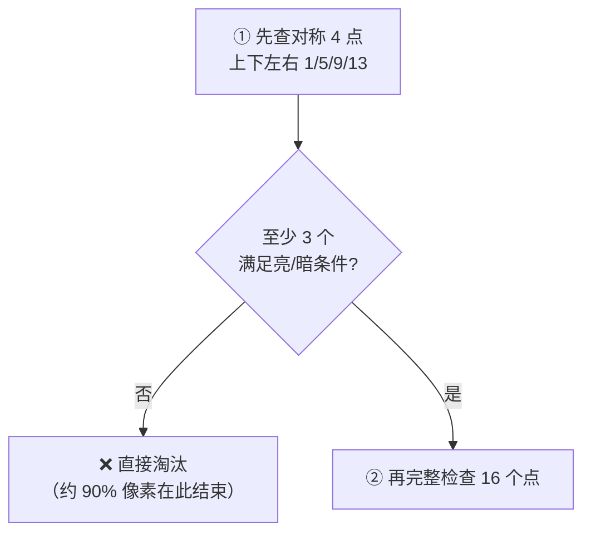

# FAST 角点检测

<AlgorithmCard
  name="FAST 角点检测"
  enName="Features from Accelerated Segment Test"
  chapter="ch-8-local-feature"
  branch="feature-detection"
  year="2006"
  author="Edward Rosten / Tom Drummond"
  paper="—"
  level="mid"
  tagline="用一个圆圈 16 个邻居，一眼认出角点，速度比 Harris 快 10 倍"
  analogy="FAST 像一个哨兵：不进屋检查，只趴在窗户上数——窗外 16 个邻居里如果连续 12 个都比屋里亮或都比屋里暗，那这间房肯定是个「犄角旮旯」"
  scene="SLAM、AR、实时物体识别里做特征点检测，毫秒级返回几千个点，CPU 上就能跑 60fps"
  :pros='["速度极快（比 Harris 快 10 倍以上）", "实现简单", "角点重复率高", "OpenCV 高度优化"]'
  :cons='["不具备尺度不变性", "不具备旋转不变性", "阈值敏感", "需要 NMS", "不含描述子"]'
/>
## 核心概念 1：角点的「圆周判据」

FAST 的核心洞察非常简单：

> **如果一个像素周围一圈（半径 3，16 个像素）中，存在连续 N 个像素都比它亮（或暗）超过阈值 t，那它就是角点。**

**生活比方**：你站在圆圈中心看周围 16 个人。如果连续 12 个人都穿黑衣服，或者连续 12 个都穿白衣服，那说明你站在"一块颜色突变的边界点"上——就是角点。

**为什么 N=12**：经验值，也叫 FAST-12；也有 FAST-9（9/16 连续，更灵敏）和 FAST-5（5/8 连续，更快）。

## 核心概念 2：两步加速——先筛 4 点再扫 16 点

如果逐个像素老老实实检查 16 个邻居，还是不够快。FAST 用一个**闪电式初筛**：

**这步初筛能过滤掉 90% 以上的非角点**，是 FAST 飞快的关键——它和 Viola-Jones 级联的思想一脉相承：**先用极便宜的特征快速排除大多数负样本**。

## 核心概念 3：ID3 决策树——把判断压缩到平均 2.7 次比较

Rosten 的关键创新：**用 ID3 决策树自动学习出一个最优的像素检查顺序**。

- 在训练集（~10000 张标注过的角点/非角点 patch）上跑 ID3
- 决策树的每个节点是"检查某个邻居像素比中心亮/暗/相似"
- 叶子节点给出"是/否角点"的判断

结果：判断一个像素是否是角点，**平均只需 ~3 次比较**——这比硬编码顺序快得多。

## 核心概念 4：非极大值抑制（NMS）——角点扎堆怎么办

FAST 在一个真正的角点周围，往往会检测出好几个相邻点（因为它们的邻域都满足条件）。

**解决**：对每个角点算一个**响应分数**（比如最大的连续像素和中心的差值和 V=sum|I(p)-I(x)|），然后在 3×3 邻域内只保留分数最大的那个。

## 核心概念 5：FAST 的天然缺陷

| 缺失的能力 | 说明 | 如何补 |
|---|---|---|
| **方向** | 不知道角点的朝向，无法应对旋转 | ORB 用灰度质心法 |
| **尺度** | 只有一个检测窗口，不抗缩放 | 多尺度金字塔 |
| **描述子** | 只告诉你"这里是角点"，没说"长什么样" | 配 BRIEF/ORB 描述子 |

## 相关链接

- [FAST 论文故事](/algorithms/fast/paper)
- [角点检测分支](/branches/feature-detection/corners)
- [ORB 完整档案（FAST+BRIEF 升级版）](/algorithms/orb/)
