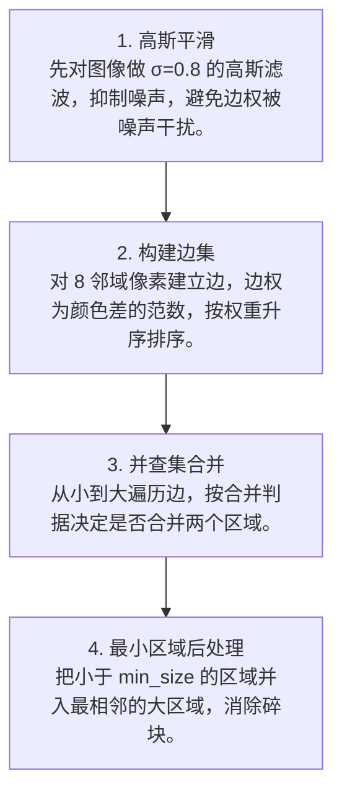

# 第 4 页 · 算法架构

## 完整流程图

## 每一步在做什么

### 步骤 1：高斯平滑

先对图像做 σ=0.8 的高斯滤波，抑制噪声，避免边权被噪声干扰。

### 步骤 2：构建边集

对 8 邻域像素建立边，边权为颜色差的范数，按权重升序排序。

### 步骤 3：并查集合并

从小到大遍历边，按合并判据决定是否合并两个区域。

### 步骤 4：最小区域后处理

把小于 min_size 的区域并入最相邻的大区域，消除碎块。

## 在整体视觉管线中的位置

## 复杂度分析

时间复杂度 O(E log E)，E 为边数（约 4W·H）；并查集合并近乎常数。空间复杂度 O(W·H)。

## 参数总览（论文建议 vs OpenCV 默认 vs 实战推荐）

| 参数 | 含义 | 论文建议 | OpenCV 默认 | 实战推荐 |
|------|------|----------|-------------|----------|
| scale (k) | 合并阈值尺度 | — | 100 | ****150~500（图越大越高）**** |
| sigma | 预处理高斯 σ | 0.8 | 0.8 | **0.8** |
| min_size | 最小区域大小 | — | 20 | **按分辨率调，防碎块** |
| (输入) | 颜色空间 | RGB | RGB | **Lab 更均匀** |

## 边界情况与失败模式

- **k 太小碎成一片**：合并阈值太低，图像被切得七零八落。
- **min_size 不设**：出现大量 1~2 像素的小碎块。
- **边界不贴真实边缘**：该算法侧重「区域一致性」而非像素级边界，需配合后处理。
- **高纹理区域过分割**：草地、毛发等纹理区容易产生大量细碎区域。
