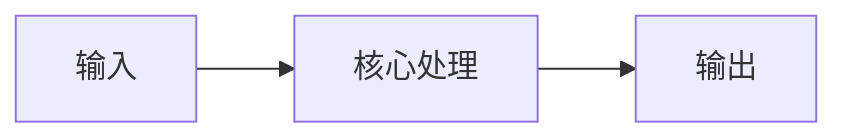
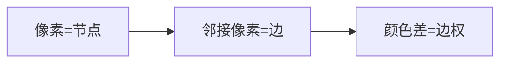
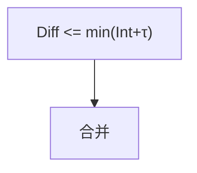

# 第 3 页 · 核心概念

## 先用生活直觉理解

把每个像素看成一个村庄，相邻村庄之间修一条路，路的「难走程度」等于两村颜色的差异。一开始每个村独立成国，然后不断把「路好走」的相邻国家合并；只有当两个国家内部都很平整、边界却很陡时才停下来。最后剩下的一块块，就是分割区域。

**典型应用**：超像素分割、区域建议（R-CNN 的 selectivesearch 借鉴其思想）、图像简化、医学组织分区

## 概念逐个拆解

### 概念 1：把图像变成图

每个像素是一个节点，相邻像素之间连一条边，边权是两像素的颜色（或亮度）差异。

### 概念 2：内部差异 Int

一个区域内所有边的最大权重，代表这个区域「内部有多不一致」。区域越均匀，Int 越小。

### 概念 3：区域间差异 Diff

两个相邻区域之间所有连边的最小权重，代表它们的「边界有多明显」。

### 概念 4：合并判据与 τ

当 Diff 不比两侧的 Int 大多少时合并。判据里加 τ = k/|C| 使小区域更容易合并，避免碎块。

## 和其他算法的关系

| 关系 | 算法 | 说明 |
|------|------|------|
| 前置依赖 | 高斯平滑（降噪） | 通常先做这些再做本算法 |
| 同类对比 | SLIC 超像素、MeanShift、Watershed | 解决同类问题，各有取舍 |
| 下游常用 | 区域特征提取、selective search、目标候选生成 | 本算法结果常交给它们处理 |

::: tip 记忆锚点
记住「k 越大区域越大越方，min_size 过滤碎块」。
:::
