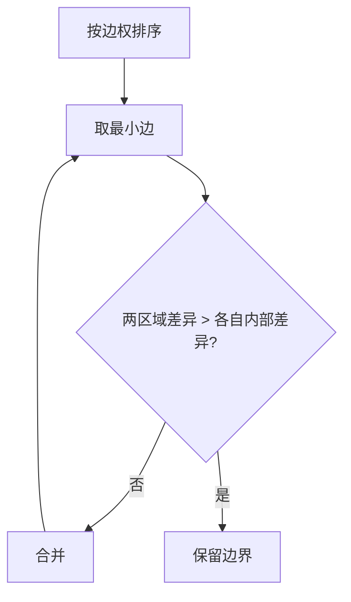

# 第 2 页 · 论文溯源

## 论文名片

| 项目 | 内容 |
|------|------|
| 标题 | **Efficient Graph-Based Image Segmentation** |
| 作者 | Pedro F. Felzenszwalb / Daniel P. Huttenlocher |
| 年份 | 2004 |
| 发表 | IJCV 2004 |
| 原文 | [https://cs.brown.edu/people/pfelzens/papers/seg-ijcv.pdf](https://cs.brown.edu/people/pfelzens/papers/seg-ijcv.pdf) |
| 一句话贡献 | 提出基于图论的高效分割：用「区域内差异不大于区域间差异」作为合并判据，速度接近线性。 |

## 1. 当时的问题

当时的分割方法要么慢（如归一化割），要么需要预设区域数量，要么对参数极敏感，难以在大图上实用。

## 2. 核心思想

把图像建成加权图，边权为相邻像素的颜色差。定义两个量：区域的**内部差异**（区域内最大边权）和**区域间差异**（两区域间最小边权）。若区域间差异明显大于任一侧内部差异，说明这是真正的边界，不合并；否则合并。

## 3. 关键贡献

- 提出上述**合并判据**，用阈值函数 k/|C| 自适应控制
- 用**并查集**实现，合并过程近线性
- 引入 min_size 后处理，消除碎块
- 成为 R-CNN 中 selective search 的基础分割

## 4. 核心公式（看懂思路即可）

合并判据：Diff(C1, C2) ≤ min( Int(C1) + τ(C1), Int(C2) + τ(C2) )，其中 τ(C) = k / |C|，|C| 为区域大小，k 为尺度参数。

## 5. 实验结果

在 Berkeley 分割数据集上，该方法以远快于当时主流方法的速度取得了有竞争力的分割质量，且实现只需几十行代码。

## 6. 局限与争议

侧重区域一致性，边界精度一般；对高纹理区域易过分割；参数 k 与图像尺寸强相关，需调。

## 7. 历史影响

成为超像素/区域建议的经典方法，直接启发 selective search 与 R-CNN 的候选框生成；至今仍是 OpenCV 里 segmentation 模块和 scikit-image 的标准分割器。

## 8. 一句话总结

> 把分割变成「排序边 + 并查集合并」，用几十行代码换来近线性的速度。
